# ALUR KERJA APLIKASI (APPLICATION FLOW) — FLIPBOOK STUDIO

---

## 1. Identitas Dokumen dan Status Persetujuan

- **Nama Proyek:** Flipbook Studio
- **Kode Proyek:** FS-CORE
- **Nomor Dokumen:** FS-DOC-02
- **Nama Dokumen:** `docs/APP_FLOW.md`
- **Fase Pengembangan:** Fase 0 — Audit dan Dokumentasi Arsitektur
- **Status Dokumen:** **APPROVED & LOCKED — DISETUJUI PEMILIK PROYEK**
- **Versi Dokumen:** `v1.0.0-approved-locked`
- **Tanggal Penyusunan:** 17 November 2026
- **Tanggal Persetujuan:** 18 November 2026
- **Basis Acuan (Single Source of Truth):**
  - `docs/PRODUCT_REQUIREMENTS.md` (Versi: `v1.2.0-final-alignment`, Status: `APPROVED & LOCKED — DISETUJUI PEMILIK PROYEK`)
  - `FLIPBOOK_STUDIO_MASTER_PROMPT.md` (Referensi Pendukung)
  - Keputusan Terkunci Q1–Q5 dan A1–A12
- **Penulis Dokumen:** Tim Arsitektur Sistem Flipbook Studio (Senior Software Architect, Product Manager, System Analyst, UX Flow Architect, Backend Architect, Database Architect, Security Architect, Technical Documentation Specialist)
- **Kebijakan Perubahan:** Dokumen ini merupakan baseline yang telah disetujui dan dikunci oleh pemilik proyek. Setiap perubahan substantif setelah penguncian wajib melalui pengendalian versi, merujuk patuh pada PRD terkunci (`FS-DOC-01`), dan memperoleh persetujuan eksplisit pemilik proyek.

---

## 2. Tujuan dan Ruang Lingkup

### 2.1 Tujuan Dokumen
Dokumen **Application Flow (`APP_FLOW.md`)** ini menyajikan spesifikasi alur kerja operasional terpadu untuk platform Flipbook Studio. Tujuannya adalah mendeskripsikan secara presisi, deterministik, dan menyeluruh interaksi antara pengguna (Administrator dan Pembaca Publik) dengan lapisan sistem internal (Frontend React, Supabase Edge Functions, PostgreSQL Functions/RPC, Storage, dan RLS) untuk setiap skenario kerja.

Dokumen ini menjadi landasan arsitektural hulu bagi:
1. `docs/INFORMATION_ARCHITECTURE.md` (Peta situs, taksonomi navigasi, dan struktur hierarki menu).
2. `docs/CORE_FEATURES.md` (Rincian spesifikasi teknis dan pemetaan modul).
3. `docs/UI_UX_SPEC.md` (Wireframe konseptual, panduan interaksi, responsivitas, dan aksesibilitas WCAG).
4. `docs/DATABASE_ARCHITECTURE.md`, `DATABASE_ERD.md`, `DATA_DICTIONARY.md`, dan dokumen keamanan database berikutnya.

### 2.2 Batasan Ruang Lingkup Dokumen
Dokumen ini mendefinisikan *alur fungsional, pemicu (triggers), interaksi UI konseptual, alur backend, kontrak data konseptual, dan penanganan kegagalan*. Dokumen ini **bukan** merupakan implementasi kode program, bukan spesifikasi skema SQL fisik final, bukan konfigurasi deployment definitif, dan tidak menambahkan fitur di luar ruang lingkup PRD terkunci.

---

## 3. Referensi dan Aturan Keterlacakan

### 3.1 Konvensi Penomoran Alur Kerja
Setiap alur di dalam dokumen ini diberi kode unik terstandarisasi dengan konvensi penomoran:
- **AF-01-XXX:** Alur Pembaca Publik (*Anonymous Reader Flows*).
- **AF-02-XXX:** Alur Administrator (*Authenticated Admin Flows*).
- **AF-03-XXX:** Alur Sistem, Backend, dan Integrasi (*Internal System & Engine Flows*).

### 3.2 Struktur Atribut Alur
Setiap subflow disusun dengan struktur atribut terstandarisasi:
1. **Flow ID & Nama Alur:** Pengenal unik dan deskriptif.
2. **Tujuan:** Sasaran fungsional yang ingin dicapai.
3. **Aktor Utama:** Inisiator alur.
4. **Trigger (Pemicu):** Tindakan pengguna atau event sistem yang menginisiasi alur.
5. **Prasyarat (Preconditions):** Status sistem/pengguna sebelum alur dieksekusi.
6. **Langkah Utama (Main Flow):** Rangkaian tahapan normal yang bernomor.
7. **Respons UI (UI Interaction):** Umpan balik visual yang diterima pengguna.
8. **Interaksi Backend & Batas Sistem:** Komunikasi lintas lapisan (Frontend -> Edge Functions -> Database / Storage).
9. **Data yang Dibaca/Ditulis (Konseptual):** Entitas data yang diproses.
10. **Alur Alternatif & Percabangan (Alternative Flows):** Variasi eksekusi normal yang sah.
11. **Alur Pengecualian & Penanganan Kesalahan (Exception Flows):** Penanganan galat jaringan, validasi, otorisasi, atau integritas.
12. **Kondisi Akhir (Postconditions):** State akhir sistem setelah alur tuntas.
13. **Pemetaan Kebutuhan PRD (Requirement Traceability):** Tautan ke identifier FR, NFR, dan AC yang relevan.
14. **Fase Implementasi:** Penandaan apakah alur termasuk **Fase 1 (MVP)**, **Fase 2**, atau **Fase 3** merujuk pada §13 PRD.

### 3.3 Status Keputusan Arsitektur dan Usulan Implementasi

Untuk menjaga integritas tata kelola arsitektur dan kepatuhan mutlak terhadap dokumen induk PRD (`v1.2.0-final-alignment`), seluruh ketentuan teknis di dalam `APP_FLOW.md` diklasifikasikan secara tegas ke dalam dua kategori status:

| Kategori | Definisi & Otoritas | Cakupan Ketentuan Teknis | Dokumen Rujukan / Batas Validasi |
|---|---|---|---|
| **Kategori A — Baseline Terkunci** (*Locked Architectural Decisions*) | Keputusan arsitektur strategis yang telah disepakati, diaudit, dan dikunci secara definitif oleh Pemilik Proyek melalui PRD (`FS-DOC-01`), Q1–Q5, dan A1–A12. Tidak boleh diubah tanpa persetujuan tertulis pemilik proyek. | 1. **Arsitektur Hybrid PostgreSQL:** Relasional untuk draf kerja, JSONB immutable untuk versi terbit, skema `private` untuk kunci rahasia & audit.<br>2. **Backend-Only Scoring:** Seluruh evaluasi dan pembobotan kuis dieksekusi di server; kunci jawaban disimpan terisolasi di skema `private`.<br>3. **Keamanan Sesi Siswa (Privacy by Design):** Identitas minimal (*self-reported* nama & kelas), token lokal CSPRNG dengan penyimpanan hash SHA-256 di server, tanpa autentikasi/kredensial akun siswa.<br>4. **Target Biaya Rp0:** Arsitektur dioptimalkan secara ketat pada batas tingkat gratis (*free tier*) Supabase tanpa langganan wajib berbayar.<br>5. **Autentikasi Tunggal Admin:** Menggunakan Supabase Auth untuk satu pengelola sistem (Admin).<br>6. **Atomic Publish Snapshot:** Penerbitan buku bersifat ACID, zero-downtime, snapshot immutable, disertai verifikasi integritas file biner media fisik publik.<br>7. **Kebijakan Unpublish:** Mendukung penarikan default dengan masa tenggang (*grace period*) bagi sesi aktif serta opsi blokir instan (*immediate block*).<br>8. **Emergency Revoke:** Pemblokiran instan di tingkat edge/gateway dan invalidasi cache peladen tanpa pemaksaan penetapan nilai nol otomatis pada sesi siswa aktif.<br>9. **Rollback Snapshot Historis:** Pembalikan versi atomik dengan verifikasi prasyarat dependensi keberadaan file media snapshot target.<br>10. **Dual QR Code:** QR Statis untuk tautan abadi langsung dan QR Dinamis berbasis `/q/:shortCode` dengan audit statistik agregat harian non-PII. | `docs/PRODUCT_REQUIREMENTS.md` (`v1.2.0-final-alignment`), Keputusan Q1–Q5 & A1–A12 |
| **Kategori B — Usulan Teknis — Belum Dikunci** (*Conceptual Implementation Proposals*) | Usulan teknis operasional, penamaan, struktur protokol, atau mekanisme internal yang mempermudah visualisasi alur, namun **belum berstatus final** dan menunggu perincian pada dokumen arsitektur hilir dalam roadmap PRD. | 1. **Konvensi Nama RPC & PostgreSQL Functions:** Nama fungsi internal yang muncul sebagai ilustrasi alur.<br>2. **Endpoint Path REST/API Spesifik:** Jalur routing dan status HTTP spesifik.<br>3. **Detail Struktur Payload JSON:** Atribut request/response serta format galat.<br>4. **Skema fisik database:** Nama tabel, tipe kolom sekunder, dan indeks.<br>5. **Caching/CDN dan scheduler:** Header cache, purge, dan pilihan pemicu penjadwalan. | Menunggu penetapan pada dokumen roadmap PRD yang relevan: `INFORMATION_ARCHITECTURE.md`, `CORE_FEATURES.md`, `UI_UX_SPEC.md`, `DATABASE_ARCHITECTURE.md`, `DATABASE_ERD.md`, `DATA_DICTIONARY.md`, `DATABASE_CONSTRAINTS.md`, `RLS_SECURITY.md`, `DATABASE_MIGRATION_PLAN.md`, dan `DATABASE_TEST_PLAN.md`. |

---

## 4. Definisi Aktor dan Batas Kepercayaan (Trust Boundaries)

Sistem secara ketat mendefinisikan batas otorisasi dan peran pengguna:

```
+---------------------------------------------------------------------------------------------------+
|                                      ZONA KEPERCAYAAN SISTEM                                      |
+---------------------------------------------------------------------------------------------------+
| [ ZONA 1: PUBLIK TIDAK TEROTENTIKASI (UNTRUSTED BROWSER CLIENT) ]                                |
| - Aktor: Pembaca Publik (Termasuk Siswa SD).                                                     |
| - Identitas: Anonim murni saat membaca buku; Nama & Kelas hanya self-reported saat kuis.          |
| - Kredensial: Zero-account. Token sesi lokal dibuat acak CSPRNG di peramban.                      |
| - Batas Akses: Hanya dapat membaca snapshot buku aktif via Data API/CDN; hak tulis terbatas       |
|   hanya melalui endpoint Edge Functions yang divalidasi token sesi ber-hash.                     |
+---------------------------------------------------------------------------------------------------+
                                                  |
                                                  v  [ API Gateway / Cloudflare Edge / TLS 1.3 ]
+---------------------------------------------------------------------------------------------------+
| [ ZONA 2: ADMINISTRATOR TEROTENTIKASI (AUTHENTICATED TRUSTED CLIENT) ]                           |
| - Aktor: Administrator Tunggal.                                                                   |
| - Identitas: Terverifikasi via Supabase Auth (Email & Password) -> Record admin_profiles.         |
| - Kredensial: JWT Auth Token (disimpan aman, dikirim via Authorization Header).                   |
| - Batas Akses: Akses CRUD penuh terhadap draf, media, konfigurasi, QR, nilai, dan publikasi.      |
+---------------------------------------------------------------------------------------------------+
                                                  |
                                                  v  [ Supabase Edge Functions / Deno Runtime ]
+---------------------------------------------------------------------------------------------------+
| [ ZONA 3: PELADEN TERISOLASI & DATABASE POSTGRESQL (HIGH TRUST BOUNDARY) ]                        |
| - Komponen Internal: Edge Functions, PostgreSQL Functions (SECURITY DEFINER), Skema 'private'.   |
| - Batas Akses: Kunci penilaian kuis (grading secrets), audit log, hash verifier, transaksi atomik. |
| - Service Role Key HANYA berada di zona ini, DILARANG KERAS diekspos ke Zona 1 atau Zona 2.       |
+---------------------------------------------------------------------------------------------------+
```

---

## 5. Peta Alur Global (Global Flowchart)

Diagram alur berikut mengilustrasikan percabangan awal jalur akses antara Administrator dan Pembaca Publik, serta interaksinya dengan lapisan backend terpercaya:

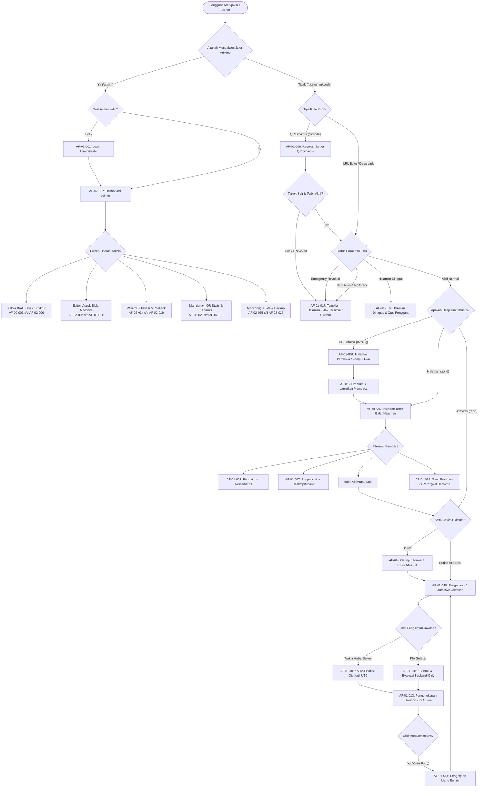

---

## 6. AF-01 — Alur Pembaca Publik (Anonymous Reader Flows)

### AF-01-001: Membuka URL Buku dan Halaman Pembuka
- **Tujuan:** Menampilkan gerbang masuk buku digital interaktif dengan sampul luar, judul, deskripsi, metadata, dan tombol aksi tanpa melewati halaman secara acak.
- **Aktor:** Pembaca Publik (Siswa/Masyarakat).
- **Trigger:** Pembaca mengetik URL buku `/b/:slug` atau mengklik tautan web.
- **Prasyarat:** Buku telah diterbitkan (`books.active_version_id IS NOT NULL`) dan berstatus aktif.
- **Langkah Utama:**
  1. Pembaca mengakses URL `https://<domain>/b/:slug`.
  2. Router aplikasi di peramban memanggil Edge Function / Data API publik untuk memvalidasi `slug`.
  3. Sistem memverifikasi bahwa slug merujuk ke buku dengan versi aktif yang sah.
  4. Frontend memeriksa `localStorage` untuk mengetahui apakah terdapat riwayat posisi baca untuk buku ini.
  5. Antarmuka menampilkan Halaman Pembuka (Sampul Luar) lengkap dengan judul, deskripsi, penulis, mata pelajaran, target kelas, tahun, dan tombol aksi.
- **Respons UI:** Jika pembaca baru: tombol "Mulai Membaca". Jika pembaca lama: ditampilkan opsi "Lanjutkan Membaca (Halaman X)" dan "Mulai dari Awal". Terdapat tombol "Ganti Pembaca" di pojok atas.
- **Interaksi Backend:** `SELECT metadata, cover_image, active_version_id FROM public.books WHERE slug = :slug`.
- **Titik Pemeriksaan Kinerja (NFR-PERF-001):** Pada pengujian implementasi, ukur FCP dengan metrik browser sejak navigasi ke `/b/:slug` dimulai hingga peramban pertama kali menampilkan konten yang memenuhi kriteria FCP, seperti teks, gambar, SVG, atau canvas nonkosong. FCP tidak didefinisikan sebagai waktu hingga seluruh tata letak awal selesai dirender. Skenario mengikuti PRD: jaringan 4G standar (latensi sekitar 100 ms, unduh sekitar 10 Mbps) dan halaman teks proporsional dengan aset gambar terkompresi di bawah 1,5 MB. Hasil dibandingkan dengan target PRD FCP < 2,5 detik; dokumen ini mendefinisikan mekanisme ukur, bukan bukti target telah tercapai.
- **Data Konseptual:** `books`, `book_slug_aliases`.
- **Alur Alternatif:** Jika slug merupakan slug lama, sistem mengeksekusi pengalihan HTTP 301/308 via `book_slug_aliases` (lihat AF-03-010).
- **Alur Pengecualian:** Jika buku dalam status Unpublish atau Emergency Revoke, sistem mengarahkan ke AF-01-017.
- **Kondisi Akhir:** Pembaca berada di Halaman Pembuka buku yang sah.
- **Requirement PRD:** `FR-RDR-001`, `FR-RDR-002`, `FR-LNK-001`, `FR-LNK-002`, `NFR-PERF-001`, `AC-RDR-001`, `AC-LNK-001`.
- **Fase:** Fase 1 (MVP).

### AF-01-002: Memulai atau Melanjutkan Membaca
- **Tujuan:** Mengarahkan pembaca dari halaman pembuka masuk ke konten isi buku digital.
- **Aktor:** Pembaca Publik.
- **Trigger:** Pembaca mengklik "Mulai Membaca", "Lanjutkan Membaca", atau "Mulai dari Awal".
- **Prasyarat:** Pembaca berada di Halaman Pembuka (AF-01-001).
- **Langkah Utama:**
  1. Pembaca memilih opsi aksi membaca.
  2. Jika "Mulai Membaca" atau "Mulai dari Awal": aplikasi memuat halaman urutan pertama dari snapshot terbit aktif.
  3. Jika "Lanjutkan Membaca": aplikasi membaca `stablePageId` dari `localStorage` dan memuat halaman tersebut.
  4. Reader merender komponen isi halaman sesuai snapshot JSONB.
- **Respons UI:** Transisi halus dari halaman pembuka ke kanvas Reader. Toolbar baca ringkas muncul di bagian atas/bawah.
- **Interaksi Backend:** `SELECT content_snapshot FROM public.published_pages WHERE version_id = :active_version_id`.
- **Kondisi Akhir:** Pembaca aktif melihat materi halaman isi buku.
- **Requirement PRD:** `FR-RDR-001`, `FR-RDR-006`.
- **Fase:** Fase 1 (MVP).

### AF-01-003: Navigasi Bab, Halaman Mandiri, dan Daftar Isi
- **Tujuan:** Menjelajahi halaman buku melalui tombol navigasi linear, tautan internal, atau laci Daftar Isi (TOC).
- **Aktor:** Pembaca Publik.
- **Trigger:** Klik tombol "Berikutnya", "Sebelumnya", item Daftar Isi, atau tautan internal di dalam teks.
- **Prasyarat:** Reader sedang aktif menampilkan konten buku.
- **Langkah Utama:**
  1. Pembaca memilih tombol berikutnya/sebelumnya atau membuka laci Daftar Isi (*drawer TOC*).
  2. Reader memeriksa struktur hierarki buku (maksimal 2 tingkat: Bab > Halaman atau Halaman Mandiri).
  3. Jika berpindah halaman: URL peramban diperbarui menjadi `/b/:slug/p/:stablePageId` menggunakan Stable UUID (bukan nomor halaman).
  4. Posisi halaman tersimpan lokal ke `localStorage`.
- **Respons UI:** Pada desktop dengan mode flipbook: animasi pembalikan halaman buku jika konten sesuai. Pada mobile atau konten panjang: transisi scroll vertikal mulus. Nomor halaman dan progres baca diperbarui.
- **Interaksi Backend:** Tidak ada kueri peladen baru jika snapshot telah dicache oleh peramban; data dibaca dari memori lokal snapshot JSONB.
- **Alur Pengecualian:** Jika tautan internal merujuk ke ID halaman yang tidak ada di snapshot aktif, tampilkan penanganan AF-01-016.
- **Kondisi Akhir:** Konten halaman tujuan ditampilkan secara utuh.
- **Requirement PRD:** `FR-BOK-004`, `FR-BOK-006`, `FR-RDR-003`, `FR-RDR-004`, `FR-RDR-005`, `AC-BOK-001`, `AC-RDR-002`.
- **Fase:** Fase 1 (MVP).

### AF-01-004: Membuka Deep Link Halaman atau Aktivitas
- **Tujuan:** Langsung membuka halaman atau kuis tertentu tanpa melewati halaman pembuka secara manual.
- **Aktor:** Pembaca Publik.
- **Trigger:** Akses langsung URL `/b/:slug/p/:stablePageId` atau `/b/:slug/a/:stableActivityId`.
- **Prasyarat:** Target halaman atau aktivitas tersedia dalam snapshot terbit aktif buku.
- **Langkah Utama:**
  1. Peramban meminta URL deep link ke sistem.
  2. Backend memvalidasi `slug` dan keberadaan `stableId` pada `content_snapshot` versi aktif.
  3. Reader langsung memuat dan merender halaman/aktivitas target.
  4. Bilah navigasi tetap menyediakan tombol "Beranda Buku / Sampul" dan Daftar Isi lengkap.
- **Respons UI:** Tampilan langsung menyajikan halaman/aktivitas yang dituju dengan indikator posisi dalam struktur buku.
- **Alur Pengecualian:** Jika halaman/aktivitas telah dihapus dari versi terbit aktif, sistem mengeksekusi AF-01-016.
- **Requirement PRD:** `FR-LNK-001`, `FR-LNK-003`, `AC-LNK-001`.
- **Fase:** Fase 1 (MVP).

### AF-01-005: Mengakses Buku Melalui QR Statis
- **Tujuan:** Mengakses buku cetak fisik ke digital melalui pemindaian QR Code statis.
- **Aktor:** Pembaca Publik (Siswa dengan kamera ponsel/tablet).
- **Trigger:** Memindai QR Code statis pada modul cetak.
- **Prasyarat:** QR statis dicetak dari URL publik buku yang sah.
- **Langkah Utama:**
  1. Kamera gawai membaca matriks QR statis dan mendekodekan URL langsung `https://<domain>/b/:slug`.
  2. Peramban gawai membuka URL tersebut.
  3. Alur dilanjutkan ke AF-01-001.
- **Respons UI:** Peramban gawai langsung menampilkan Halaman Pembuka buku.
- **Interaksi Backend:** Standar HTTP GET pada rute publik. Tidak ada pencatatan analitik khusus pada QR statis.
- **Requirement PRD:** `FR-LNK-004`.
- **Fase:** Fase 1 (MVP).

### AF-01-006: Mengakses Buku Melalui QR Dinamis
- **Tujuan:** Mengakses konten digital melalui tautan pendek perantara yang target tujuannya dapat dikelola admin tanpa merusak cetakan fisik.
- **Aktor:** Pembaca Publik.
- **Trigger:** Memindai QR Code dinamis yang mengkodekan URL `/q/:shortCode`.
- **Prasyarat:** Kode QR dinamis terdaftar di sistem dan berstatus aktif.
- **Langkah Utama:**
  1. Kamera gawai membuka URL `https://<domain>/q/:shortCode`.
  2. Edge Router menerima permintaan dan memanggil fungsi resolusi target QR (AF-03-022).
  3. Sistem memverifikasi status QR (`status = 'active'`) dan target tujuan internal.
  4. Sistem mencatat penambahan agregat pemindaian harian non-PII (`successful_accesses + 1` zona waktu `Asia/Jakarta`).
  5. Edge Router mengembalikan pengalihan HTTP 302/307 ke URL tujuan akhir (`/b/:slug/...`).
  6. Peramban pembaca memuat halaman tujuan akhir.
- **Respons UI:** Transisi cepat ke halaman pembuka, bab, atau aktivitas target.
- **Alur Pengecualian:** Jika QR berstatus `inactive`, target dalam status Emergency Revoke, atau target terhapus, sistem mengembalikan halaman penjelasan error ramah pengguna (AF-01-017).
- **Requirement PRD:** `FR-LNK-005`, `FR-LNK-006`, `FR-LNK-008`, `NFR-PERF-003`, `AC-LNK-002`, `AC-LNK-004`.
- **Fase:** Fase 2 (QR Dinamis & Analitik Agregat).

### AF-01-007: Membaca pada Desktop, Tablet, dan Mobile
- **Tujuan:** Menjamin kenyamanan membaca responsif dan adaptif sesuai ukuran layar perangkat pembaca.
- **Aktor:** Pembaca Publik.
- **Trigger:** Pembaca membuka buku pada berbagai variasi viewport peramban.
- **Prasyarat:** Dokumen terbit telah dimuat di Reader.
- **Langkah Utama:**
  1. Reader mendeteksi lebar viewport dan kapabilitas perangkat.
  2. **Desktop Resolusi Lebar (> 1024px):** Jika konten halaman seimbang dan tidak melebihi batas vertikal, Reader mengaktifkan mode pembalikan dua halaman (*dual-page flipbook*). Jika halaman berisi kuis atau teks panjang, sistem otomatis fallback ke mode satu halaman / scroll vertikal terpadu.
  3. **Tablet (768px - 1024px):** Reader merender mode satu halaman proporsional dengan navigasi swipe atau tombol sentuh.
  4. **Mobile Smartphone (< 768px):** Reader secara eksklusif merender tata letak satu kolom vertikal yang mulus. Navigasi sentuh (swipe) opsional diisolasi agar tidak memicu konflik sentuh pada komponen interaktif seret (drag-and-drop).
  5. Audio dan video **tidak** mulai diputar saat halaman dibuka atau saat pembaca berpindah halaman. Pemutaran hanya dimulai setelah tindakan eksplisit pembaca; kontrol media dapat dioperasikan melalui keyboard serta memiliki label aksesibel. Embed pihak ketiga wajib mematuhi kebijakan ini dan tidak boleh mengaktifkan autoplay.
- **Respons UI:** Tata letak menyesuaikan layar tanpa pemotongan teks (*no text clipping*), elemen interaktif memiliki target sentuh minimal 44x44 CSS px. Preferensi *reduced motion* dari AF-01-008 tetap menonaktifkan animasi Reader, terpisah dari larangan autoplay media.
- **Requirement PRD:** `FR-RDR-003`, `FR-RDR-004`, `FR-RDR-008`, `NFR-ACC-003`, `AC-RDR-002`.
- **Fase:** Fase 1 (MVP).

### AF-01-008: Menggunakan Pengaturan Aksesibilitas
- **Tujuan:** Memberikan kemandirian bagi pembaca dengan kebutuhan khusus atau preferensi visual tertentu untuk menyesuaikan tampilan Reader.
- **Aktor:** Pembaca Publik (Termasuk siswa berkebutuhan khusus).
- **Trigger:** Pembaca mengklik ikon "Aksesibilitas / Pengaturan Baca" di toolbar.
- **Prasyarat:** Reader sedang aktif.
- **Langkah Utama:**
  1. Pembaca membuka panel preferensi aksesibilitas.
  2. Pembaca dapat memilih:
     - **Ukuran Teks:** Normal (100%), Sedang (125%), Besar (150%) — teks menyesuaikan tanpa merusak struktur kolom.
     - **Kontras Tinggi:** Mengaktifkan tema kontras tinggi hitam-kuning atau putih-hitam (memenuhi rasio kontras WCAG AA minimal 4.5:1).
     - **Reduced Motion:** Mematikan seluruh animasi pembalikan halaman flipbook dan transisi bergerak.
  3. Preferensi disimpan secara lokal di `localStorage`.
- **Respons UI:** Antarmuka Reader dan konten teks langsung menyesuaikan secara instan (*live preview*).
- **Interaksi Keyboard:** Seluruh panel dan navigasi Reader dapat dioperasikan penuh via keyboard (Tab, Shift+Tab, Enter, Panah Kiri/Kanan, Esc).
- **Requirement PRD:** `FR-RDR-007`, `FR-RDR-008`, `NFR-ACC-001`, `NFR-ACC-002`, `NFR-ACC-004`.
- **Fase:** Fase 1 (MVP).

### AF-01-009: Memulai Aktivitas Tercatat dengan Nama dan Kelas
- **Tujuan:** Mendaftarkan sesi pengerjaan kuis/aktivitas secara aman dengan prinsip minimisasi data (*Privacy by Design*).
- **Aktor:** Siswa / Pembaca Publik.
- **Trigger:** Pembaca membuka halaman aktivitas pembelajaran interaktif yang hasilnya dicatat ke peladen.
- **Prasyarat:** Versi aktivitas telah dipublikasikan secara sah dan buku berstatus aktif.
- **Langkah Utama:**
  1. Siswa diarahkan ke formulir awal aktivitas. Membaca materi buku sebelumnya 100% tanpa identitas; identitas *hanya* diminta saat masuk ke aktivitas penilaian ini.
  2. Antarmuka menampilkan pemberitahuan privasi ramah anak: *"Nama dan kelasmu hanya digunakan agar gurumu dapat melihat nilaimu. Data ini tidak dibagikan ke orang lain."*
  3. Siswa menginputkan Nama Panggilan/Lengkap dan Pilihan Kelas (*self-reported*).
  4. Siswa menekan tombol "Mulai Aktivitas".
  5. Peramban menghasilkan token sesi rahasia acak menggunakan kriptografi aman (CSPRNG `crypto.getRandomValues`).
  6. Peramban menghitung hash SHA-256 dari token tersebut.
  7. Frontend mengirim permintaan mulai sesi ke Supabase Edge Function (`POST /api/activity/start`) memuat `activity_version_id`, `display_name`, `class_label`, dan `token_hash`.
  8. Backend memvalidasi hak akses, membuat record sesi pengerjaan (`activity_attempts`), menetapkan batas waktu resmi peladen (UTC), mematok versi aktivitas (*version pinning*), dan mengembalikan ID percobaan serta batas waktu.
  9. Frontend menyimpan token sesi rahasia di penyimpanan peramban lokal.
- **Respons UI:** Formulir identitas berganti ke antarmuka lembar kuis interaktif dengan timer mundur peladen yang tersinkronisasi.
- **Interaksi Backend:** Lihat alur teknis AF-03-011. Kunci jawaban **tidak pernah** disertakan dalam payload respons ini.
- **Alur Pengecualian:** Jika kuota percobaan siswa telah habis dan tidak memiliki grant retry, sistem menolak pembuatan sesi baru dan menampilkan rekap nilai sebelumnya (AF-01-013).
- **Kondisi Akhir:** Record percobaan aktif terbuat di backend; siswa mulai mengerjakan kuis.
- **Requirement PRD:** `FR-ACT-001`, `FR-ACT-002`, `FR-ACT-003`, `FR-ACT-004`, `AC-ACT-001`, `AC-ACT-006`.
- **Fase:** Fase 1 (MVP).

### AF-01-010: Mengerjakan dan Menyimpan Jawaban (Autosave Idempoten & Status Penyimpanan)
- **Tujuan:** Menjawab butir aktivitas interaktif dengan pengamanan jawaban otomatis berkala serta pembedaan status penyimpanan server yang tegas dan jujur.
- **Aktor:** Siswa / Pembaca.
- **Trigger:** Siswa memilih opsi jawaban (Pilihan Ganda, Benar/Salah, Isian Singkat) atau timer autosave periodik terpicu.
- **Prasyarat:** Sesi aktivitas dalam status aktif (`attempt_id` sah).
- **Langkah Utama:**
  1. Siswa berinteraksi dengan komponen soal (misal: memilih radio button pilihan ganda).
  2. State sementara peramban mencatat lembar jawaban baru dengan status *Menunggu Pengiriman* (*Status B*).
  3. Indikator UI segera menampilkan status: *"Menyimpan ke server..."* atau *"Belum tersimpan di server"*. Sistem tidak memberikan ilusi bahwa jawaban pasti aman sebelum ada konfirmasi peladen.
  4. Fungsi *debounced autosave* sisi klien mengirimkan payload jawaban ke Edge Function (`POST /api/activity/save-answers`) disertai token sesi dan header `Idempotency-Key`.
  5. Backend memverifikasi token sesi via hash, memastikan sesi belum melewati batas waktu UTC resmi peladen, dan menyimpan lembar jawaban ke tabel pengerjaan secara idempoten.
  6. Backend mengembalikan konfirmasi penyimpanan sukses dengan timestamp resmi server.
  7. Frontend memperbarui status menjadi *Tersimpan di Server* (*Status A*).
- **Respons UI:** 
  - Saat sukses terkonfirmasi peladen: *"Jawaban tersimpan di server"* (Status A).
  - Saat offline / koneksi terputus: *"Koneksi terputus — Jawaban belum tersimpan di server"* (Status B).
- **Kebijakan Batas Offline (MVP):** Sistem tidak menjanjikan dukungan pengerjaan offline penuh. Antrean jawaban sementara di memori peramban tidak menjamin persistensi jika peramban ditutup, di-refresh paksa, atau perangkat mati. Koneksi terputus tidak memperpanjang batas waktu tenggat resmi peladen. Jika koneksi pulih sebelum tenggat, klien mencoba mengirim ulang antrean; namun jika waktu UTC server telah melewati tenggat, jawaban antrean ditolak oleh peladen (Status C) dan finalisasi hanya menggunakan jawaban terakhir yang telah diterima sah oleh peladen sebelum tenggat. (Catatan Arsitektur: Penggunaan penyimpanan lokal persisten seperti IndexedDB merupakan opsi teknis lanjutan yang belum dikunci pada MVP).
- **Requirement PRD:** `FR-ACT-005`, `FR-ACT-006`, `NFR-REL-002`, `AC-ACT-005`.
- **Fase:** Fase 1 (MVP).

### AF-01-011: Mengirim Jawaban dan Menyelesaikan Aktivitas
- **Tujuan:** Melakukan finalisasi pengerjaan kuis atas inisiatif siswa dan meminta penilaian dari peladen.
- **Aktor:** Siswa.
- **Trigger:** Siswa menekan tombol "Kirim Jawaban & Selesai".
- **Prasyarat:** Sesi kuis aktif dan seluruh soal telah ditinjau siswa.
- **Langkah Utama:**
  1. Siswa menekan tombol "Kirim Jawaban".
  2. Dialog konfirmasi muncul: *"Apakah kamu yakin ingin menyelesaikan kuis ini?"*.
  3. Siswa mengonfirmasi.
  4. Frontend mengirim permintaan finalisasi ke Edge Function (`POST /api/activity/finalize`) dengan header `Idempotency-Key`.
  5. Backend mengeksekusi penilaian server-only (AF-03-014), mengunci sesi menjadi `finalized`, mencatat nilai akhir di skema privat, dan mengembalikan hasil sesuai kebijakan pengungkapan.
- **Respons UI:** Layar beralih ke halaman ringkasan hasil aktivitas (AF-01-013).
- **Alur Pengecualian:** Jika tombol diklik berulang kali (*double-submit*), mekanisme idempotency memastikan penilaian hanya dihitung tepat satu kali.
- **Requirement PRD:** `FR-ACT-003`, `FR-ACT-006`, `AC-ACT-005`.
- **Fase:** Fase 1 (MVP).

### AF-01-012: Mengalami Tenggat Waktu dan Finalisasi Otomatis (Server Timer)
- **Tujuan:** Menegakkan keadilan batas waktu ujian secara deterministik berdasarkan jam peladen (UTC), menangkal manipulasi jam lokal peramban.
- **Aktor:** Siswa / Sistem.
- **Trigger:** Waktu resmi peladen telah melampaui batas waktu pengerjaan (`deadline_utc`).
- **Prasyarat:** Sesi kuis masih berstatus aktif di database saat waktu habis.
- **Langkah Utama:**
  1. **Skenario Normal (Peramban Terbuka):** Timer mundur UI mencapai 00:00. Frontend menonaktifkan seluruh input soal dan otomatis memanggil fungsi finalisasi backend.
  2. **Skenario Gangguan (Peramban Ditutup / Koneksi Mati / Antrean Belum Terkirim):** Siswa menutup peramban pada menit ke-5 setelah menjawab 3 butir (yang sudah berhasil tersimpan di server). Dua jawaban berikutnya masih di antrean lokal peramban saat koneksi putus. Waktu batas pengerjaan resmi (menit ke-10) terlewati. Siswa membuka kembali tautan pada menit ke-15.
  3. Siswa atau klien mencoba mengirimkan jawaban sisa dari antrean lokal.
  4. Backend memeriksa timestamp UTC peladen: waktu saat ini > `deadline_utc`.
  5. Backend secara tegas menolak seluruh jawaban yang baru dikirim setelah tenggat (*Status C: Ditolak*). Jawaban yang hanya ada di antrean lokal dan belum pernah diterima server sebelum tenggat **tidak dihitung**.
  6. Backend mengeksekusi *on-access finalization* secara idempoten: menghitung skor akhir berdasarkan jawaban terakhir yang telah diterima secara sah di database sebelum tenggat (3 butir soal), memperbarui status sesi menjadi `finalized`, dan mengembalikan hasil. Tidak terjadi penghitungan nilai ganda.
- **Respons UI:** Antarmuka menampilkan pemberitahuan ramah: *"Waktu pengerjaan telah selesai. Jawaban terakhirmu telah dikumpulkan secara otomatis."*
- **Requirement PRD:** `FR-ACT-005`, `AC-ACT-002`, `AC-ACT-004`.
- **Fase:** Fase 1 (MVP).

### AF-01-013: Melihat Hasil Sesuai Kebijakan Pengungkapan
- **Tujuan:** Menampilkan umpan balik nilai, ketuntasan, atau pembahasan soal sesuai konfigurasi yang ditetapkan administrator.
- **Aktor:** Siswa.
- **Trigger:** Sesi pengerjaan berhasil difinalisasi (AF-01-011 atau AF-01-012).
- **Prasyarat:** Sesi berstatus `finalized`.
- **Langkah Utama:**
  1. Frontend meminta rincian skor hasil pengerjaan ke peladen.
  2. Backend memeriksa konfigurasi pengungkapan hasil pada versi aktivitas (`disclosure_policy`):
     - **Mode 1 (Skor Saja):** Menampilkan total skor angka dan status tuntas/belum tuntas. Kunci jawaban dan status benar/salah per butir tetap disembunyikan.
     - **Mode 2 (Skor & Status Benar/Salah):** Menampilkan skor dan tanda centang/silang pada masing-masing nomor soal.
     - **Mode 3 (Lengkap dengan Pembahasan):** Menampilkan skor, status benar/salah, kunci jawaban yang sah, dan teks penjelasan pembahasan.
     - **Mode 4 (Tertutup Sementara):** Hanya menampilkan pesan *"Jawabanmu sudah diterima. Nilai akan diumumkan oleh gurumu nanti."*
  3. Frontend merender data hasil sesuai izin kebijakan yang diterima dari peladen.
- **Respons UI:** Tampilan kartu hasil nilai yang rapi, ramah anak, dan informatif.
- **Keamanan:** Kunci jawaban atau pembahasan dilarang keras dikirim ke peramban jika kebijakan versi aktivitas belum mengizinkannya.
- **Requirement PRD:** `FR-ACT-003`, `FR-ACT-007`, `AC-ACT-001`.
- **Fase:** Fase 1 (MVP).

### AF-01-014: Melakukan Pengerjaan Ulang yang Diizinkan (Retry Grant)
- **Tujuan:** Memberikan kesempatan pengerjaan kuis ulang kepada siswa yang membutuhkan perbaikan atau mengalami kendala teknis.
- **Aktor:** Siswa.
- **Trigger:** Siswa memasukkan kode otorisasi pengerjaan ulang (*retry code*) yang diberikan oleh administrator.
- **Prasyarat:** Siswa telah menyelesaikan pengerjaan sebelumnya dan admin telah menerbitkan kode retry yang sah (AF-02-023).
- **Langkah Utama:**
  1. Pada halaman hasil kuis yang telah selesai, siswa melihat opsi "Masukkan Kode Ulang Kuis".
  2. Siswa mengetikkan kode acak sekali pakai yang diperoleh dari guru/admin.
  3. Frontend mengirim kode retry ke Edge Function (`POST /api/activity/consume-retry`).
  4. Backend memverifikasi kode secara atomik: kode valid, belum kedaluwarsa, belum pernah digunakan, dan buku tidak sedang di-Emergency Revoke.
  5. Backend menandai kode telah digunakan (`consumed = true`), membuat record pengerjaan baru (`attempt_id` baru), dan mematok versi aktivitas asal. Rekord nilai lama tidak ditimpa dan tetap tersimpan utuh di database.
  6. Frontend memperbarui sesi lokal dan membuka kembali lembar soal kuis bersih.
- **Respons UI:** Lembar kuis terbuka kembali dengan timer pengerjaan baru.
- **Alur Pengecualian:** Jika kode salah atau kedaluwarsa, tampilkan pesan: *"Kode tidak valid atau sudah kedaluwarsa. Silakan hubungi gurumu."*
- **Requirement PRD:** `FR-ACT-008`, `AC-ACT-003`.
- **Fase:** Fase 2 (Penguatan Pembelajaran & Retry Grant).

### AF-01-015: Mengganti Pembaca pada Perangkat Bersama
- **Tujuan:** Membersihkan data sesi pembaca sebelumnya pada komputer laboratorium sekolah atau gawai bersama agar tidak bercampur dengan siswa berikutnya.
- **Aktor:** Siswa / Guru Pendamping.
- **Trigger:** Pengguna menekan tombol "Ganti Pembaca" pada header Reader atau Halaman Pembuka buku.
- **Prasyarat:** Perangkat peramban menyimpan data sesi atau identitas pembaca sebelumnya di penyimpanan lokal.
- **Langkah Utama:**
  1. Pengguna menekan tombol "Ganti Pembaca".
  2. Dialog konfirmasi muncul: *"Apakah kamu ingin keluar agar temanmu dapat membaca di komputer ini?"*.
  3. Pengguna mengonfirmasi.
  4. Frontend menghapus seluruh token sesi pembaca, identitas tersimpan (`displayName`, `classLabel`), posisi halaman baca lokal, dan lembar jawaban draf sementara dari `localStorage` dan `sessionStorage` peramban.
  5. Seluruh state aplikasi di memori React direset ke kondisi awal murni.
  6. Aplikasi mengarahkan tampilan kembali ke Halaman Pembuka buku bersih.
- **Respons UI:** Tampilan kembali ke halaman pembuka murni dengan tombol "Mulai Membaca" tanpa nama siswa sebelumnya.
- **Catatan Privasi & Integritas:** Penghapusan data lokal ini **tidak menghapus** rekaman hasil kuis yang telah tersimpan di peladen Supabase. Siswa baru di komputer tersebut tidak dapat melihat jawaban atau nilai siswa sebelumnya.
- **Requirement PRD:** `FR-RDR-009`, `AC-RDR-003`, §10 Prinsip Privasi Anak.
- **Fase:** Fase 1 (MVP).

### AF-01-016: Menghadapi Halaman yang Dihapus atau Tidak Tersedia
- **Tujuan:** Menangani deep link yang mengarah ke halaman yang telah dihapus pada versi terbit aktif secara informatif dan elegan tanpa pengalihan otomatis diam-diam.
- **Aktor:** Pembaca Publik.
- **Trigger:** Pembaca membuka deep link `/b/:slug/p/:deletedPageId`.
- **Prasyarat:** Versi aktif buku tidak lagi memuat halaman dengan ID tersebut.
- **Langkah Utama:**
  1. Peramban meminta konten halaman dengan `deletedPageId`.
  2. Reader mendeteksi bahwa ID halaman tidak ditemukan pada snapshot aktif.
  3. Reader memeriksa apakah administrator telah menetapkan tujuan pengganti eksplisit (*fallback target*):
     - **Kasus A (Ada Pengganti Eksplisit):** Reader menampilkan pesan informatif: *"Halaman yang kamu tuju telah diperbarui oleh penulis. Penulis merekomendasikan halaman pengganti berikut: [Judul Halaman Pengganti]"*. Pembaca diberi tombol pilihan eksplisit untuk membuka halaman tersebut atau kembali ke beranda buku. Sistem **tidak melakukan redirect diam-diam**.
     - **Kasus B (Tidak Ada Pengganti):** Reader menampilkan halaman informasi: *"Halaman ini tidak lagi tersedia pada edisi buku saat ini."* disertai tombol kembali ke Halaman Pembuka buku.
- **Respons UI:** Halaman edukatif yang ramah anak, mencegah kebingungan akibat tautan mati (*broken link*).
- **Requirement PRD:** `FR-LNK-003`, `AC-LNK-003`.
- **Fase:** Fase 1 (MVP).

### AF-01-017: Menghadapi Buku Unpublish atau Emergency Revoke
- **Tujuan:** Memberikan respons sistem yang tepat saat buku sedang ditarik dari peredaran publik.
- **Aktor:** Pembaca Publik / Siswa.
- **Trigger:** Mengakses URL buku atau mengirimkan jawaban kuis pada buku yang status publikasinya telah ditarik.
- **Prasyarat:** Buku berstatus ditarik publikasi (`active_version_id IS NULL` atau flag Emergency Revoke aktif).
- **Langkah Utama:**
  1. **Akses Pengunjung Baru:** Pembaca membuka URL buku. Backend/Gateway menolak permintaan dan mengembalikan halaman informasi: *"Buku ini sedang tidak tersedia untuk umum atau sedang dalam pemeliharaan materi oleh pengelola."*
  2. **Siswa dengan Sesi Aktif (Unpublish Default - Grace Period):** Siswa yang telah memulai kuis *sebelum* tombol unpublish ditekan tetap diizinkan menyelesaikan pengerjaan hingga batas waktu sesinya berakhir. Penilaian tetap berjalan aman.
  3. **Siswa saat Emergency Revoke:** Seluruh permintaan pengerjaan dan pengiriman jawaban ditolak seketika oleh peladen. Antarmuka menampilkan pemberitahuan darurat: *"Aktivitas pembelajaran telah dihentikan oleh administrator."* Nilai historis yang telah difinalisasi sebelum penarikan darurat tetap aman dan tidak diubah menjadi nol.
- **Requirement PRD:** `FR-PUB-006`, `FR-PUB-007`, `AC-PUB-003`, `AC-PUB-004`.
- **Fase:** Fase 1 (MVP).

---

## 7. AF-02 — Alur Administrator (Authenticated Admin Flows)

### AF-02-001: Login Administrator
- **Tujuan:** Mengotentikasi administrator tunggal menggunakan kredensial email dan kata sandi yang sah melalui Supabase Auth.
- **Aktor:** Administrator.
- **Trigger:** Akses rute `/admin` atau klik "Masuk Admin".
- **Prasyarat:** Akun administrator terdaftar di Supabase Auth dan record profil ada di `admin_profiles`.
- **Langkah Utama:**
  1. Admin membuka halaman login `/admin/login`.
  2. Admin memasukkan alamat email dan kata sandi.
  3. Admin menekan tombol "Masuk".
  4. Frontend memanggil SDK Supabase Auth `signInWithPassword`.
  5. Supabase Auth memvalidasi kredensial, menghasilkan JWT access token & refresh token, dan mengembalikan sesi.
  6. Frontend memverifikasi keberadaan ID admin pada tabel `public.admin_profiles`.
  7. Token sesi disimpan secara aman oleh SDK peramban, dan admin diarahkan ke dashboard utama.
- **Respons UI:** Formulir login berganti ke antarmuka Dashboard Admin dalam waktu respons standar.
- **Alur Pengecualian:** Jika email atau kata sandi salah, sistem menampilkan pesan galat generik: *"Email atau kata sandi tidak sesuai"* tanpa membocorkan eksistensi akun.
- **Requirement PRD:** `FR-ADM-001`, `FR-ADM-002`, `NFR-SEC-003`, `AC-ADM-001`.
- **Fase:** Fase 1 (MVP).

### AF-02-002: Mengakses Dashboard
- **Tujuan:** Menyajikan pusat kendali ringkasan koleksi buku, status draf/terbit, pemantauan kuota penyimpanan, dan pintasan tindakan utama.
- **Aktor:** Administrator.
- **Trigger:** Login berhasil atau admin membuka menu "Dashboard".
- **Prasyarat:** Sesi login administrator aktif.
- **Langkah Utama:**
  1. Frontend meminta ringkasan data buku ke database dengan header otentikasi JWT admin.
  2. Backend mengembalikan daftar buku, jumlah buku draf, jumlah buku terbit aktif, log aktivitas penting terbaru, dan indikator kapasitas kuota database & storage.
  3. Dashboard merender kartu ringkasan metrik dan daftar buku.
- **Respons UI:** Dashboard responsif desktop/tablet menampilkan kartu statistik, tombol "Buat Buku Baru", dan tabel/grid buku.
- **Requirement PRD:** `FR-ADM-003`, `FR-ADM-004`, `AC-CST-001`.
- **Fase:** Fase 1 (MVP).

### AF-02-003: Membuat Buku Baru
- **Tujuan:** Menginisialisasi entitas buku baru dengan metadata awal dan wadah draf relasional bersih.
- **Aktor:** Administrator.
- **Trigger:** Klik tombol "+ Buat Buku Baru" pada dashboard.
- **Prasyarat:** Sesi admin aktif.
- **Langkah Utama:**
  1. Admin menekan tombol "+ Buat Buku Baru".
  2. Modal formulir muncul meminta: Judul Buku, Deskripsi Singkat, Penulis, Mata Pelajaran, Target Kelas, Tahun, dan Pilihan Tema Awal (Alam, Samudra, Hangat, Minimal).
  3. Admin mengisi data dan menekan "Simpan & Buka Editor".
  4. Sistem menghasilkan Stable UUID untuk buku dan membuat slug ramah URL unik dari judul (misal: `/b/ekosistem-dan-lingkungan`).
  5. Transaksi backend membuat baris di `books` (dengan `active_version_id = NULL`) dan baris awal di `draft_pages` (halaman sampul dalam awal).
  6. Admin otomatis diarahkan ke antarmuka Editor Visual buku tersebut (`/admin/books/:bookId/editor`).
- **Respons UI:** Modal tertutup dan layar bertransisi mulus ke antarmuka Editor 3-Panel.
- **Requirement PRD:** `FR-BOK-001`, `FR-BOK-002`, `FR-BOK-003`, `FR-THM-003`.
- **Fase:** Fase 1 (MVP).

### AF-02-004: Mengelola Metadata Buku
- **Tujuan:** Memperbarui informasi bibliografi buku, slug publik, dan pengaturan umum tanpa mengganggu draf komponen.
- **Aktor:** Administrator.
- **Trigger:** Membuka tab "Pengaturan Buku / Metadata" di dalam editor atau menu opsi buku.
- **Langkah Utama:**
  1. Admin mengubah atribut metadata (judul, deskripsi, penulis, kelas, tahun, atau slug publik).
  2. Jika admin mengubah slug publik: sistem memvalidasi keunikan slug baru.
  3. Sistem menyimpan slug lama ke tabel `book_slug_aliases` agar tautan lama yang beredar tidak rusak.
  4. Perubahan metadata draf tersimpan ke tabel `books`.
- **Respons UI:** Notifikasi toast hijau: *"Metadata buku berhasil diperbarui"*.
- **Requirement PRD:** `FR-BOK-001`, `FR-BOK-003`, `FR-LNK-002`, `AC-LNK-001`.
- **Fase:** Fase 1 (MVP).

### AF-02-005: Membuat Bab dan Halaman Mandiri
- **Tujuan:** Menyusun arsitektur struktur buku campuran antara bab/bagian dan halaman mandiri dengan batas kedalaman maksimal 2 tingkat (`Bab > Halaman`).
- **Aktor:** Administrator.
- **Trigger:** Menekan tombol "+ Tambah Bab" atau "+ Tambah Halaman Mandiri" pada Panel Kiri Editor.
- **Prasyarat:** Editor buku terbuka.
- **Langkah Utama:**
  1. Admin memilih jenis struktur yang ingin ditambahkan:
     - **Opsi A (Halaman Mandiri):** Halaman berada langsung pada tingkat akar buku (Tingkat 1).
     - **Opsi B (Bab/Bagian):** Menghasilkan kontainer Bab di Tingkat 1. Di dalam Bab, admin dapat menambahkan sub-halaman (Tingkat 2).
  2. Sistem menghasilkan Stable UUIDv4 baru untuk entitas yang dibuat.
  3. Sistem menetapkan urutan indeks struktural (`sort_order`).
  4. Panel Struktur memperbarui pohon navigasi secara instan.
- **Batasan Ketat:** Sistem secara visual dan logis menolak pembuatan sub-bab di dalam bab (membatasi kedalaman struktural tepat maksimal 2 tingkat).
- **Requirement PRD:** `FR-BOK-002`, `FR-BOK-004`, `AC-BOK-001`.
- **Fase:** Fase 1 (MVP).

### AF-02-006: Menambah, Memindahkan, Mengurutkan, dan Menggandakan Halaman
- **Tujuan:** Melakukan restrukturisasi urutan dan komposisi halaman draf secara fleksibel dengan integritas Stable ID.
- **Aktor:** Administrator.
- **Trigger:** Drag-and-drop pohon halaman, klik menu titik tiga halaman, atau tombol naik/turun.
- **Langkah Utama:**
  1. **Pindah Antarbab / Urut Ulang:** Admin menyeret halaman X dari Bab A ke Bab B, atau mengubah nomor urutnya. Backend memperbarui `parent_id` dan `sort_order`. **Stable UUID halaman X TIDAK BERUBAH**, sehingga deep link internal yang merujuknya tetap utuh.
  2. **Duplikasi Halaman:** Admin memilih "Duplikasi Halaman". Sistem menyalin seluruh struktur komponen halaman tersebut, namun **menghasilkan UUID baru** untuk halaman baru dan komponen salinannya. Seluruh data hasil aktivitas siswa historis tidak ikut disalin.
  3. **Hapus Halaman dari Draf:** Admin memilih "Hapus Halaman". Halaman draf dihapus dari pohon draf. Rekaman snapshot versi terbit sebelumnya tidak terpengaruh sama sekali.
- **Respons UI:** Pohon struktur halaman terbarui secara visual seketika.
- **Requirement PRD:** `FR-BOK-002`, `FR-BOK-005`, `AC-BOK-001`.
- **Fase:** Fase 1 (MVP).

### AF-02-007: Membuka Editor Visual
- **Tujuan:** Menyediakan lingkungan kerja penyuntingan interaktif berbasis tata letak tiga panel adaptif.
- **Aktor:** Administrator.
- **Trigger:** Admin mengklik judul buku atau memilih "Buka Editor".
- **Prasyarat:** Buku telah dibuat dan sesi admin valid.
- **Langkah Utama:**
  1. Aplikasi memuat state draf buku, struktur bab/halaman, token tema, dan komponen halaman aktif.
  2. Editor desktop menampilkan antarmuka tiga panel:
     - **Panel Kiri:** Pohon Struktur Halaman & Palet Pustaka Komponen.
     - **Panel Tengah:** Kanvas Editor responsif (*WYSIWYG visual canvas*) dengan penggaris dan batas breakpoint.
     - **Panel Kanan:** Inspektor Properti Kontekstual (Konten, Tampilan, Layout, Perilaku, Aksesibilitas).
  3. Toolbar atas menampilkan judul buku, status autosave (Tersimpan/Menyimpan), tombol Undo/Redo, tombol Preview, dan tombol "Publikasikan".
- **Respons UI:** Kanvas editor siap menerima interaksi penambahan atau penyuntingan komponen.
- **Requirement PRD:** `FR-EDT-001`, `FR-EDT-002`.
- **Fase:** Fase 1 (MVP).

### AF-02-008: Menambah dan Mengatur Komponen (Mode Blok & Batas Nesting)
- **Tujuan:** Menyusun tata letak materi dengan komponen dasar, media, kontainer, dan interaktif pada kanvas kerja.
- **Aktor:** Administrator.
- **Trigger:** Menyeret komponen dari palet kiri atau mengklik tombol "+ Tambah Komponen" pada kanvas.
- **Prasyarat:** Kanvas halaman editor aktif.
- **Langkah Utama:**
  1. Admin memilih komponen dari pustaka (misal: Kontainer Kolom, Paragraf, Gambar, Kuis Pilihan Ganda).
  2. Komponen disisipkan ke dalam alur vertikal (Mode Blok) atau grid kontainer.
  3. **Penegakan Batas Nesting:** Sistem memeriksa kedalaman hierarki penempatan:
     - Tingkat 1: Kontainer Halaman Induk.
     - Tingkat 2: Baris / Kolom / Kartu di dalam Kontainer.
     - Tingkat 3: Komponen Konten / Kuis di dalam Kolom.
     - Jika admin mencoba menyeret kontainer baru ke dalam Tingkat 3: sistem secara visual menampilkan indikator merah dan menolak pelepasan (*drop rejection*).
  4. Komponen baru mendapatkan Stable UUID unik.
- **Respons UI:** Komponen langsung dirender pada kanvas kerja; panel kanan otomatis membuka inspektor properti komponen tersebut.
- **Requirement PRD:** `FR-EDT-003`, `FR-EDT-004`, `FR-EDT-005`, `FR-CMP-001`, `FR-CMP-002`, `FR-CMP-003`, `FR-CMP-004`, `AC-EDT-001`.
- **Fase:** Fase 1 (MVP untuk Mode Blok & Komponen Dasar; Grid Responsif Bebas Terbatas pada Fase 2).

### AF-02-009: Mengatur Properti Komponen dan Tema
- **Tujuan:** Mengkustomisasi konten teks, ukuran, spasi, gaya visual, teks alternatif aksesibilitas, dan pewarisan tema komponen.
- **Aktor:** Administrator.
- **Trigger:** Admin mengklik salah satu komponen pada kanvas editor.
- **Langkah Utama:**
  1. Panel kanan menampilkan 5 tab inspektor untuk komponen terpilih:
     - **Tab Konten:** Teks, URL embed, butir daftar, opsi kuis.
     - **Tab Tampilan:** Pewarisan token tema warna, batas radius, bayangan, atau opsi override kustom.
     - **Tab Tata Letak:** Spasi dalam (*padding*), margin vertikal, lebar relatif.
     - **Tab Perilaku:** Opsi interaksi, acak pilihan, pembobotan skor kuis.
     - **Tab Aksesibilitas:** Input deskripsi teks alternatif (*alt-text* gambar), label peran ARIA, dan judul bantu pembaca layar.
  2. Jika admin mengubah warna: sistem mengutamakan pemilihan token tema baku (Primary, Secondary, Surface). Jika admin melakukan override manual, sistem menyediakan tombol "Reset ke Tema Induk" untuk mengembalikan pewarisan token.
- **Respons UI:** Perubahan di panel kanan langsung tercermin secara instan (*live rendering*) pada komponen kanvas tengah.
- **Requirement PRD:** `FR-EDT-006`, `FR-THM-001`, `FR-THM-002`, `FR-THM-004`, `NFR-ACC-004`.
- **Fase:** Fase 1 (MVP).

### AF-02-010: Autosave, Undo/Redo, dan Resolusi Konflik Revisi
- **Tujuan:** Mengamankan setiap perubahan penyuntingan secara otomatis ke database dengan pencegahan penimpaan data diam-diam (*no silent overwrite*).
- **Aktor:** Administrator / Sistem.
- **Trigger:** Perubahan state kanvas editor memicu debounced timer (misal: 1,5 detik setelah ketukan terakhir) atau admin menekan tombol Undo/Redo / Simpan.
- **Prasyarat:** Editor draf terbuka dengan nomor revisi lokal `r_local`.
- **Langkah Utama:**
  1. **Alur Normal (Tanpa Konflik):** Klien mengirim payload perubahan draf ke peladen disertai `revision = r_local`. Backend mengeksekusi operasi simpan atomik (*compare-and-swap*): memeriksa `WHERE revision = r_local`. Jika cocok, data disimpan, nomor revisi dinaikkan menjadi `r_local + 1`, dan respons sukses dikembalikan ke klien. Toolbar editor menampilkan indikator: "Semua perubahan tersimpan".
  2. **Operasi Undo/Redo:** Admin menekan `Ctrl+Z` atau ikon Undo. State lokal kembali ke riwayat sebelumnya dan memicu autosave konsisten dengan revisi tersimpan.
  3. **Alur Konflik Konkurensi (Tab Ganda / Dua Perangkat):** Jika admin membuka draf yang sama di tab peramban lain dan melakukan penyimpanan (sehingga nomor revisi di database telah menjadi `r_database > r_local`):
     - Backend menolak permintaan simpan dari tab saat ini dengan kode status konflik.
     - Sistem **TIDAK MELAKUKAN PENIMPAAN DIAM-DIAM**. Perubahan lokal tetap dipertahankan aman di memori peramban sementara.
     - Dialog Resolusi Konflik muncul di layar menampilkan perbandingan visual: *"Draf ini telah diubah dari sesi lain. Pilih versi yang ingin dipertahankan: [Gunakan Perubahan Saya] atau [Muat Ulang Versi Peladen]"*.
     - Operasi struktural (tambah/hapus halaman) wajib diselesaikan secara sadar oleh admin melalui dialog tersebut.
- **Respons UI:** Indikator autosave transparan dan non-intrusif pada alur normal; dialog modal yang jelas dan aman saat konflik terjadi.
- **Requirement PRD:** `FR-EDT-007`, `FR-EDT-008`, `NFR-PERF-002`, `AC-EDT-002`, `AC-EDT-003`, §12 Prinsip Integritas.
- **Fase:** Fase 1 (MVP).

### AF-02-011: Mengunggah dan Mengelola Media
- **Tujuan:** Mengunggah aset gambar, video, atau audio pembelajaran dengan deduplikasi konten dan penyimpanan draf privat.
- **Aktor:** Administrator.
- **Trigger:** Menyeret file gambar ke komponen Media atau mengklik tombol "Unggah Media".
- **Prasyarat:** Sesi admin aktif; format file valid (PNG, JPG, SVG, WebP, MP4, MP3).
- **Langkah Utama:**
  1. Admin memilih file dari komputer lokal.
  2. Klien menghitung hash kriptografis konten file (SHA-256).
  3. Klien memeriksa ke backend apakah file dengan hash identik sudah pernah tersimpan di sistem (*hash deduplication check*):
     - Jika sudah ada: sistem langsung menggunakan URL/referensi aset yang ada tanpa mengunggah ulang file biner (menghemat kuota storage).
     - Jika belum ada: file biner diunggah secara aman ke bucket Supabase Storage privat (`draft-media`).
  4. Backend mencatat metadata aset pada tabel `media_assets` dengan status privat.
  5. Komponen kanvas langsung menampilkan media yang baru diunggah.
- **Respons UI:** Indikator bilah progres unggah dan pratinjau instan gambar.
- **Alur Pengecualian:** Jika ukuran file melebihi batas kuota wajar atau ekstensi tidak diizinkan, unggahan ditolak dengan pesan kesalahan yang informatif.
- **Requirement PRD:** `FR-MED-001`, `FR-MED-002`, `FR-CMP-002`.
- **Fase:** Fase 1 (MVP).

### AF-02-012: Membuat dan Mengonfigurasi Aktivitas Pembelajaran
- **Tujuan:** Menyusun kuis interaktif, menetapkan kunci jawaban rahasia, bobot penilaian, durasi waktu, dan aturan pengungkapan hasil.
- **Aktor:** Administrator.
- **Trigger:** Menambahkan komponen interaktif pada kanvas atau membuka tab konfigurasi kuis.
- **Langkah Utama:**
  1. Admin memilih jenis aktivitas (Pilihan Ganda, Benar/Salah, Isian Singkat pada MVP; Multi-Respon, Mencocokkan, Hotspot pada Fase 2).
  2. Admin menyusun butir pertanyaan, opsi jawaban, dan menandai opsi yang benar (*kunci jawaban*).
  3. Admin mengatur bobot skor per butir dan nilai kelulusan minimal (*passing score*).
  4. **Fase 1 (MVP):** Admin menetapkan durasi pengerjaan (termasuk tanpa batas waktu bila dipilih), **satu percobaan** sesuai kebijakan MVP, dan kebijakan pengungkapan hasil (Skor Saja, Skor & Benar/Salah, Lengkap Pembahasan, atau Tertutup). Timer UTC server, autosave jawaban, finalisasi idempoten, dan *backend-only scoring* diterapkan oleh alur pembaca/backend terkait (AF-01-010 s.d. AF-01-013 dan AF-03-012 s.d. AF-03-016), bukan sebagai kontrol penilaian sisi klien.
  5. Kunci jawaban dan bobot penilaian disimpan secara terisolasi ke skema database `private` saat autosave; kunci tidak menjadi bagian payload Reader.
  6. **Fase 2 (Pengembangan Lanjutan):** Admin dapat mengonfigurasi multi-attempt (N kali atau tanpa batas bila disetujui konfigurasi aktivitas), metode agregasi antarpengerjaan (Nilai Tertinggi, Terakhir, Pertama, atau Rata-rata), dan retry grant. Kontrol ini tidak aktif pada MVP dan dieksekusi melalui AF-01-014, AF-02-023, dan AF-03-017.
- **Respons UI:** Editor kuis intuitif dengan indikator butir soal yang belum lengkap kunci jawabannya.
- **Requirement PRD:** `FR-CMP-004`, `FR-ACT-003`, `FR-ACT-004`, `FR-ACT-007`.
- **Fase:** Fase 1 (MVP untuk kuis dasar; multi-attempt lanjutan pada Fase 2).

### AF-02-013: Melakukan Preview dan Mode Pengujian
- **Tujuan:** Menguji tampilan responsif dan alur pengerjaan kuis secara realistis tanpa mengotori basis data nilai siswa asli.
- **Aktor:** Administrator.
- **Trigger:** Admin mengklik tombol "Quick Preview" atau "Full-screen Realistic Preview".
- **Langkah Utama:**
  1. Admin memilih mode pratinjau pada toolbar editor:
     - **Quick Preview:** Kanvas editor beralih ke mode non-editing instan.
     - **Full-screen Realistic Preview:** Tampilan membuka jendela/modal penuh menggunakan mesin render Reader yang sama persis dengan Reader publik.
  2. Admin dapat beralih antara preset viewport: Desktop (Flipbook/Scroll), Tablet, dan Mobile (Portrait/Landscape).
  3. **Mode Uji Aktivitas Terisolasi:** Admin dapat mencoba mengerjakan kuis di dalam jendela preview. Sesi uji coba ini diberi flag otentikasi `is_test_mode = true` di tingkat backend. Backend mengeksekusi penilaian uji coba namun **menolak penulisan rekaman** ke tabel hasil pengerjaan siswa asli (`activity_attempts`).
- **Respons UI:** Tampilan identik 100% dengan apa yang akan dilihat oleh pembaca publik.
- **Requirement PRD:** `FR-PRV-001`, `FR-PRV-002`, `FR-PRV-003`.
- **Fase:** Fase 1 (MVP).

### AF-02-014: Menjalankan Wizard Publikasi Lima Tahap
- **Tujuan:** Melakukan verifikasi kelayakan menyeluruh terhadap konten, kuis, tampilan, dan aksesibilitas sebelum pembentukan snapshot rilis.
- **Aktor:** Administrator.
- **Trigger:** Admin menekan tombol "Publikasikan Buku" di toolbar editor.
- **Prasyarat:** Draf buku memiliki minimal satu halaman dan seluruh perubahan draf telah tersimpan utuh di backend.
- **Langkah Utama:**
  1. Editor memicu alur modal Wizard Publikasi yang terdiri dari 5 tahapan berurutan:
     - **Tahap 1 (Pemeriksaan Konten):** Memvalidasi kelengkapan judul, struktur bab, keberadaan halaman kosong, dan integritas tautan internal.
     - **Tahap 2 (Validasi Aktivitas & Kuis):** Memeriksa bahwa setiap komponen evaluasi telah memiliki kunci jawaban yang valid, pembobotan skor lengkap, dan parameter waktu logis.
     - **Tahap 3 (Verifikasi Tampilan & Tema):** Memeriksa rasio kontras warna tema terhadap teks (WCAG AA), kelengkapan teks alternatif gambar (*alt-text*), dan kesiapan mode responsif.
     - **Tahap 4 (Pengaturan Publikasi):** Meninjau slug publik buku, opsi aksesibilitas bawaan, dan catatan rilis versi.
     - **Tahap 5 (Konfirmasi Akhir):** Menampilkan ringkasan komprehensif perubahan dari versi sebelumnya dan meminta konfirmasi final admin.
  2. Sistem menampilkan hasil validasi pada setiap tahap dengan tiga kategori status:
     - **Lulus (Pass):** Indikator hijau, siap diterbitkan.
     - **Peringatan (Warning):** Indikator kuning (misal: beberapa gambar belum memiliki alt-text opsional); admin dapat melanjutkan dengan persetujuan sadar.
     - **Kesalahan (Error):** Indikator merah (misal: soal kuis belum memiliki kunci jawaban, atau halaman kosong); **MEMBLOKIR PROSES PUBLIKASI SECARA MUTLAK**.
- **Respons UI:** Antarmuka wizard bertahap dengan progress bar, daftar ceklis visual, dan rincian perbaikan jika ditemukan galat.
- **Requirement PRD:** `FR-PUB-001`, `FR-PUB-002`, `AC-PUB-001`.
- **Fase:** Fase 1 (MVP).

### AF-02-015: Menerbitkan Versi Buku (Atomic Publish)
- **Tujuan:** Membangun snapshot konten immutable, mempromosikan media ke bucket publik terbit, dan mengalihkan pointer versi aktif secara atomik.
- **Aktor:** Administrator / Sistem Backend.
- **Trigger:** Admin menekan tombol "Konfirmasi & Terbitkan Versi" pada Tahap 5 Wizard Publikasi.
- **Prasyarat:** Seluruh tahapan Wizard Publikasi berstatus Lulus (tidak ada Error pemblokir).
- **Langkah Utama:**
  1. Frontend mengirimkan permintaan publikasi ke Supabase Edge Function (`POST /api/publish`) disertai nomor revisi draf yang tervalidasi.
  2. Backend memverifikasi otorisasi admin dan mencocokkan nomor revisi draf peladen (AF-03-007).
  3. Backend merakit snapshot JSONB final secara otoritatif dari data draf tepercaya di peladen (AF-03-008).
  4. Backend memverifikasi bahwa seluruh file biner media fisik yang direferensikan telah tersedia dan immutable pada storage publik terbit (AF-03-006).
  5. Backend mengeksekusi transaksi PostgreSQL atomik (AF-03-009):
     - Menyimpan snapshot ke `book_versions`.
     - Mengalihkan pointer `books.active_version_id` ke record versi baru.
     - Mencatat event penerbitan ke `audit_logs` dan `publication_events`.
  6. Transaksi tuntas secara ACID.
- **Titik Pemeriksaan Kinerja (NFR-PERF-004):** Pada pengujian implementasi, ukur keseluruhan operasi publikasi dari saat Edge Function menerima konfirmasi publish beserta revisi draf hingga respons sukses dikembalikan setelah verifikasi media, pembentukan snapshot, transaksi aktivasi pointer, dan audit log selesai. Batas awal/akhir tersebut adalah usulan operasional belum dikunci karena PRD hanya menetapkan target; hasil dibandingkan terhadap target PRD < 3,0 detik untuk buku standar hingga 50 halaman. Kegagalan validasi atau promosi media bukan publikasi berhasil dan tidak dicatat sebagai keberhasilan target.
- **Respons UI:** Modal wizard menampilkan animasi sukses dengan tautan publik buku (`/b/:slug`), tombol "Salin URL", dan tombol "Buka Tampilan Pembaca".
- **Alur Pengecualian:** Jika terjadi kegagalan sistem (misal: timeout aset media atau galat database), transaksi di-rollback penuh; pointer buku tetap menunjuk versi lama tanpa korupsi data.
- **Requirement PRD:** `FR-PUB-003`, `FR-PUB-004`, `NFR-PERF-004`, `AC-PUB-002`, `AC-MED-001`, `NFR-REL-001`.
- **Fase:** Fase 1 (MVP).

### AF-02-016: Memperbarui Buku yang Sudah Terbit
- **Tujuan:** Mengembangkan revisi materi baru pada tingkat draf secara mandiri tanpa mengganggu buku yang sedang dibaca publik.
- **Aktor:** Administrator.
- **Trigger:** Admin membuka kembali editor buku yang telah berstatus terbit aktif.
- **Langkah Utama:**
  1. Admin membuka buku yang telah terbit.
  2. Sistem membuka data draf relasional buku tersebut. Status publikasi aktif tetap melayani pembaca dari snapshot versi terbit (`book_versions`).
  3. Admin bebas menambah halaman, menyunting teks, mengganti gambar, atau mengubah urutan pada draf.
  4. **Pemisahan Mutlak:** Seluruh pengeditan draf tersimpan di tabel `draft_*` dan **TIDAK MENGUBAH APAPUN** pada tampilan pembaca publik hingga admin secara sadar menempuh kembali Wizard Publikasi (AF-02-014 & AF-02-015) untuk menerbitkan versi berikutnya (misal: v2).
- **Respons UI:** Banner status di bagian atas editor: *"Versi v1 sedang aktif dibaca publik. Kamu sedang mengedit draf untuk pembaruan berikutnya."*
- **Requirement PRD:** §4 Siklus Buku, §9.1, `FR-PUB-005`.
- **Fase:** Fase 1 (MVP).

### AF-02-017: Melakukan Unpublish (Penarikan Publikasi Terkendali)
- **Tujuan:** Menonaktifkan akses buku dari konsumsi publik secara terencana dengan kebijakan penanganan percobaan kuis siswa yang sedang berlangsung.
- **Aktor:** Administrator.
- **Trigger:** Admin memilih opsi "Tarik Publikasi (Unpublish)" pada menu opsi buku.
- **Prasyarat:** Buku dalam status terbit aktif.
- **Langkah Utama:**
  1. Admin memilih menu "Tarik Publikasi".
  2. Sistem menampilkan modal konfirmasi pilihan kebijakan:
     - **Pilihan Default (Grace Period Aktif):** Pendaftaran percobaan kuis baru ditolak seketika; siswa yang telah memulai pengerjaan sebelum penarikan diizinkan menyelesaikan kuis hingga batas waktu sesinya berakhir; seluruh hasil nilai historis tetap aman tersimpan.
     - **Pilihan Tambahan (Immediate Block):** Penerimaan jawaban baru dari seluruh sesi berjalan langsung dihentikan seketika.
  3. Admin memilih kebijakan (default direkomendasikan) dan mengonfirmasi tindakan.
  4. Backend mengosongkan pointer `books.active_version_id = NULL` dan memperbarui status publikasi menjadi tidak aktif.
  5. Audit log mencatat event unpublish beserta opsi kebijakan yang dipilih.
- **Respons UI:** Status buku pada dashboard admin berubah menjadi "Ditarik / Tidak Terbit".
- **Requirement PRD:** `FR-PUB-006`, `AC-PUB-003`, Keputusan Q2/A5.
- **Fase:** Fase 1 (MVP).

### AF-02-018: Melakukan Emergency Revoke (Pencabutan Darurat)
- **Tujuan:** Menghentikan seluruh akses publik dan aktivitas pengerjaan seketika dalam kondisi darurat kritis (kebocoran soal atau pelanggaran materi) melalui kontrol gateway backend.
- **Aktor:** Administrator.
- **Trigger:** Admin memilih menu tindakan kritis "Emergency Revoke" dan mengetikkan kata kunci konfirmasi.
- **Prasyarat:** Buku terbit aktif atau sedang mengalami insiden integritas.
- **Langkah Utama:**
  1. Admin membuka panel tindakan darurat buku dan memilih "Emergency Revoke".
  2. Sistem menampilkan peringatan merah tebal mengenai dampak tindakan darurat dan meminta pengetikan judul buku sebagai konfirmasi sadar.
  3. Admin menekan "Eksekusi Pencabutan Darurat".
  4. Backend Edge Gateway langsung memblokir seluruh rute publik buku tersebut seketika dan menolak otorisasi seluruh token sesi aktivitas yang sedang berjalan.
  5. Sistem memicu invalidasi cache peladen/CDN yang masih dapat dikendalikan.
  6. Sesi siswa yang dihentikan paksa **TIDAK OTOMATIS DIBERI NILAI NOL**. Seluruh rekaman historis dipertahankan utuh untuk evaluasi manual admin.
  7. Tindakan dicatat secara permanen di `audit_logs` skema privat.
- **Respons UI:** Banner peringatan darurat merah aktif di dashboard admin; akses publik langsung terputus.
- **Requirement PRD:** `FR-PUB-007`, `AC-PUB-004`, Keputusan A4.
- **Fase:** Fase 1 (MVP).

### AF-02-019: Melakukan Rollback Versi
- **Tujuan:** Mengembalikan versi terbit aktif buku ke salah satu snapshot versi masa lalu yang sah secara instan melalui transaksi atomik tanpa merusak riwayat data.
- **Aktor:** Administrator.
- **Trigger:** Admin memilih salah satu versi lama pada menu "Riwayat Versi Publikasi" dan menekan "Rollback ke Versi Ini".
- **Prasyarat:** Buku memiliki sekurang-kurangnya dua riwayat versi terbit di `book_versions`.
- **Langkah Utama:**
  1. Admin membuka tab "Riwayat Versi" pada buku.
  2. Admin memilih versi target (misal: kembali dari v3 ke v2 yang stabil).
  3. Sistem memvalidasi keberadaan snapshot v2 dan memastikan seluruh aset media yang direferensikan snapshot v2 masih tersedia utuh di storage (*dependency verification*).
  4. Admin mengonfirmasi rollback.
  5. Backend mengeksekusi transaksi atomik: mengalihkan pointer `books.active_version_id` kembali ke ID versi target (v2) dan mencatat event rollback ke audit log.
  6. Seluruh snapshot historis (v1, v2, v3) tetap tersimpan utuh dan tidak ada yang ditimpa (*immutable history*). Sesi siswa yang telah selesai di v3 tetap terikat aturan v3.
- **Respons UI:** Status buku langsung terbarui ke versi v2; pembaca publik yang membuka buku langsung disajikan konten v2.
- **Requirement PRD:** `FR-PUB-008`, `AC-PUB-005`, Keputusan A4.
- **Fase:** Fase 1 (MVP untuk Rollback Dasar Atomik; Antarmuka Visual Diff pada Fase 3).

### AF-02-020: Membuat dan Mengekspor QR Statis
- **Tujuan:** Menghasilkan kode QR matriks langsung menuju URL buku terbit untuk dicetak pada buku fisik atau lembar kerja siswa.
- **Aktor:** Administrator.
- **Trigger:** Admin memilih menu "Bagikan & QR Code" -> tab "QR Statis".
- **Prasyarat:** Buku telah berstatus terbit aktif.
- **Langkah Utama:**
  1. Admin memilih target URL yang ingin dibuatkan QR (Halaman Utama Buku, Bab Tertentu, atau Halaman Tertentu).
  2. Sistem menghasilkan gambar QR code berbasis vektor SVG yang mengkodekan URL lengkap target secara langsung.
  3. Sistem memvalidasi batas *quiet zone* (area margin kosong di sekeliling kode) dan rasio kontras gelap-terang otomatis untuk memastikan keterbacaan pemindaian optimal.
  4. Admin memilih format unduhan: PNG resolusi tinggi (300 DPI siap cetak) atau SVG murni vektor.
  5. File QR Code terunduh ke komputer lokal admin.
- **Respons UI:** Pratinjau QR Code tajam di layar dan dialog unduhan file peramban.
- **Requirement PRD:** `FR-LNK-004`, `FR-LNK-007`.
- **Fase:** Fase 1 (MVP).

### AF-02-021: Membuat dan Mengelola QR Dinamis
- **Tujuan:** Membuat tautan pendek cerdas (`/q/:shortCode`) yang target tujuannya dapat dialihkan kapan saja secara fleksibel tanpa mengubah fisik cetakan QR.
- **Aktor:** Administrator.
- **Trigger:** Admin membuka menu "Manajemen QR Dinamis" dan memilih "+ Buat QR Dinamis Baru".
- **Prasyarat:** Sesi admin aktif; target rute merupakan entitas terbit yang sah.
- **Langkah Utama:**
  1. Admin menentukan label penanda QR (misal: *"QR Modul Siswa Halaman 12"*).
  2. Admin memilih target rute internal (pilihan buku terbit, bab, atau halaman tertentu).
  3. Sistem memvalidasi bahwa target sah, internal, dan tidak membentuk rantai pengalihan melingkar (*no redirect loops*).
  4. Sistem menghasilkan kode unik acak pendek (`shortCode`) dan mencatat baris baru di `dynamic_qr_codes`.
  5. Admin dapat mengunduh QR dalam format PNG/SVG.
  6. **Pembaruan Target di Masa Depan:** Kapan saja admin dapat mengubah target tujuan QR dinamis tersebut ke halaman atau buku lain yang berstatus terbit sah. Setiap pembaruan target dicatat di riwayat perubahan tujuan (`qr_target_history`).
  7. Admin dapat memantau grafik agregat pemindaian harian (*successful vs failed accesses*).
- **Respons UI:** Tabel manajemen QR dinamis dengan kolom status (Aktif/Nonaktif), target saat ini, jumlah pemindaian harian, dan tombol ubah target.
- **Requirement PRD:** `FR-LNK-005`, `FR-LNK-006`, `FR-LNK-007`, `FR-LNK-008`, `AC-LNK-002`, `AC-LNK-004`.
- **Fase:** Fase 2 (Manajemen QR Dinamis & Statistik Agregat).

### AF-02-022: Melihat Hasil Aktivitas Siswa
- **Tujuan:** Memantau rekap pengerjaan evaluasi pembelajaran siswa berdasarkan kelas dan waktu pengerjaan.
- **Aktor:** Administrator.
- **Trigger:** Admin membuka tab "Hasil Siswa / Nilai" pada buku tertentu.
- **Prasyarat:** Sesi admin aktif; siswa telah mengerjakan kuis.
- **Langkah Utama:**
  1. Admin membuka menu hasil aktivitas buku.
  2. Admin dapat memfilter daftar berdasarkan Aktivitas Kuis, Label Kelas, Rentang Tanggal, atau Nama Siswa.
  3. Backend menyajikan tabel rekap memuat: Tanggal Pengerjaan, Nama Siswa (*self-reported*), Kelas, ID Percobaan, Versi Aktivitas yang Dikerjakan, Durasi Waktu, Skor Akhir, dan Status Ketuntasan.
  4. Admin dapat mengklik salah satu baris untuk melihat lembar jawaban rinci siswa (jawaban siswa vs kunci penilaian).
- **Respons UI:** Tabel analitik responsif dengan fitur pencarian dan filter kelas.
- **Requirement PRD:** `FR-ACT-001`, `FR-ACT-004`, §10 Prinsip Privasi Siswa.
- **Fase:** Fase 1 (MVP untuk Rekap Tabel Dasar; Analisis Sebaran Butir Soal pada Fase 2).

### AF-02-023: Memberikan Retry Grant (Izin Pengerjaan Ulang Siswa)
- **Tujuan:** Menerbitkan kode otorisasi pengerjaan ulang sekali pakai bagi siswa tertentu tanpa menghapus atau menimpa nilai lamanya.
- **Aktor:** Administrator.
- **Trigger:** Admin mengklik tombol "Beri Izin Ulang (Grant Retry)" pada baris hasil siswa di tabel hasil pengerjaan.
- **Prasyarat:** Siswa telah memiliki record percobaan sebelumnya (`attempt_id`).
- **Langkah Utama:**
  1. Admin memilih baris siswa yang bersangkutan dan menekan "Beri Izin Ulang".
  2. Modal muncul meminta admin menentukan masa berlaku kode (misal: 60 menit atau 24 jam).
  3. Admin menekan "Terbitkan Kode".
  4. Backend Edge Function menghasilkan kode acak aman (misal: 6 karakter alfanumerik unik), mencatatnya ke tabel otorisasi retry di skema privat dengan referensi `attempt_id` asal, dan mencatat tindakan ke audit log.
  5. Modal menampilkan kode yang diterbitkan bersama tombol "Salin Kode".
  6. Admin memberikan kode tersebut kepada siswa secara lisan atau pesan kelas.
- **Respons UI:** Dialog modal menampilkan kode retry siap salin dengan masa kedaluwarsa yang jelas.
- **Requirement PRD:** `FR-ACT-008`, `AC-ACT-003`, Keputusan A11.
- **Fase:** Fase 2 (Penguatan Pembelajaran & Retry Grant).

### AF-02-024: Mengelola Konfigurasi Aplikasi
- **Tujuan:** Mengatur preferensi global sistem, kontak admin, dan kebijakan privasi aplikasi.
- **Aktor:** Administrator.
- **Trigger:** Membuka menu "Pengaturan Sistem" (`/admin/settings`).
- **Langkah Utama:**
  1. Admin membuka halaman pengaturan.
  2. Admin dapat mengonfigurasi judul institusi/studio, domain terdaftar, domain allowlist embed pihak ketiga (YouTube, Vimeo), dan teks pemberitahuan privasi anak.
  3. Perubahan disimpan ke tabel `app_settings` di database.
- **Respons UI:** Toast notifikasi: *"Pengaturan sistem berhasil disimpan"*.
- **Requirement PRD:** `FR-ADM-005`, `FR-EDT-009`.
- **Fase:** Fase 1 (MVP).

### AF-02-025: Memantau Kuota dan Kapasitas (Target Biaya Rp0)
- **Tujuan:** Memberikan transparansi kapasitas penggunaan sumber daya cloud secara realistis untuk menjaga target biaya operasional tetap Rp0 tanpa risiko kenaikan tagihan otomatis.
- **Aktor:** Administrator.
- **Trigger:** Membuka widget kapasitas di dashboard atau tab "Kapasitas & Biaya".
- **Langkah Utama:**
  1. Admin membuka menu pemantauan kapasitas.
  2. Sistem menampilkan indikator metrik yang tersedia dari backend:
     - **Kapasitas Database:** Ukuran database aktual (target < 500 MB batas Supabase Free).
     - **Penyimpanan File Storage:** Total ukuran file media di bucket privat dan publik (target < 1 GB).
     - **Estimasi Bandwidth Keluar (Egress):** Berdasarkan estimasi lalu lintas unduhan media.
     - **Pemanggilan Edge Functions:** Frekuensi eksekusi fungsi backend.
  3. Jika salah satu metrik melampaui 80% dari ambang batas aman paket gratis: sistem memunculkan indikator peringatan visual kuning (*warning banner*) di dashboard admin.
  4. Sistem secara tegas menegakkan aturan **tanpa eskalasi biaya otomatis**: tidak ada tagihan kartu kredit atau konversi akun berbayar yang terjadi secara sepihak.
- **Respons UI:** Diagram batang persentase penggunaan kuota yang bersih dan mudah dipahami.
- **Requirement PRD:** `FR-ADM-003`, `NFR-CST-001`, `NFR-CST-002`, `AC-CST-001`, `RSK-001`.
- **Fase:** Fase 1 (MVP untuk Indikator Kapasitas Dasar; Grafik Tren Historis pada Fase 2).

### AF-02-026: Melakukan Backup dan Pemulihan Bencana (Disaster Recovery)
- **Tujuan:** Menjalankan prosedur pencadangan menyeluruh (database dan file biner media fisik sebenarnya) serta verifikasi kesiapan pemulihan.
- **Aktor:** Administrator.
- **Trigger:** Admin menjalankan prosedur pencadangan manual sebelum pembaruan besar, atau membuka panduan pemulihan di menu Pengaturan.
- **Prasyarat:** Sesi admin aktif.
- **Langkah Utama:**
  1. Admin membuka menu "Pencadangan & Pemulihan".
  2. Sistem menguraikan status backup:
     - Mengingatkan admin bahwa paket gratis Supabase **tidak menyediakan** backup otomatis harian atau Point-in-Time Recovery.
     - Admin mengekspor dump data relasional database (skema dan isi tabel publik/privat).
     - Admin mengekspor arsip file fisik biner media sebenarnya (*actual binary files*) dari Supabase Storage.
  3. Sistem memvalidasi keutuhan pemetaan dependensi antara snapshot terbit dan aset media dalam arsip cadangan.
  4. Salinan cadangan disimpan di media penyimpanan terpisah yang aman di luar cloud utama.
  5. Sistem menyediakan dokumen panduan pengujian pemulihan (*restore procedure*) berkala untuk memvalidasi keutuhan sistem hasil pemulihan.
- **Respons UI:** Antarmuka utilitas ekspor cadangan data dan status kelengkapan aset media.
- **Requirement PRD:** `NFR-REL-003`, `AC-REL-001`, `RSK-007`, Keputusan A7.
- **Fase:** Fase 1 (MVP untuk Prosedur Pencadangan Manual Komprehensif; Skrip Otomasi Terjadwal pada Fase 2).

### AF-02-027: Logout dan Penanganan Sesi Kedaluwarsa
- **Tujuan:** Mengakhiri sesi administrasi secara aman atau menangani token otentikasi yang telah habis masa berlakunya.
- **Aktor:** Administrator / Sistem.
- **Trigger:** Admin mengklik tombol "Keluar (Logout)" atau token JWT kedaluwarsa saat idle.
- **Langkah Utama:**
  1. Jika admin mengklik "Logout": Frontend memanggil SDK Supabase Auth `signOut()`. Token lokal dihapus dari peramban, dan admin diarahkan kembali ke `/admin/login`.
  2. Jika sesi kedaluwarsa saat admin sedang aktif: Panggilan API berikutnya mengembalikan status 401 Unauthorized. Frontend menampilkan dialog: *"Sesi login kamu telah berakhir demi keamanan. Silakan masuk kembali."* Klien mengamankan draf yang belum tersimpan ke memori lokal peramban sebelum mengarahkan ke halaman login.
- **Requirement PRD:** `FR-ADM-001`, `FR-ADM-002`, `NFR-SEC-003`, `AC-ADM-001`.
- **Fase:** Fase 1 (MVP).

### AF-02-028: Mengarsipkan atau Menghapus Buku Secara Aman
- **Tujuan:** Menghentikan peredaran buku atau menghapus draf buku dengan perlindungan terhadap rekaman snapshot historis dan data hasil siswa.
- **Aktor:** Administrator.
- **Trigger:** Admin memilih opsi "Arsipkan Buku" atau "Hapus Buku" pada daftar buku dashboard.
- **Prasyarat:** Buku dalam status ditarik (tidak sedang aktif dipublikasikan).
- **Langkah Utama:**
  1. Admin memilih "Hapus Buku".
  2. Sistem memeriksa dependensi data:
     - Jika buku memiliki snapshot historis di `book_versions` atau siswa telah memiliki hasil kuis: sistem **MENOLAK PENGHAPUSAN KERAS DATABASE** (*restricted foreign key constraint*).
     - Sistem menawarkan opsi "Arsipkan Buku" (buku disembunyikan dari dashboard aktif, namun seluruh snapshot dan nilai siswa tetap aman tersimpan).
     - Jika buku benar-benar berstatus draf murni tanpa pernah diterbitkan dan tanpa hasil siswa: admin diminta mengetik judul buku untuk konfirmasi penghapusan permanen draf.
- **Respons UI:** Dialog konfirmasi dengan penjelasan konsekuensi data yang transparan.
- **Requirement PRD:** `FR-BOK-001`, `FR-PUB-003`, `AC-PUB-006`, §12 Prinsip Integritas Data.
- **Fase:** Fase 1 (MVP).

---

## 8. AF-03 — Alur Sistem, Backend, dan Integrasi (Internal System Flows)

### AF-03-001: Validasi Autentikasi dan Otorisasi Admin
- **Trigger:** Setiap permintaan HTTP masuk ke rute atau endpoint yang memerlukan hak istimewa admin (`/api/admin/*`, RPC, Storage admin).
- **Batas Lapisan:** Gateway / Supabase Edge Functions / PostgreSQL RLS.
- **Urutan Pemrosesan:**
  1. Sistem mengekstrak Bearer JWT Token dari Authorization Header.
  2. Supabase Auth memvalidasi tanda tangan kriptografis token dan memeriksa masa kedaluwarsa (*expiry time*).
  3. Sistem memverifikasi bahwa `auth.uid()` terdaftar pada tabel `public.admin_profiles` dengan peran aktif.
  4. Jika sah: permintaan diteruskan ke fungsi internal dengan konteks admin.
  5. Jika tidak sah: sistem langsung menolak dengan status HTTP 401 Unauthorized atau 403 Forbidden tanpa mengeksekusi operasi database.
- **Kontrol Enkripsi (NFR-SEC-003):** Permintaan publik, admin, API, dan Storage wajib menggunakan HTTPS/TLS 1.3 sesuai PRD; token, kredensial, dan data sensitif tidak boleh dikirim melalui koneksi tanpa enkripsi. Konfigurasi HTTPS/TLS harus diverifikasi sebelum deployment. Verifikasi aktual konfigurasi layanan dilakukan pada tahap implementasi, sehingga ketentuan ini bukan klaim bahwa konfigurasi telah terbukti aktif.
- **Efek State:** Akses diizinkan atau ditolak seketika pada lapisan terluar.
- **Requirement PRD:** `FR-ADM-001`, `FR-ADM-002`, `NFR-SEC-001`, `NFR-SEC-002`.
- **Fase:** Fase 1 (MVP).

### AF-03-002: Validasi Akses Reader Publik (RLS Default Deny)
- **Trigger:** Permintaan pembaca anonim untuk membaca konten buku, bab, atau halaman.
- **Batas Lapisan:** Supabase PostgREST Data API / PostgreSQL RLS.
- **Urutan Pemrosesan:**
  1. Permintaan masuk dengan peran database `anon`.
  2. Kebijakan RLS tingkat database dieksekusi dengan postur awal *Default Deny*.
  3. Kueri hanya diizinkan (`SELECT`) pada tabel publikasi (`published_pages`, `books`) yang memenuhi syarat: `books.active_version_id IS NOT NULL` dan `published_pages.version_id = books.active_version_id`.
  4. Seluruh tabel draf (`draft_books`, `draft_pages`, `draft_components`) dan skema privat ditolak secara mutlak dari akses peran `anon`.
- **Efek State:** Hanya data snapshot yang telah sah terbit yang dapat dibaca publik.
- **Requirement PRD:** `NFR-SEC-001`, `AC-SEC-001`.
- **Fase:** Fase 1 (MVP).

### AF-03-003: Penyimpanan Draf dengan Optimistic Concurrency Control
- **Trigger:** Panggilan autosave draf dari editor admin (`POST /api/draft/save`).
- **Input:** `book_id`, `page_id`, `components_data`, `expected_revision`.
- **Batas Lapisan:** Edge Function -> PostgreSQL Function (`save_draft_page`).
- **Urutan Pemrosesan:**
  1. Fungsi database memeriksa nomor revisi saat ini pada baris draf: `SELECT revision FROM draft_pages WHERE id = :page_id FOR UPDATE`.
  2. Memeriksa kecocokan: apakah `revision == expected_revision`?
  3. **Jika Cocok:**
     - Data komponen draf diperbarui.
     - Nomor revisi dinaikkan: `revision = revision + 1`.
     - Timestamp `updated_at = NOW()`.
     - Mengembalikan status sukses dengan nomor revisi baru.
  4. **Jika Tidak Cocok (Terjadi Tabrakan Revisi):**
     - Transaksi dibatalkan (rollback).
     - Mengembalikan kode galat HTTP 409 Conflict memuat data revisi peladen terbaru.
- **Efek State:** Menjamin pencegahan penimpaan data diam-diam (*zero silent overwrite*).
- **Requirement PRD:** `FR-EDT-007`, `AC-EDT-002`, `AC-EDT-003`, Keputusan A10.
- **Fase:** Fase 1 (MVP).

### AF-03-004: Sanitasi Konten dan Validasi Komponen
- **Trigger:** Penyimpanan draf teks kaya (*rich text*) atau komponen embed.
- **Batas Lapisan:** Edge Function Validator / PostgreSQL Trigger.
- **Urutan Pemrosesan:**
  1. Payload teks kaya diproses melalui pustaka sanitasi HTML (berbasis DOMPurify/sanitizer tepercaya).
  2. Seluruh tag script, event handler inline (`onclick`, `onerror`), dan iframe dari domain tidak dikenal dibersihkan secara mutlak (*XSS protection*).
  3. Komponen embed (video, slide) dicocokkan terhadap allowlist domain resmi (`app_settings`): hanya mengizinkan `youtube.com`, `youtu.be`, `vimeo.com`, dan `docs.google.com`.
  4. Memeriksa kepatuhan kedalaman nesting kontainer (maksimal 3 tingkat).
- **Efek State:** Hanya payload bersih dan sah yang diizinkan masuk ke basis data.
- **Requirement PRD:** `FR-EDT-005`, `FR-EDT-009`, `NFR-SEC-005`.
- **Fase:** Fase 1 (MVP).

### AF-03-005: Penyimpanan Media Privat (Draf)
- **Trigger:** Admin mengunggah file media pada saat mengedit draf.
- **Batas Lapisan:** Edge Function / Supabase Storage (`draft-media`).
- **Urutan Pemrosesan:**
  1. File biner diunggah ke bucket privat Supabase Storage.
  2. Akses ke bucket privat dikontrol via RLS Storage: hanya admin terotentikasi yang dapat membaca dan menulis.
  3. Backend mencatat referensi aset di `media_assets` dengan status `is_published = false`.
- **Kontrol Enkripsi At-Rest (NFR-SEC-003):** Sebelum rilis, admin memverifikasi perlindungan enkripsi at-rest yang disediakan layanan untuk database dan Storage, termasuk cakupan bucket media. Detail penyedia, konfigurasi, dan tanggung jawab pengelolaan kunci adalah usulan teknis belum dikunci; tidak boleh diasumsikan terbukti tanpa verifikasi konfigurasi.
- **Efek State:** Media draf aman dari akses pembaca publik sebelum buku resmi diterbitkan.
- **Requirement PRD:** `FR-MED-001`, Keputusan Q3/A2.
- **Fase:** Fase 1 (MVP).

### AF-03-006: Promosi dan Verifikasi Media Terbit (Immutable Media)
- **Trigger:** Dijalankan secara otomatis sebagai bagian dari alur transaksi publikasi (AF-02-015).
- **Batas Lapisan:** Edge Function -> Storage Engine -> Database Metadata.
- **Urutan Pemrosesan:**
  1. Sistem mengekstrak seluruh daftar ID media yang digunakan dalam draf halaman yang akan diterbitkan.
  2. Untuk setiap file media:
     - Sistem memverifikasi bahwa file fisik biner media telah benar-benar tersedia pada bucket publik terbit (`published-media`) dengan status immutable.
     - Jika file fisik belum ada di bucket publik: sistem menyalin file biner dari bucket privat ke bucket publik menggunakan nama berbasis hash konten (`content_hash.ext`), atau memanfaatkan objek terbit yang sudah ada jika kontennya identik (*hash deduplication*).
     - Sistem menaikkan penghitung referensi (*reference count*) media tersebut pada tabel aset.
  3. Jika terdapat satu saja file media yang gagal disalin atau fisiknya hilang/korup: seluruh proses promosi dibatalkan, memblokir publikasi buku agar tidak menghasilkan halaman dengan gambar rusak.
- **Efek State:** File media fisik terbit terjamin tersedia dan tidak dapat ditimpa oleh pengeditan draf di masa depan.
- **Requirement PRD:** `FR-MED-001`, `FR-MED-002`, `FR-MED-003`, `AC-MED-001`.
- **Fase:** Fase 1 (MVP).

### AF-03-007: Validasi Wizard Publikasi di Tingkat Peladen
- **Trigger:** Panggilan verifikasi wizard publikasi dari klien admin.
- **Batas Lapisan:** Supabase Edge Function (`/api/publish/validate`).
- **Urutan Pemrosesan:**
  1. Backend membaca struktur lengkap draf buku relasional.
  2. **Validasi Konten:** Memastikan minimal ada 1 halaman terisi, tidak ada halaman mandiri tanpa judul, dan seluruh referensi tautan internal menunjuk ke Stable ID yang sah.
  3. **Validasi Kuis:** Memastikan seluruh soal evaluasi memiliki kunci jawaban lengkap di skema privat dan bobot nilai tidak bernilai negatif/nol.
  4. **Validasi Aset:** Memeriksa ketersediaan seluruh file media yang dirujuk.
  5. Mengembalikan daftar hasil validasi dengan status Pass, Warning, atau Error.
- **Efek State:** Klien admin menerima hasil validasi yang dapat diandalkan dari peladen.
- **Requirement PRD:** `FR-PUB-001`, `FR-PUB-002`, `AC-PUB-001`.
- **Fase:** Fase 1 (MVP).

### AF-03-008: Pembentukan Snapshot Immutable
- **Trigger:** Eksekusi publikasi buku yang lolos validasi wizard.
- **Batas Lapisan:** Supabase Edge Function / PostgreSQL Procedure.
- **Urutan Pemrosesan:**
  1. Backend menyusun dokumen JSONB terpadu (`content_snapshot`) yang merepresentasikan buku pada saat rilis secara utuh:
     - Metadata buku dan konfigurasi tema aktif.
     - Daftar isi dan pohon hierarki bab/halaman.
     - Seluruh array komponen per halaman beserta properti visualnya.
     - URL referensi aset media publik immutable.
     - Snapshot konfigurasi aktivitas publik (tanpa kunci jawaban rahasia).
  2. Dokumen JSONB disanitasi, dikompresi, dan diberi checksum integritas.
- **Efek State:** Snapshot mandiri tersusun di memori peladen siap dipersistensikan.
- **Requirement PRD:** `FR-PUB-003`, `RSK-003`, §11 Arsitektur Hybrid.
- **Fase:** Fase 1 (MVP).

### AF-03-009: Aktivasi Versi Atomik dan Idempoten
- **Trigger:** Tahap akhir publikasi buku di database.
- **Batas Lapisan:** PostgreSQL Transaction (`BEGIN ... COMMIT`).
- **Urutan Pemrosesan:**
  1. Membuka transaksi database PostgreSQL: `BEGIN TRANSACTION ISOLATION LEVEL SERIALIZABLE`.
  2. Mengunci baris buku: `SELECT * FROM books WHERE id = :book_id FOR UPDATE`.
  3. Memasukkan baris baru ke `book_versions` memuat `version_number`, `content_snapshot`, dan `created_at`.
  4. Memperbarui pointer versi aktif pada tabel buku: `UPDATE books SET active_version_id = :new_version_id, updated_at = NOW() WHERE id = :book_id`.
  5. Menuliskan catatan audit ke `publication_events` dan `audit_logs`.
  6. Mengeksekusi `COMMIT`.
  7. Jika terjadi kegagalan pada langkah apapun: dieksekusi `ROLLBACK`; pointer buku tetap menunjuk versi lama tanpa perubahan parsial.
- **Efek State:** Versi buku baru aktif secara instan dan atomik (100% konsistensi ACID).
- **Requirement PRD:** `FR-PUB-004`, `AC-PUB-002`, `NFR-REL-001`, §18 Metrik Publikasi.
- **Fase:** Fase 1 (MVP).

### AF-03-010: Pengelolaan Slug Alias dan Stable Deep Link
- **Trigger:** Akses pembaca ke rute `/b/:slug` atau saat admin mengubah slug buku.
- **Batas Lapisan:** PostgreSQL Router Query / Edge Function.
- **Urutan Pemrosesan:**
  1. Kueri awal mencari slug di tabel utama: `SELECT id FROM books WHERE slug = :slug`.
  2. Jika ditemukan: mengembalikan metadata buku aktif.
  3. Jika tidak ditemukan: sistem mencari di tabel riwayat alias: `SELECT book_id FROM book_slug_aliases WHERE old_slug = :slug`.
  4. Jika ditemukan di tabel alias: sistem mengambil slug aktif buku tersebut dan mengembalikan status HTTP 301/308 Permanent Redirect menuju URL slug baru.
  5. Jika tidak ditemukan di tabel manapun: mengembalikan status HTTP 404 Not Found.
- **Efek State:** Menjamin tautan materi cetak lama yang beredar tidak rusak saat terjadi penyesuaian judul.
- **Requirement PRD:** `FR-LNK-002`, `AC-LNK-001`.
- **Fase:** Fase 1 (MVP).

### AF-03-011: Pembuatan Sesi Aktivitas dan Token Hash
- **Trigger:** Panggilan mulai aktivitas dari siswa (`POST /api/activity/start`).
- **Input:** `activity_version_id`, `display_name`, `class_label`, `token_hash`.
- **Batas Lapisan:** Edge Function -> PostgreSQL Function (`start_activity_attempt`).
- **Urutan Pemrosesan:**
  1. Backend memverifikasi bahwa `activity_version_id` sah dan buku dalam status terbit aktif.
  2. Memeriksa kuota percobaan siswa berdasarkan aturan aktivitas: jika kuota habis dan tidak ada retry grant, tolak permintaan.
  3. Mengambil durasi pengerjaan resmi (`duration_minutes`) dari konfigurasi aktivitas di database.
  4. Menghitung batas waktu resmi: `deadline_utc = NOW() + (duration_minutes * INTERVAL '1 minute')`.
  5. Memasukkan record baru ke `activity_attempts`:
     - `attempt_id = gen_random_uuid()`
     - `token_hash = :token_hash` (hanya nilai hash SHA-256 yang disimpan, token mentah tidak pernah masuk database)
     - `activity_version_id = :activity_version_id` (*version pinning*)
     - `started_at = NOW()`, `deadline_utc = :deadline_utc`, `status = 'in_progress'`.
  6. Mengembalikan `attempt_id`, `deadline_utc`, dan daftar butir soal (tanpa kunci jawaban).
- **Efek State:** Sesi resmi tercatat di backend dengan pengamanan hash token.
- **Requirement PRD:** `FR-ACT-001`, `FR-ACT-002`, `FR-ACT-003`, `FR-ACT-005`, `AC-ACT-001`, `AC-ACT-006`.
- **Fase:** Fase 1 (MVP).

### AF-03-012: Penyimpanan Jawaban Idempoten
- **Trigger:** Panggilan autosave jawaban dari siswa (`POST /api/activity/save-answers`).
- **Input:** `attempt_id`, `token_hash`, `answers_payload`, `Idempotency-Key`.
- **Batas Lapisan:** Edge Function -> Database.
- **Urutan Pemrosesan:**
  1. Backend memverifikasi token sesi: mencocokkan `token_hash` terhadap record `attempt_id`.
  2. Memeriksa status sesi: wajib `in_progress` dan `NOW() <= deadline_utc`.
  3. Memeriksa tabel idempotensi request: jika `idempotency_key` telah diproses dalam rentang waktu yang sama, kembalikan respons sukses tersimpan sebelumnya (*duplicate request protection*).
  4. Melakukan operasi *upsert* pada tabel `attempt_answers` untuk butir-butir soal yang dikirimkan.
  5. Mengembalikan status sukses dengan timestamp penyimpanan.
- **Efek State:** Jawaban siswa tersimpan aman tanpa duplikasi record data.
- **Requirement PRD:** `FR-ACT-006`, `NFR-REL-002`, `AC-ACT-005`.
- **Fase:** Fase 1 (MVP).

### AF-03-013: Penegakan Timer UTC Server Otoritatif
- **Trigger:** Setiap penerimaan jawaban atau permintaan evaluasi kuis.
- **Batas Lapisan:** PostgreSQL Trigger / Edge Function Engine.
- **Urutan Pemrosesan:**
  1. Backend mengekstrak waktu transaksi resmi peladen: `CURRENT_TIMESTAMP AT TIME ZONE 'UTC'`.
  2. Membandingkan dengan batas waktu sesi: `IF current_time > attempt.deadline_utc THEN`.
  3. Jika waktu telah terlewati: sistem menolak seluruh mutasi data jawaban baru, menetapkan bahwa sesi secara logis telah kedaluwarsa, dan secara otomatis memicu alur finalisasi (AF-03-014).
- **Efek State:** Waktu lokal peramban siswa tidak dapat digunakan untuk mencurangi batas pengerjaan.
- **Requirement PRD:** `FR-ACT-005`, `AC-ACT-002`, `AC-ACT-004`.
- **Fase:** Fase 1 (MVP).

### AF-03-014: Finalisasi Sesi dan Backend-Only Scoring
- **Trigger:** Panggilan submit dari siswa (AF-01-011) atau on-access auto-finalize (AF-01-012).
- **Batas Lapisan:** PostgreSQL Function di skema `private` (`grade_and_finalize_attempt`).
- **Urutan Pemrosesan:**
  1. Fungsi database memeriksa status sesi: jika sudah `finalized`, kembalikan hasil yang telah dihitung sebelumnya (idempoten murni).
  2. Mengunci baris sesi: `SELECT * FROM activity_attempts WHERE id = :attempt_id FOR UPDATE`.
  3. Membaca lembar jawaban siswa dari `attempt_answers` yang tersimpan sebelum atau tepat pada `deadline_utc`.
  4. Membaca kunci jawaban rahasia dan bobot nilai dari tabel skema privat (`private.grading_keys`) yang terikat pada `activity_version_id` sesi asal (*version pinning*).
  5. Menghitung skor per butir dan mengakumulasi total skor akhir serta status ketuntasan.
  6. Menyimpan skor dan rincian evaluasi ke tabel `attempt_results`.
  7. Memperbarui status sesi: `status = 'finalized'`, `finalized_at = NOW()`.
  8. Mengembalikan skor dan umpan balik yang telah difilter sesuai `disclosure_policy`.
- **Efek State:** Sesi terkunci permanen, nilai tersimpan aman di skema privat tanpa celah kebocoran kunci jawaban.
- **Requirement PRD:** `FR-ACT-003`, `FR-ACT-005`, `NFR-SEC-004`, `AC-ACT-001`, `AC-ACT-002`.
- **Fase:** Fase 1 (MVP).

### AF-03-015: Version Pinning Aktivitas
- **Trigger:** Penerbitan versi baru buku saat terdapat sesi siswa yang sedang berlangsung.
- **Batas Lapisan:** PostgreSQL Foreign Key Constraints & Logical Pinning.
- **Urutan Pemrosesan:**
  1. Sesi siswa menyimpan `activity_version_id` yang mereferensikan record versi aktivitas secara definitif pada saat sesi dimulai.
  2. Saat admin menerbitkan buku versi v2 dengan perubahan soal kuis: pointer publik buku beralih ke v2, namun sesi siswa yang sedang berlangsung tetap merujuk ke record v1.
  3. Mesin penilaian mengevaluasi jawaban siswa menggunakan kunci jawaban v1, menjamin tidak ada perubahan aturan di tengah pengerjaan.
- **Efek State:** Menjamin konsistensi dan integritas penilaian siswa lintas siklus hidup rilis buku.
- **Requirement PRD:** `FR-PUB-005`, §12 Prinsip Integritas Data.
- **Fase:** Fase 1 (MVP).

### AF-03-016: Pengungkapan Hasil Sesuai Kebijakan (Disclosure Engine)
- **Trigger:** Klien meminta hasil nilai kuis yang telah difinalisasi.
- **Batas Lapisan:** Supabase Edge Function (`/api/activity/get-result`).
- **Urutan Pemrosesan:**
  1. Backend membaca konfigurasi `disclosure_policy` dari versi aktivitas.
  2. Jika kebijakan berstatus "Tertutup": atribut kunci jawaban, pembahasan, dan status benar/salah dihapus dari payload JSON respons.
  3. Jika kebijakan berstatus "Skor Saja": hanya angka skor total yang disertakan.
  4. Jika kebijakan berstatus "Lengkap": seluruh atribut pembahasan disertakan.
  5. Mengembalikan payload tersanitasi ke klien.
- **Efek State:** Pencegahan kebocoran pembahasan soal sebelum waktu yang diizinkan admin.
- **Requirement PRD:** `FR-ACT-007`, `NFR-SEC-004`.
- **Fase:** Fase 1 (MVP).

### AF-03-017: Penerbitan dan Konsumsi Retry Grant
- **Trigger:** Panggilan penerbitan retry oleh admin (AF-02-023) atau konsumsi oleh siswa (AF-01-014).
- **Batas Lapisan:** PostgreSQL Procedure di skema `private`.
- **Urutan Pemrosesan:**
  1. **Penerbitan:** Backend menghasilkan token acak unik (CSPRNG), menyimpannya di `private.retry_grants` dengan status `consumed = false` dan batas waktu `expires_at`.
  2. **Konsumsi:** Saat siswa mengirimkan kode:
     - Memeriksa validitas kode dalam satu transaksi: `SELECT * FROM private.retry_grants WHERE code = :code FOR UPDATE`.
     - Memastikan `consumed = false` dan `NOW() <= expires_at`.
     - Memperbarui `consumed = true`, `consumed_at = NOW()`.
     - Membuat record `activity_attempts` baru dengan status aktif.
     - Mengeksekusi commit transaksi atomik.
- **Efek State:** Kode sekali pakai hangus secara deterministik, mencegah penggunaan berulang.
- **Requirement PRD:** `FR-ACT-008`, `AC-ACT-003`, Keputusan A11.
- **Fase:** Fase 2 (Penguatan Pembelajaran & Retry Grant).

### AF-03-018: Penegakan Unpublish Grace Period
- **Trigger:** Panggilan unpublish buku dengan opsi default grace period.
- **Batas Lapisan:** Edge Gateway & PostgreSQL Constraint.
- **Urutan Pemrosesan:**
  1. Pointer buku disetel `active_version_id = NULL`. Status publikasi buku menjadi `unpublished`.
  2. Seluruh permintaan pembuatan sesi baru (`POST /api/activity/start`) ditolak dengan kode 403 Forbidden.
  3. Endpoint autosave dan finalisasi (`POST /api/activity/save-answers`, `POST /api/activity/finalize`) tetap mengizinkan pemrosesan *hanya* untuk `attempt_id` yang waktu mulainya tercatat sebelum waktu unpublish dan belum melampaui `deadline_utc`.
- **Efek State:** Siswa aktif tidak dirugikan; tidak ada pembaca baru yang dapat memulai aktivitas.
- **Requirement PRD:** `FR-PUB-006`, `AC-PUB-003`, Keputusan Q2/A5.
- **Fase:** Fase 1 (MVP).

### AF-03-019: Penegakan Unpublish Immediate Block
- **Trigger:** Panggilan unpublish buku dengan opsi immediate block.
- **Batas Lapisan:** Edge Gateway & PostgreSQL Constraint.
- **Urutan Pemrosesan:**
  1. Pointer buku disetel `active_version_id = NULL`. Status publikasi disetel `unpublished_immediate`.
  2. Seluruh endpoint publik (baca, mulai kuis, autosave, dan finalisasi) ditolak seketika di tingkat gateway dengan kode 403/404.
  3. Rekor jawaban yang tersimpan sebelum unpublish tetap aman di database.
- **Efek State:** Akses dan mutasi data publik dihentikan seketika.
- **Requirement PRD:** `FR-PUB-006`, Keputusan Q2/A5.
- **Fase:** Fase 1 (MVP).

### AF-03-020: Penegakan Emergency Revoke di Tingkat Gateway
- **Trigger:** Panggilan tindakan darurat Emergency Revoke oleh admin.
- **Batas Lapisan:** Edge Gateway / Supabase Edge Functions / Database.
- **Urutan Pemrosesan:**
  1. Flag darurat `is_emergency_revoked = true` disetel pada tabel buku.
  2. Pointer `active_version_id = NULL`.
  3. Gateway Edge Function langsung menolak seluruh permintaan yang membawa slug buku tersebut dengan HTTP 403 Forbidden.
  4. Sesi siswa yang sedang berjalan langsung ditolak untuk pengiriman data apapun. Rekor nilai yang telah difinalisasi sebelum waktu pencabutan tetap dipertahankan dan **tidak diubah menjadi nol**.
  5. Memicu permintaan invalidasi cache ke CDN Cloudflare untuk rute buku terkait.
- **Efek State:** Penghentian total akses materi yang bermasalah dalam hitungan detik.
- **Requirement PRD:** `FR-PUB-007`, `AC-PUB-004`, Keputusan A4.
- **Fase:** Fase 1 (MVP).

### AF-03-021: Rollback Snapshot dan Pengalihan Pointer
- **Trigger:** Panggilan rollback versi oleh admin (AF-02-019).
- **Batas Lapisan:** PostgreSQL Function (`execute_rollback_version`).
- **Urutan Pemrosesan:**
  1. Membuka transaksi database.
  2. Memverifikasi keberadaan snapshot target di `book_versions`.
  3. Memverifikasi ketersediaan seluruh aset media terkait pada bucket publik terbit.
  4. Memperbarui `books.active_version_id = :target_version_id`.
  5. Mencatat event ke `audit_logs`.
  6. Mengeksekusi commit transaksi atomik.
- **Efek State:** Buku kembali menyajikan konten versi masa lalu secara instan tanpa downtime.
- **Requirement PRD:** `FR-PUB-008`, `AC-PUB-005`, Keputusan A4.
- **Fase:** Fase 1 (MVP).

### AF-03-022: Resolusi QR Dinamis dan Pemeriksaan Status Target
- **Trigger:** Permintaan masuk ke rute `/q/:shortCode`.
- **Batas Lapisan:** Cloudflare Edge / Supabase Edge Function.
- **Urutan Pemrosesan:**
  1. Edge Function membaca record QR dari tabel `dynamic_qr_codes` berdasarkan `short_code`.
  2. Memeriksa status QR: jika `status != 'active'`, kembalikan halaman penjelasan non-aktif.
  3. Memeriksa status buku target: jika buku target berstatus Unpublish atau Emergency Revoke, tolak pengalihan dan tampilkan halaman tidak tersedia (mencegah bypass status publikasi).
  4. Memeriksa validitas rute target: memastikan target adalah URL internal yang sah tanpa redirect melingkar (*redirect loop*).
  5. Menjadwalkan penambahan agregat pemindaian (AF-03-023).
  6. Mengembalikan respons HTTP 302/307 Redirect ke URL target.
- **Efek State:** Pengalihan instan yang aman dan terpantau.
- **Requirement PRD:** `FR-LNK-005`, `FR-LNK-006`, `AC-LNK-002`, `AC-LNK-004`.
- **Fase:** Fase 2 (Manajemen QR Dinamis).

### AF-03-023: Agregasi Statistik QR Harian Non-Invasif
- **Trigger:** Setiap resolusi pemindaian QR dinamis yang sukses atau gagal.
- **Batas Lapisan:** PostgreSQL Function (`increment_qr_daily_stat`).
- **Urutan Pemrosesan:**
  1. Sistem mengekstrak tanggal hari ini berdasarkan zona waktu resmi `Asia/Jakarta`: `current_date_wib = CURRENT_DATE AT TIME ZONE 'Asia/Jakarta'`.
  2. Mengeksekusi operasi penambahan atomik (*atomic increment*):
     `INSERT INTO qr_daily_stats (qr_id, stat_date, successful_accesses, failed_accesses) VALUES (:qr_id, current_date_wib, 1, 0) ON CONFLICT (qr_id, stat_date) DO UPDATE SET successful_accesses = qr_daily_stats.successful_accesses + 1`.
  3. **Larangan Ketat:** Sistem dilarang keras menyimpan alamat IP, koordinat GPS, user-agent fingerprint, nama siswa, atau data pribadi apapun pada baris statistik.
- **Efek State:** Counter agregat harian bertambah tanpa melanggar privasi anak.
- **Requirement PRD:** `FR-LNK-008`, §10 Prinsip Privasi Anak.
- **Fase:** Fase 2 (Manajemen QR Dinamis & Statistik Agregat).

### AF-03-024: RLS, Isolasi Data Privat, dan Rate Limiting Mandiri
- **Trigger:** Setiap kueri masuk ke Supabase PostgREST API dan Edge Functions.
- **Batas Lapisan:** PostgreSQL RLS Engine & Function Throttler.
- **Urutan Pemrosesan:**
  1. **PostgreSQL RLS:** Setiap tabel di skema `public` memiliki kebijakan RLS aktif. Pengguna anonim ditolak dari membaca data draf dan data sesi siswa lain.
  2. **Isolasi Skema Privat:** Skema `private` sama sekali tidak diekspos ke Data API PostgREST. Kunci jawaban kuis dan audit log hanya dapat diakses melalui fungsi database tepercaya dengan parameter `search_path = ''`.
  3. **Rate Limiting Mandiri:** Terlepas dari perlindungan tepi Cloudflare, fungsi backend Supabase memeriksa frekuensi permintaan per alamat IP/token pada memori cache Edge Function guna menangkal brute-force atau spam penyerahan jawaban.
- **Efek State:** Perlindungan keamanan data berlapis (*defense-in-depth*).
- **Requirement PRD:** `NFR-SEC-001`, `NFR-SEC-004`, `NFR-SEC-006`, `NFR-SEC-007`, `AC-SEC-001`.
- **Fase:** Fase 1 (MVP).

### AF-03-025: Audit Logging Tindakan Kritis
- **Trigger:** Setiap eksekusi aksi penting oleh administrator (Penerbitan, Unpublish, Emergency Revoke, Rollback, Ubah Target QR, Grant Retry).
- **Batas Lapisan:** PostgreSQL Trigger / Security Procedure di skema `private`.
- **Urutan Pemrosesan:**
  1. Sistem mencatat baris baru di `private.audit_logs`:
     - `admin_id = auth.uid()`
     - `action_type = :action_type`
     - `target_entity = :entity_name`, `target_id = :entity_id`
     - `payload_summary = :json_summary`
     - `ip_address = :request_ip`, `created_at = NOW()`.
  2. Tabel audit log berstatus *append-only* (dilarang diubah atau dihapus).
- **Efek State:** Rekam jejak akuntabilitas sistem tersimpan permanen.
- **Requirement PRD:** `FR-ADM-004`, `NFR-SEC-004`.
- **Fase:** Fase 1 (MVP).

### AF-03-026: Retensi Snapshot dan Perlindungan Media Historis
- **Trigger:** Permintaan penghapusan aset media atau pembersihan data draf.
- **Batas Lapisan:** PostgreSQL Foreign Key & Reference Counter.
- **Urutan Pemrosesan:**
  1. Saat admin meminta penghapusan media: sistem menjalankan fungsi audit dependensi `check_media_dependencies(asset_id)`.
  2. Fungsi memeriksa apakah ID aset tersebut masih direferensikan oleh sekurang-kurangnya satu snapshot di `book_versions` (baik versi terbit aktif maupun snapshot historis yang dipertahankan sejalan keputusan A3), atau sesi pengerjaan siswa aktif.
  3. Jika masih ada referensi: operasi penghapusan ditolak secara mutlak (*restricted deletion*).
  4. Hanya media yatim piatu (*orphaned media*) yang tidak lagi dirujuk oleh versi manapun yang diizinkan untuk dibersihkan.
- **Efek State:** Perlindungan terhadap integritas snapshot historis dan pencegahan tautan aset gambar rusak.
- **Requirement PRD:** `FR-MED-003`, `AC-MED-001`, `AC-PUB-006`, Keputusan A3.
- **Fase:** Fase 1 (MVP).

### AF-03-027: Backup dan Verifikasi Restore
- **Trigger:** Eksekusi skrip pencadangan manual oleh administrator.
- **Batas Lapisan:** Database Dump Utility & Storage Sync Tool.
- **Urutan Pemrosesan:**
  1. Utilitas menghasilkan dump skema dan data database PostgreSQL (mencakup skema `public` dan `private`).
  2. Utilitas menyinkronkan seluruh objek biner fisik media dari Supabase Storage bucket (`draft-media` dan `published-media`).
  3. Sistem memvalidasi integritas arsip: memeriksa bahwa setiap kunci file media yang tercatat di database tersedia lengkap pada direktori arsip fisik media (*media integrity verification*).
  4. Arsip dienkripsi dan disimpan di lokasi penyimpanan terpisah di luar infrastruktur utama.
  5. Sebelum backup dipakai untuk pemulihan, admin memverifikasi bahwa enkripsi arsip, lokasi penyimpanan, dan akses kunci memenuhi konfigurasi layanan yang disetujui; bukti verifikasi ini merupakan keluaran pengujian implementasi, bukan asumsi dokumen.
- **Efek State:** Salinan cadangan menyeluruh dan konsisten tersedia untuk skenario pemulihan bencana.
- **Requirement PRD:** `NFR-REL-003`, `AC-REL-001`, `RSK-007`, Keputusan A7.
- **Fase:** Fase 1 (MVP untuk Prosedur Manual; Otomasi Terjadwal pada Fase 2).

### AF-03-028: Monitoring Kuota dan Peringatan Kapasitas
- **Trigger:** Pemuatan dashboard admin atau cron pemeriksaan berkala.
- **Batas Lapisan:** Supabase Edge Function (`/api/admin/capacity`).
- **Urutan Pemrosesan:**
  1. Fungsi membaca metrik penggunaan kapasitas dari database (`pg_database_size`) dan metadata ukuran total file media di tabel `media_assets`.
  2. Membandingkan angka penggunaan terhadap batas paket gratis:
     - Kapasitas Database: Ukuran DB vs 500 MB.
     - Kapasitas Storage: Ukuran File vs 1 GB.
  3. Menghitung persentase penggunaan: jika melampaui 80%, mengembalikan status *Warning*; jika di bawah 80%, mengembalikan status *Healthy*.
  4. Mengembalikan ringkasan metrik ke dashboard admin.
- **Efek State:** Admin menerima peringatan dini tanpa adanya eskalasi tagihan otomatis.
- **Requirement PRD:** `FR-ADM-003`, `NFR-CST-001`, `NFR-CST-002`, `AC-CST-001`, `RSK-001`.
- **Fase:** Fase 1 (MVP).

---

## 9. Diagram Alur Terperinci (Mermaid Flowcharts & Sequences)

### 9.1 Diagram Aktivitas Siswa: Dari Registrasi Sesi hingga Hasil Kuis
Diagram ini mengilustrasikan alur pengerjaan kuis siswa, mulai dari pengisian identitas minimal, pengamanan token ber-hash, timer server UTC, autosave, hingga evaluasi penilaian di backend privat:

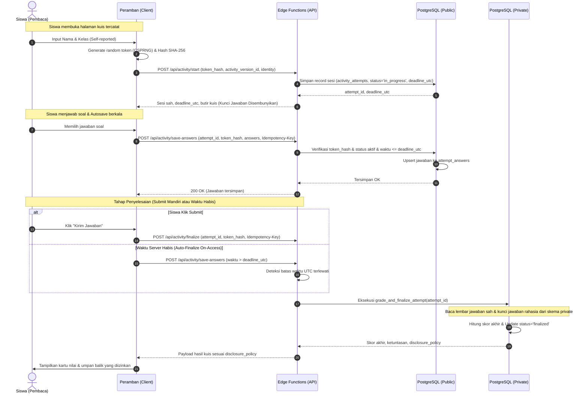

### 9.2 Diagram Sequence Publikasi Versi Buku (Atomic Publish)
Diagram ini memvisualisasikan transaksi atomik publikasi buku lintas lapisan Admin, Frontend, Edge Function, Database, dan Storage:

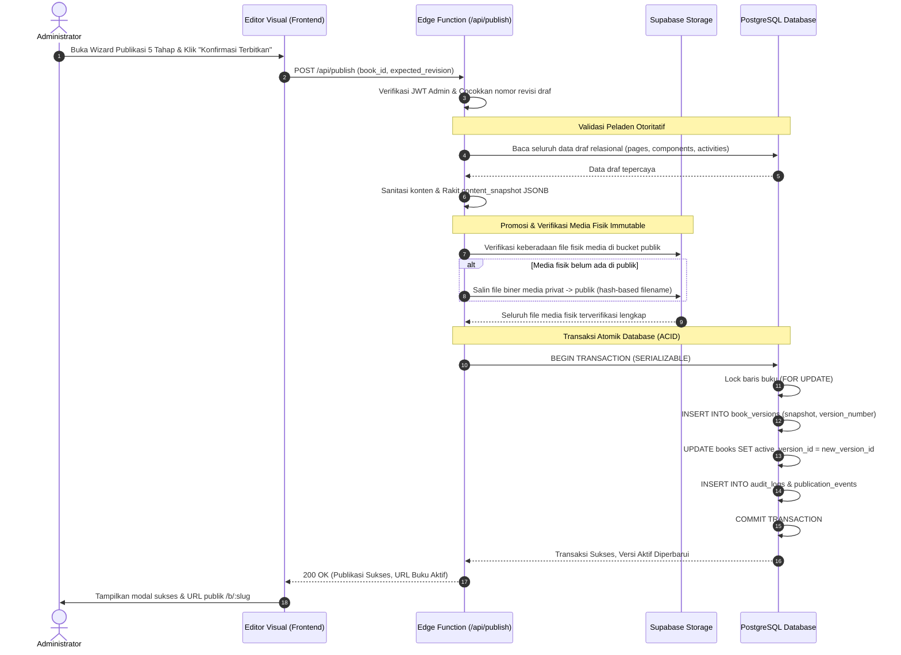

### 9.3 Diagram Siklus Penarikan Publikasi dan Rollback
Diagram state ini memperlihatkan transisi status buku antara Draf, Terbit Aktif, Ditarik Publikasi (Unpublish Grace Period vs Immediate Block), Emergency Revoke, dan Rollback:

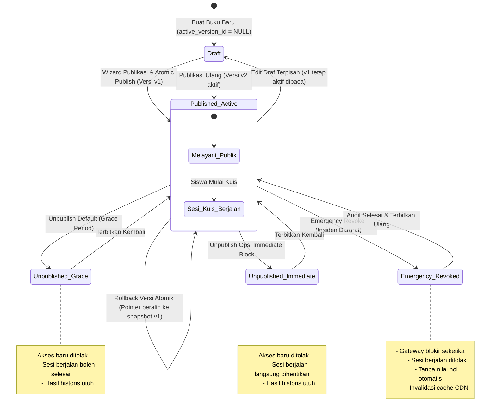

### 9.4 Navigasi Reader dan Deep Link (AF-01-001 s.d. AF-01-004)
**Tujuan:** Memastikan pembaca publik dapat masuk, bernavigasi, dan menangani target yang tidak tersedia tanpa login.

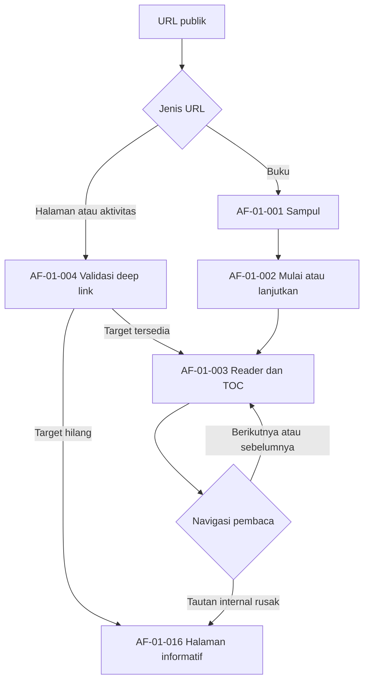

### 9.5 Ganti Pembaca Perangkat Bersama (AF-01-015)
**Tujuan:** Memisahkan sesi pembaca pada perangkat bersama tanpa menghapus hasil yang telah disimpan di server.

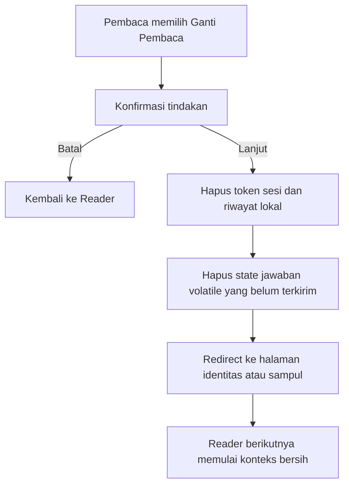

### 9.6 Login dan Dashboard Administrator (AF-02-001 s.d. AF-02-002)
**Tujuan:** Memperlihatkan autentikasi admin dan penolakan sesi tidak sah atau kedaluwarsa.

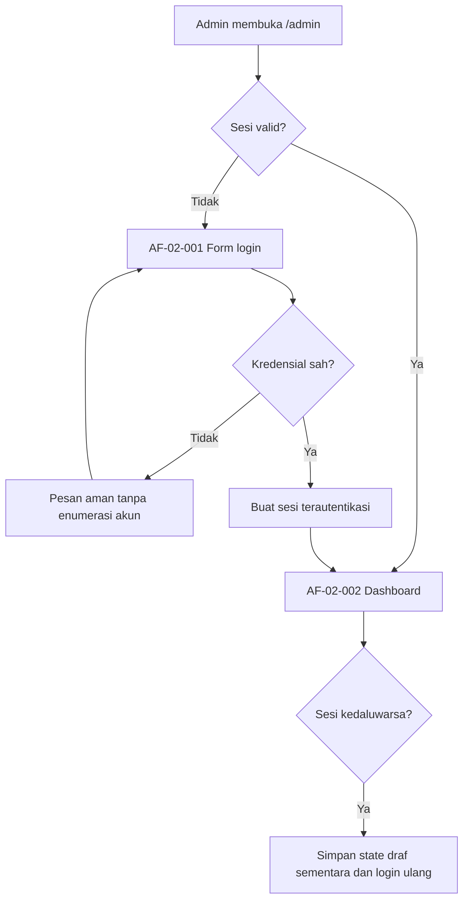

### 9.7 Pembuatan Buku dan Editor Visual (AF-02-003 s.d. AF-02-009)
**Tujuan:** Menunjukkan pembentukan draf, struktur terbatas, dan masuk ke editor adaptif.

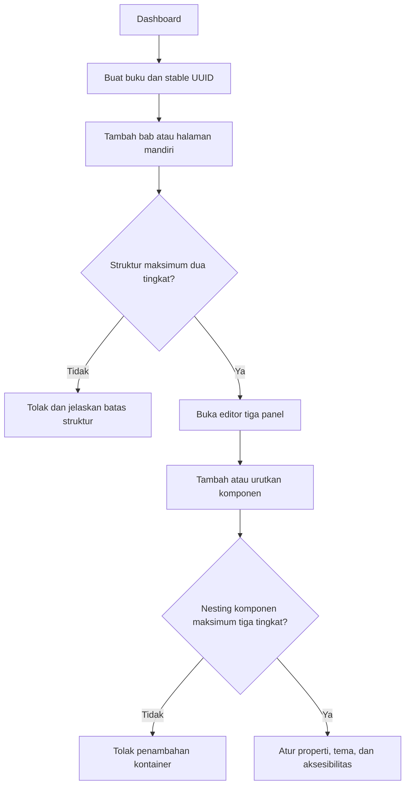

### 9.8 Autosave dan Konflik Revisi (AF-02-010, AF-03-003)
**Tujuan:** Menjelaskan compare-and-swap, keberhasilan autosave, dan resolusi konflik tanpa silent overwrite.

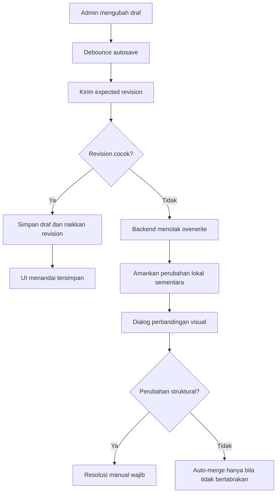

### 9.9 Wizard Publikasi Lima Tahap (AF-02-014, AF-03-007)
**Tujuan:** Menampilkan validasi berurutan dan blokir mutlak saat terdapat Error.

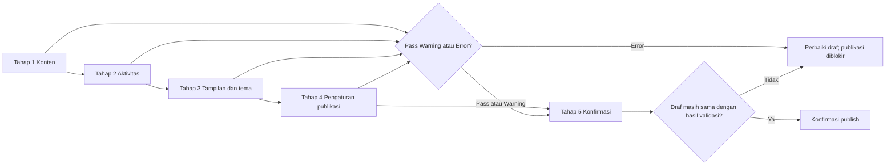

### 9.10 Unpublish Immediate Block dan Emergency Revoke (AF-02-017, AF-02-018, AF-03-019, AF-03-020)
**Tujuan:** Membedakan blokir segera terencana dari pencabutan darurat tanpa penetapan nilai nol otomatis.

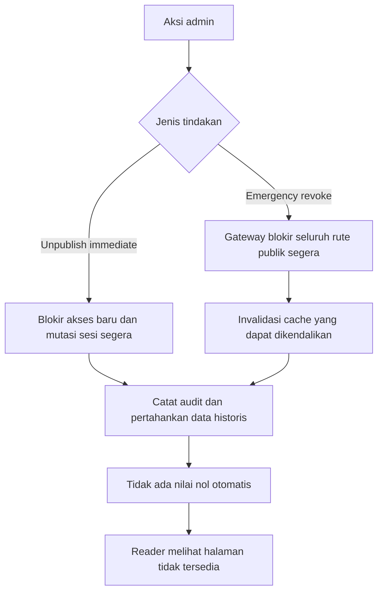

### 9.11 Rollback Snapshot Historis (AF-02-019, AF-03-021)
**Tujuan:** Memastikan rollback hanya mengalihkan pointer secara atomik setelah media target diverifikasi.

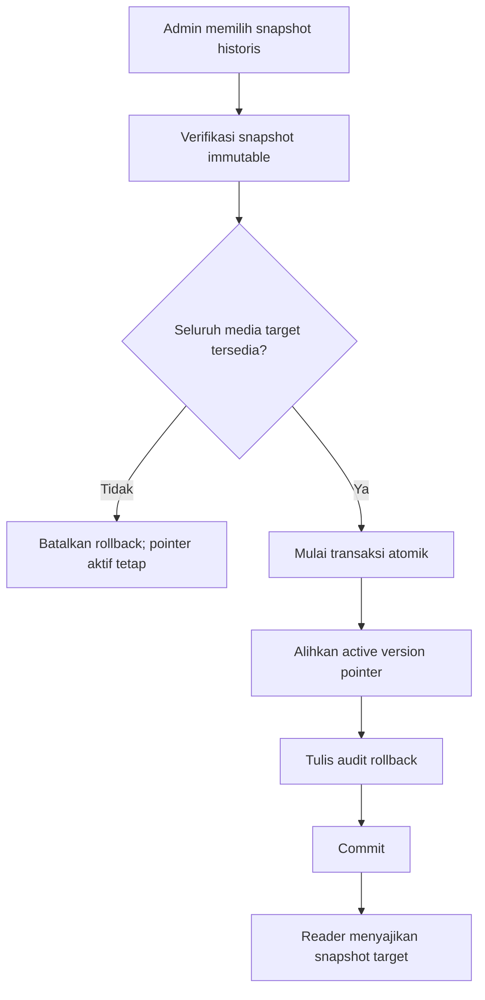

### 9.12 Backend-Only Scoring dan Finalisasi Idempoten (AF-03-012 s.d. AF-03-014)
**Tujuan:** Menegaskan bahwa hanya jawaban sah sebelum tenggat yang dinilai tanpa membocorkan kunci jawaban.

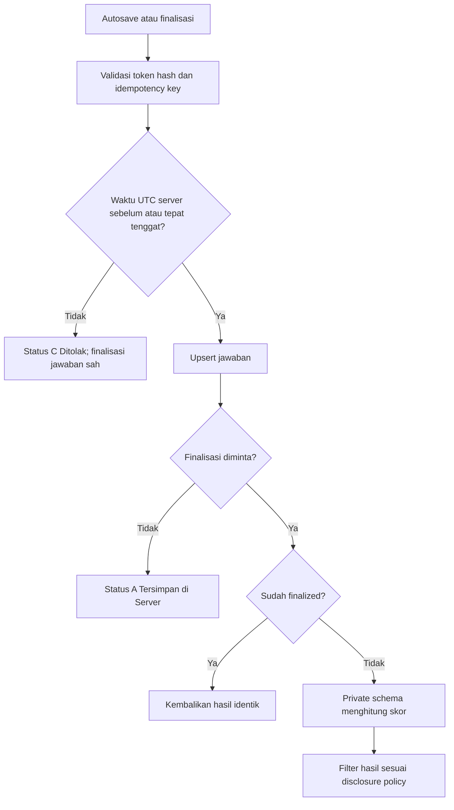

### 9.13 QR Statis dan Dinamis (AF-01-005, AF-01-006, AF-02-020, AF-03-022)
**Tujuan:** Membeda­kan QR langsung MVP dari resolusi QR dinamis Fase 2 yang tervalidasi.

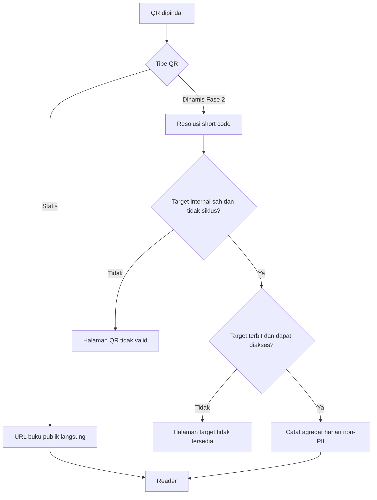

### 9.14 Retensi Media dan Dependensi Snapshot (AF-03-026)
**Tujuan:** Mencegah penghapusan snapshot atau media yang masih menjadi dependensi historis.

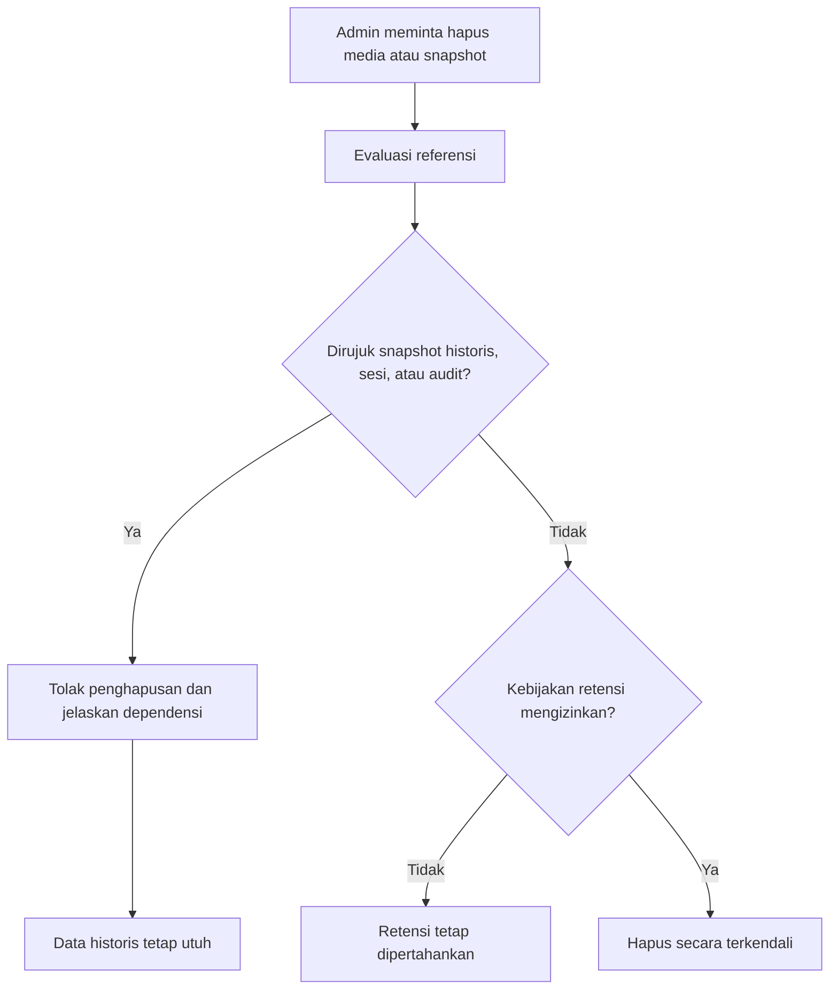

---

## 10. Matriks Status dan Transisi Sistem

Matriks berikut menjabarkan transisi status konseptual pada entitas utama aplikasi:

| Entitas | Status Awal | Aksi / Pemicu | Status Akhir | Dampak terhadap Akses Pembaca | Dampak terhadap Data & Sesi |
|---|---|---|---|---|---|
| **Buku** | `draft_only` | Atomic Publish (AF-02-015) | `published` | Buku dapat diakses publik di `/b/:slug` | `active_version_id` menunjuk snapshot baru |
| **Buku** | `published` | Unpublish Default (AF-02-017) | `unpublished` | Pengunjung baru ditolak (AF-01-017) | Sesi aktif lanjut (*grace period*); `active_version_id = NULL` |
| **Buku** | `published` | Unpublish Immediate (AF-02-017) | `unpublished` | Seluruh pembaca publik ditolak | Sesi aktif ditolak seketika; data historis aman |
| **Buku** | `published` | Emergency Revoke (AF-02-018) | `emergency_revoked` | Seluruh akses publik diblokir di gateway | Sesi aktif diblokir; tanpa nilai nol auto; audit ditulis |
| **Buku** | `published (v2)` | Rollback Versi (AF-02-019) | `published (v1)` | Pembaca disajikan konten versi v1 | Pointer menunjuk snapshot v1; sesi v2 historis tetap aman |
| **Sesi Kuis** | `not_started` | Siswa Submit Identitas (AF-01-009) | `in_progress` | Lembar kuis terbuka di peramban | Record percobaan aktif dibuat; token hash tersimpan |
| **Sesi Kuis** | `in_progress` | Siswa Klik Selesai (AF-01-011) | `finalized` | Layar menampilkan hasil nilai | Skor dihitung di skema privat; sesi terkunci |
| **Sesi Kuis** | `in_progress` | Waktu Server Habis (AF-01-012) | `finalized` | Layar beralih ke hasil evaluasi | Jawaban sah terakhir dinilai; sesi dikunci otomatis |
| **Sesi Kuis** | `in_progress` | Emergency Revoke Ditekan (AF-03-020) | `revoked_blocked` | Antarmuka kuis ditutup paksa | Sesi dibatalkan; nilai tidak diset nol; data historis aman |
| **Sesi Kuis** | `finalized` | Admin Beri Retry Grant (AF-02-023) | `retry_granted` | Siswa dapat memasukkan kode retry | Kode sekali pakai aktif di skema privat |
| **QR Dinamis** | `active` | Admin Alihkan Target (AF-02-021) | `active` | Pemindaian diarahkan ke target baru | Riwayat target dicatat di `qr_target_history` |
| **QR Dinamis** | `active` | Admin Nonaktifkan QR | `inactive` | Pemindaian menampilkan halaman non-aktif | Counter pemindaian gagal bertambah |

---

## 11. Matriks Penanganan Kesalahan (Exception Handling Matrix)

Status jawaban kuis dipakai konsisten: **A** = terkonfirmasi tersimpan di server; **B** = hanya berada di memori sementara/menunggu kirim dan belum aman; **C** = ditolak server. Status B bukan penyimpanan persisten dan tidak memperpanjang tenggat UTC server.

| Error ID | Skenario | Pemicu | Respons UI/API | Dampak data | Pemulihan | Requirement PRD | Flow ID |
|---|---|---|---|---|---|---|---|
| **ERR-001** | Login admin gagal | Kredensial salah | Pesan aman tanpa enumerasi akun | Tidak ada sesi | Masukkan ulang kredensial | `FR-ADM-001`, `AC-ADM-001` | AF-02-001, AF-03-001 |
| **ERR-002** | Sesi admin kedaluwarsa | JWT tidak valid/kedaluwarsa | Tolak akses; minta login ulang | Tidak ada mutasi; state draf sementara dipertahankan bila ada | Autentikasi ulang | `FR-ADM-002`, `AC-ADM-001` | AF-02-027, AF-03-001 |
| **ERR-003** | Akses ilegal data privat/draf | Klien anon mencoba membaca/menulis data privat | 401/403 atau respons tanpa data | RLS default deny mencegah kebocoran | Tidak ada; gunakan jalur berotorisasi | `NFR-SEC-001`, `AC-SEC-001` | AF-03-002, AF-03-024 |
| **ERR-004** | Buku belum terbit/tidak tersedia | Tidak ada versi aktif | Halaman informatif; tidak bocorkan draf | Tidak ada konten privat keluar | Admin terbitkan bila berwenang | `FR-PUB-001` | AF-01-001, AF-01-017 |
| **ERR-005** | Halaman/deep link tidak tersedia | Stable ID tidak ada pada snapshot aktif | Halaman pengganti dengan pilihan eksplisit | Tidak ada redirect diam-diam | Reader memilih beranda/TOC | `FR-LNK-003`, `AC-LNK-003` | AF-01-004, AF-01-016 |
| **ERR-006** | Slug lama diakses | Alias slug cocok | Redirect aman ke slug sah | Tidak mengubah snapshot | Lanjutkan ke URL baru | `FR-LNK-002`, `AC-LNK-001` | AF-01-001, AF-03-010 |
| **ERR-007** | QR tidak valid/target tidak sah | Short code tidak ada, eksternal, siklus, atau target tidak aktif | Halaman QR tidak tersedia; tidak redirect eksternal | Resolusi dihentikan; agregat gagal boleh dicatat non-PII | Admin perbaiki/nonaktifkan QR | `FR-LNK-005`, `FR-LNK-006`, `AC-LNK-002`, `AC-LNK-004` | AF-01-006, AF-03-022 |
| **ERR-008** | Konflik autosave draf | Expected revision tidak cocok | Dialog perbandingan; API menolak overwrite | Perubahan server utuh; perubahan lokal dipertahankan sementara | Resolusi manual untuk struktur; merge aman hanya non-struktural | `FR-EDT-007`, `AC-EDT-002`, `AC-EDT-003` | AF-02-010, AF-03-003 |
| **ERR-009** | Unggah/verifikasi media gagal | File/validasi/hash/media publik gagal | Tampilkan kegagalan per berkas; publish diblokir bila dependensi belum siap | Draf dan versi aktif tidak berubah | Unggah ulang/perbaiki aset lalu verifikasi ulang | `FR-MED-001`, `FR-MED-002`, `FR-PUB-003` | AF-02-011, AF-03-005, AF-03-006 |
| **ERR-010** | Validasi wizard gagal | Error Tahap 1–4 | Error pemblokir dan daftar perbaikan | Tidak ada snapshot/pointer baru | Perbaiki draf, jalankan ulang validasi | `FR-PUB-001`, `FR-PUB-002`, `AC-PUB-001` | AF-02-014, AF-03-007 |
| **ERR-011** | Draf berubah setelah validasi | Revision saat publish berbeda | Publish ditolak; wizard minta validasi ulang | Versi aktif tetap | Simpan/selesaikan konflik lalu validasi ulang | `FR-EDT-007`, `FR-PUB-004` | AF-02-010, AF-02-015, AF-03-007 |
| **ERR-012** | Transaksi publish atomik gagal | Media/DB/commit gagal | Status gagal; tidak ada sukses parsial | Rollback; pointer versi lama tetap | Perbaiki penyebab dan ulangi publish | `FR-PUB-003`, `FR-PUB-004`, `AC-PUB-002` | AF-02-015, AF-03-008, AF-03-009 |
| **ERR-013** | Kuis offline/belum tersimpan | Jaringan putus sebelum konfirmasi | Status B: belum tersimpan di server | Jawaban hanya di memori volatile; tidak dihitung bila browser hilang | Kirim ulang sebelum deadline; tanpa janji offline penuh | `FR-ACT-005`, `FR-ACT-006` | AF-01-010, AF-03-012 |
| **ERR-014** | Jawaban terlambat | Waktu UTC server melewati deadline | Status C; API menolak jawaban baru | Hanya jawaban Status A sebelum deadline dinilai | Finalisasi idempoten | `FR-ACT-005`, `AC-ACT-002`, `AC-ACT-004` | AF-01-012, AF-03-013, AF-03-014 |
| **ERR-015** | Kirim/finalisasi berulang | Retry jaringan atau double click | Kembalikan hasil/konfirmasi identik | Tidak ada jawaban/nilai duplikat | Klien gunakan respons yang sama | `FR-ACT-006`, `NFR-REL-002`, `AC-ACT-005` | AF-01-011, AF-03-012, AF-03-014 |
| **ERR-016** | Browser ditutup saat kuis | Klien berhenti sebelum finalisasi | Saat akses berikutnya, status sesi ditampilkan | Hanya jawaban Status A tetap tersedia; on-access finalize jika lewat deadline | Buka lagi sebelum deadline atau lihat hasil | `FR-ACT-005`, `AC-ACT-004` | AF-01-012, AF-03-013 |
| **ERR-017** | Unpublish immediate block | Admin memilih immediate block | Reader/API segera tidak tersedia | Mutasi sesi dihentikan; riwayat aman | Terbitkan ulang sesuai kewenangan | `FR-PUB-006` | AF-02-017, AF-03-019 |
| **ERR-018** | Emergency revoke saat kuis | Admin revoke darurat | Semua rute/operasi publik diblokir | Sesi diblokir; tidak ada nilai nol otomatis; audit dicatat | Audit lalu terbitkan ulang bila disetujui | `FR-PUB-007`, `AC-PUB-004` | AF-02-018, AF-03-020 |
| **ERR-019** | Retry grant tidak sah/terpakai | Kode salah, kedaluwarsa, atau consumed | Tolak tanpa membuat sesi baru | Nilai/sesi lama tidak tertimpa | Minta grant baru dari admin (Fase 2) | `FR-ACT-008`, `AC-ACT-003` | AF-01-014, AF-02-023, AF-03-017 |
| **ERR-020** | Rollback media hilang | Dependensi snapshot target gagal diverifikasi | Modal rollback dibatalkan | Pointer aktif dan snapshot historis tidak berubah | Pulihkan/verifikasi media lalu ulangi | `FR-PUB-008`, `AC-PUB-005` | AF-02-019, AF-03-021 |
| **ERR-021** | Kuota storage tidak cukup | Batas kuota/ambang kritis tercapai | Peringatan dashboard atau tolak unggah dengan alasan | Tidak memicu upgrade berbayar; data ada tetap utuh | Bersihkan hanya aset tanpa dependensi atau minta keputusan biaya | `NFR-CST-001`, `NFR-CST-002`, `AC-CST-001` | AF-02-025, AF-03-028 |
| **ERR-022** | Backup/restore gagal | Arsip DB/media atau uji restore tidak lengkap | Peringatan kegagalan dan status tidak siap | Tidak klaim pemulihan berhasil | Perbaiki arsip, ulangi backup dan restore test | `NFR-REL-003`, `AC-REL-001` | AF-02-026, AF-03-027 |

---

## 12. Matriks Keterlacakan Requirement (Traceability Matrix)

### 12.1 Pemetaan Alur Kerja ke Requirement PRD (Flow -> PRD)

| Flow ID | Modul | Requirement PRD Terkait | Kriteria Penerimaan (AC) | Fase Rilis | Keterangan Hubungan Fungsional |
|---|---|---|---|---|---|
| **AF-01-001** | Reader | `FR-RDR-001`, `FR-RDR-002`, `FR-LNK-001`, `NFR-PERF-001` | `AC-RDR-001`, `AC-LNK-001` | Fase 1 (MVP) | Akses halaman pembuka buku terbit via slug publik dan titik ukur FCP |
| **AF-01-002** | Reader | `FR-RDR-001`, `FR-RDR-006` | `AC-RDR-001` | Fase 1 (MVP) | Transisi dari sampul ke halaman isi buku & posisi lokal |
| **AF-01-003** | Reader | `FR-BOK-004`, `FR-BOK-006`, `FR-RDR-003..005` | `AC-BOK-001`, `AC-RDR-002` | Fase 1 (MVP) | Navigasi struktur bab/halaman & flipbook adaptif |
| **AF-01-004** | Reader | `FR-LNK-001`, `FR-LNK-003` | `AC-LNK-001` | Fase 1 (MVP) | Deep link langsung halaman/aktivitas via Stable ID |
| **AF-01-005** | Reader | `FR-LNK-004` | — | Fase 1 (MVP) | Pemindaian QR statis menuju URL buku publik |
| **AF-01-006** | Reader | `FR-LNK-005`, `FR-LNK-006`, `FR-LNK-008` | `AC-LNK-002`, `AC-LNK-004` | Fase 2 | Resolusi rute QR dinamis dan penambahan agregat non-PII |
| **AF-01-007** | Reader | `FR-RDR-003`, `FR-RDR-004`, `FR-RDR-008`, `NFR-ACC-003` | `AC-RDR-002` | Fase 1 (MVP) | Responsivitas Reader, kontrol media eksplisit, dan larangan autoplay |
| **AF-01-008** | Reader | `FR-RDR-007`, `NFR-ACC-001..004` | — | Fase 1 (MVP) | Preferensi font, tema kontras tinggi, reduced motion |
| **AF-01-009** | Aktivitas | `FR-ACT-001`, `FR-ACT-002`, `FR-ACT-003` | `AC-ACT-001`, `AC-ACT-006` | Fase 1 (MVP) | Registrasi sesi nama/kelas minimal & isolasi hash token |
| **AF-01-010** | Aktivitas | `FR-ACT-005`, `FR-ACT-006`, `NFR-REL-002` | `AC-ACT-005` | Fase 1 (MVP) | Pengerjaan kuis dan autosave jawaban idempoten |
| **AF-01-011** | Aktivitas | `FR-ACT-003`, `FR-ACT-006` | `AC-ACT-005` | Fase 1 (MVP) | Finalisasi pengerjaan kuis atas inisiatif siswa |
| **AF-01-012** | Aktivitas | `FR-ACT-005` | `AC-ACT-002`, `AC-ACT-004` | Fase 1 (MVP) | Penegakan batas waktu server UTC & on-access finalize |
| **AF-01-013** | Aktivitas | `FR-ACT-003`, `FR-ACT-007` | `AC-ACT-001` | Fase 1 (MVP) | Pengungkapan skor/pembahasan sesuai kebijakan rilis |
| **AF-01-014** | Aktivitas | `FR-ACT-008` | `AC-ACT-003` | Fase 2 | Pengerjaan kuis ulang menggunakan kode retry sekali pakai |
| **AF-01-015** | Reader | `FR-RDR-009` | `AC-RDR-003` | Fase 1 (MVP) | Pembersihan tuntas sesi peramban pada perangkat bersama |
| **AF-01-016** | Reader | `FR-LNK-003` | `AC-LNK-003` | Fase 1 (MVP) | Penanganan ramah anak untuk deep link halaman terhapus |
| **AF-01-017** | Reader | `FR-PUB-006`, `FR-PUB-007` | `AC-PUB-003`, `AC-PUB-004` | Fase 1 (MVP) | Respons tampilan buku yang ditarik publikasi / darurat |
| **AF-02-001** | Admin | `FR-ADM-001`, `FR-ADM-002` | `AC-ADM-001` | Fase 1 (MVP) | Autentikasi kredensial email & password Supabase Auth |
| **AF-02-002** | Admin | `FR-ADM-003`, `FR-ADM-004` | `AC-CST-001` | Fase 1 (MVP) | Dashboard ringkasan buku, metrik kapasitas, dan audit log |
| **AF-02-003** | Admin | `FR-BOK-001`, `FR-BOK-002`, `FR-BOK-003` | — | Fase 1 (MVP) | Inisialisasi buku baru dan pembuatan Stable UUID |
| **AF-02-004** | Admin | `FR-BOK-001`, `FR-BOK-003`, `FR-LNK-002` | `AC-LNK-001` | Fase 1 (MVP) | Pembaruan metadata buku dan pencatatan slug alias |
| **AF-02-005** | Admin | `FR-BOK-002`, `FR-BOK-004` | `AC-BOK-001` | Fase 1 (MVP) | Pembuatan struktur bab dan halaman mandiri (maks 2 tingkat) |
| **AF-02-006** | Admin | `FR-BOK-002`, `FR-BOK-005` | `AC-BOK-001` | Fase 1 (MVP) | Operasi susun ulang, duplikasi ID baru, dan hapus draf |
| **AF-02-007** | Editor | `FR-EDT-001`, `FR-EDT-002` | — | Fase 1 (MVP) | Antarmuka editor adaptif 3-panel (desktop/tablet/mobile) |
| **AF-02-008** | Editor | `FR-EDT-003..005`, `FR-CMP-001..004` | `AC-EDT-001` | Fase 1 (MVP) | Penyusunan komponen Mode Blok & batas nesting 3 tingkat |
| **AF-02-009** | Editor | `FR-EDT-006`, `FR-THM-001..004` | — | Fase 1 (MVP) | Inspektor properti, pewarisan token tema, dan reset override |
| **AF-02-010** | Editor | `FR-EDT-007`, `FR-EDT-008` | `AC-EDT-002`, `AC-EDT-003` | Fase 1 (MVP) | Autosave debounced, compare-and-swap, dan resolusi konflik |
| **AF-02-011** | Media | `FR-MED-001`, `FR-MED-002`, `FR-CMP-002` | — | Fase 1 (MVP) | Unggah media draf privat & deduplikasi hash konten |
| **AF-02-012** | Aktivitas | `FR-CMP-004`, `FR-ACT-003..004`, `FR-ACT-007` | — | Fase 1 (MVP) | Konfigurasi kuis, pembobotan, dan kunci jawaban privat |
| **AF-02-013** | Pratinjau | `FR-PRV-001`, `FR-PRV-002`, `FR-PRV-003` | — | Fase 1 (MVP) | Quick/Fullscreen preview & mode pengujian kuis terisolasi |
| **AF-02-014** | Publikasi | `FR-PUB-001`, `FR-PUB-002` | `AC-PUB-001` | Fase 1 (MVP) | Wizard publikasi 5 tahap (Konten, Kuis, Tema, Akses, Cek) |
| **AF-02-015** | Publikasi | `FR-PUB-003`, `FR-PUB-004`, `NFR-PERF-004`, `NFR-REL-001` | `AC-PUB-002`, `AC-MED-001` | Fase 1 (MVP) | Atomic publish, snapshot JSONB, aktivasi pointer, dan titik ukur waktu publish |
| **AF-02-016** | Publikasi | `FR-PUB-005` | — | Fase 1 (MVP) | Pembaruan draf mandiri tanpa mengubah buku terbit aktif |
| **AF-02-017** | Publikasi | `FR-PUB-006` | `AC-PUB-003` | Fase 1 (MVP) | Unpublish buku dengan grace period atau immediate block |
| **AF-02-018** | Publikasi | `FR-PUB-007` | `AC-PUB-004` | Fase 1 (MVP) | Emergency revoke pencabutan akses darurat di gateway |
| **AF-02-019** | Publikasi | `FR-PUB-008` | `AC-PUB-005` | Fase 1 (MVP) | Rollback versi buku atomik berbasis verifikasi dependensi |
| **AF-02-020** | QR Code | `FR-LNK-004`, `FR-LNK-007` | — | Fase 1 (MVP) | Generator dan ekspor QR statis PNG/SVG siap cetak |
| **AF-02-021** | QR Code | `FR-LNK-005..008` | `AC-LNK-002`, `AC-LNK-004` | Fase 2 | Manajemen QR dinamis, ubah target, dan analitik agregat |
| **AF-02-022** | Aktivitas | `FR-ACT-001`, `FR-ACT-004` | — | Fase 1 (MVP) | Rekap hasil evaluasi siswa berdasarkan kelas & tanggal |
| **AF-02-023** | Aktivitas | `FR-ACT-008` | `AC-ACT-003` | Fase 2 | Penerbitan kode retry grant sekali pakai berbatas waktu |
| **AF-02-024** | Admin | `FR-ADM-005`, `FR-EDT-009` | — | Fase 1 (MVP) | Pengaturan aplikasi, kontak, dan allowlist embed domain |
| **AF-02-025** | Operasional| `FR-ADM-003`, `NFR-CST-001..002` | `AC-CST-001` | Fase 1 (MVP) | Monitoring kapasitas kuota gratis & pencegahan eskalasi |
| **AF-02-026** | Keandalan | `NFR-REL-003` | `AC-REL-001` | Fase 1 (MVP) | Prosedur backup database + file media dan uji restore |
| **AF-02-027** | Keamanan | `FR-ADM-001`, `FR-ADM-002` | `AC-ADM-001` | Fase 1 (MVP) | Logout admin dan penanganan sesi JWT kedaluwarsa |
| **AF-02-028** | Admin | `FR-BOK-001`, `FR-PUB-003` | `AC-PUB-006` | Fase 1 (MVP) | Pengarsipan buku dan pencegahan hapus data berelasi |
| **AF-03-001** | Backend | `FR-ADM-001`, `FR-ADM-002`, `NFR-SEC-002`, `NFR-SEC-003` | — | Fase 1 (MVP) | Validasi JWT admin dan kontrol koneksi terenkripsi di gateway |
| **AF-03-002** | Backend | `NFR-SEC-001` | `AC-SEC-001` | Fase 1 (MVP) | Penegakan RLS default deny untuk akses data publik |
| **AF-03-003** | Backend | `FR-EDT-007` | `AC-EDT-002`, `AC-EDT-003` | Fase 1 (MVP) | Penyimpanan draf atomik via compare-and-swap revisi |
| **AF-03-004** | Backend | `FR-EDT-005`, `FR-EDT-009`, `NFR-SEC-005` | `AC-EDT-001` | Fase 1 (MVP) | Sanitasi XSS konten dan validasi allowlist domain embed |
| **AF-03-005** | Storage | `FR-MED-001`, `NFR-SEC-003` | — | Fase 1 (MVP) | Media draf privat serta verifikasi enkripsi at-rest Storage |
| **AF-03-006** | Storage | `FR-MED-001`, `FR-MED-002`, `FR-MED-003` | `AC-MED-001` | Fase 1 (MVP) | Promosi file media biner ke bucket publik & deduplikasi |
| **AF-03-007** | Backend | `FR-PUB-001`, `FR-PUB-002` | `AC-PUB-001` | Fase 1 (MVP) | Validasi kelayakan penerbitan buku di tingkat peladen |
| **AF-03-008** | Backend | `FR-PUB-003` | — | Fase 1 (MVP) | Pembentukan serialisasi snapshot JSONB immutable |
| **AF-03-009** | Backend | `FR-PUB-004`, `NFR-REL-001` | `AC-PUB-002` | Fase 1 (MVP) | Transaksi atomik PostgreSQL pengalihan active_version_id |
| **AF-03-010** | Backend | `FR-LNK-002` | `AC-LNK-001` | Fase 1 (MVP) | Routing redirect HTTP 301/308 untuk slug buku lama |
| **AF-03-011** | Backend | `FR-ACT-001`, `FR-ACT-002`, `FR-ACT-005` | `AC-ACT-006` | Fase 1 (MVP) | Pembuatan record sesi aktivitas & penyimpanan hash token |
| **AF-03-012** | Backend | `FR-ACT-006`, `NFR-REL-002` | `AC-ACT-005` | Fase 1 (MVP) | Penyimpanan jawaban kuis berkala dengan idempotency key |
| **AF-03-013** | Backend | `FR-ACT-005` | `AC-ACT-002`, `AC-ACT-004` | Fase 1 (MVP) | Penegakan batas waktu server UTC & tolak jawaban telat |
| **AF-03-014** | Backend | `FR-ACT-003`, `FR-ACT-005`, `NFR-SEC-004` | `AC-ACT-001`, `AC-ACT-002` | Fase 1 (MVP) | Evaluasi nilai kuis di skema privat & finalisasi status |
| **AF-03-015** | Backend | `FR-PUB-005` | — | Fase 1 (MVP) | Version pinning pengerjaan kuis pada activity_version asal |
| **AF-03-016** | Backend | `FR-ACT-007`, `NFR-SEC-004` | `AC-ACT-001` | Fase 1 (MVP) | Filter respons hasil kuis sesuai disclosure_policy |
| **AF-03-017** | Backend | `FR-ACT-008` | `AC-ACT-003` | Fase 2 | Konsumsi kode retry grant sekali pakai secara atomik |
| **AF-03-018** | Backend | `FR-PUB-006` | `AC-PUB-003` | Fase 1 (MVP) | Penegakan unpublish grace period untuk percobaan aktif |
| **AF-03-019** | Backend | `FR-PUB-006` | — | Fase 1 (MVP) | Penegakan unpublish immediate block di tingkat gateway |
| **AF-03-020** | Backend | `FR-PUB-007` | `AC-PUB-004` | Fase 1 (MVP) | Penegakan emergency revoke & penolakan mutlak gateway |
| **AF-03-021** | Backend | `FR-PUB-008` | `AC-PUB-005` | Fase 1 (MVP) | Rollback versi atomik dengan verifikasi kelengkapan aset |
| **AF-03-022** | Backend | `FR-LNK-005`, `FR-LNK-006` | `AC-LNK-002`, `AC-LNK-004` | Fase 2 | Resolusi QR dinamis, validasi target sah, dan anti-siklus |
| **AF-03-023** | Backend | `FR-LNK-008` | — | Fase 2 | Increment atomik agregat harian QR non-PII (Asia/Jakarta) |
| **AF-03-024** | Keamanan | `NFR-SEC-001`, `NFR-SEC-006..007` | `AC-SEC-001` | Fase 1 (MVP) | Search_path aman, RLS, dan rate limiting mandiri Supabase |
| **AF-03-025** | Keamanan | `FR-ADM-004`, `NFR-SEC-004` | — | Fase 1 (MVP) | Pencatatan audit_logs tindakan kritis di skema privat |
| **AF-03-026** | Storage | `FR-MED-003` | `AC-MED-001`, `AC-PUB-006` | Fase 1 (MVP) | Perlindungan referensi media snapshot historis & sesi |
| **AF-03-027** | Keandalan | `NFR-REL-003`, `NFR-SEC-003` | `AC-REL-001` | Fase 1 (MVP) | Integritas backup serta verifikasi enkripsi arsip dan akses kunci |
| **AF-03-028** | Operasional| `FR-ADM-003`, `NFR-CST-001..002` | `AC-CST-001` | Fase 1 (MVP) | Perhitungan persentase kuota DB & Storage batas gratis |

---

### 12.2 Pemetaan Pemenuhan Kebutuhan PRD ke Alur (PRD -> Flow)

Tabel berikut merangkum **keterlacakan identifier** untuk seluruh **68 FR**, **20 NFR**, dan **28 AC**. Label `100% Tercakup` pada ringkasan kategori berarti setiap identifier memiliki pemetaan; penilaian **ketercakupan rancangan** individual dan status lintas alurnya bersifat normatif pada §12.3. Validasi dokumentasi tidak membuktikan pemenuhan implementasi atau capaian performa aktual.

| Kategori Kebutuhan | Identifier Requirement / Kriteria | Status Cakupan | Alur Kerja yang Mengimplementasikan |
|---|---|---|---|
| **Administrator (FR-ADM)** | `FR-ADM-001` s/d `FR-ADM-005` (5 FR) | **5/5 ID terpetakan** | AF-02-001, AF-02-002, AF-02-015, AF-02-017, AF-02-018, AF-02-019, AF-02-021, AF-02-023, AF-02-024, AF-02-025, AF-03-001, AF-03-024, AF-03-025, AF-03-028 |
| **Manajemen Buku (FR-BOK)** | `FR-BOK-001` s/d `FR-BOK-006` (6 FR) | **6/6 ID terpetakan** | AF-01-003, AF-02-003, AF-02-004, AF-02-005, AF-02-006, AF-02-028 |
| **Editor Visual (FR-EDT)** | `FR-EDT-001` s/d `FR-EDT-009` (9 FR) | **9/9 ID terpetakan** | AF-02-007, AF-02-008, AF-02-009, AF-02-010, AF-02-024, AF-03-003, AF-03-004 |
| **Pustaka Komponen (FR-CMP)** | `FR-CMP-001` s/d `FR-CMP-004` (4 FR) | **4/4 ID terpetakan** | AF-02-008, AF-02-011, AF-02-012 |
| **Sistem Tema (FR-THM)** | `FR-THM-001` s/d `FR-THM-005` (5 FR) | **5/5 ID terpetakan** | AF-02-009, AF-02-016 |
| **Pratinjau (FR-PRV)** | `FR-PRV-001` s/d `FR-PRV-003` (3 FR) | **3/3 ID terpetakan** | AF-02-013 |
| **Publikasi (FR-PUB)** | `FR-PUB-001` s/d `FR-PUB-008` (8 FR) | **8/8 ID terpetakan** | AF-02-014, AF-02-015, AF-02-016, AF-02-017, AF-02-018, AF-02-019, AF-03-006, AF-03-007, AF-03-008, AF-03-009, AF-03-011, AF-03-015, AF-03-018, AF-03-019, AF-03-020, AF-03-021 |
| **Reader (FR-RDR)** | `FR-RDR-001` s/d `FR-RDR-009` (9 FR) | **9/9 ID terpetakan** | AF-01-001, AF-01-002, AF-01-003, AF-01-007, AF-01-008, AF-01-015 |
| **Aktivitas & Kuis (FR-ACT)** | `FR-ACT-001` s/d `FR-ACT-008` (8 FR) | **8/8 ID terpetakan** | AF-01-009, AF-01-010, AF-01-011, AF-01-012, AF-01-013, AF-01-014, AF-02-012, AF-02-023, AF-03-011, AF-03-012, AF-03-013, AF-03-014, AF-03-016, AF-03-017 |
| **Tautan & QR (FR-LNK)** | `FR-LNK-001` s/d `FR-LNK-008` (8 FR) | **8/8 ID terpetakan** | AF-01-001, AF-01-004, AF-01-005, AF-01-006, AF-01-016, AF-02-004, AF-02-020, AF-02-021, AF-03-010, AF-03-022, AF-03-023 |
| **Media & Aset (FR-MED)** | `FR-MED-001` s/d `FR-MED-003` (3 FR) | **3/3 ID terpetakan** | AF-02-011, AF-02-028, AF-03-005, AF-03-006, AF-03-026 |
| **Kinerja (NFR-PERF)** | `NFR-PERF-001` s/d `NFR-PERF-004` (4 NFR) | **4/4 ID terpetakan** | AF-01-001, AF-01-006, AF-02-010, AF-02-015, AF-03-006, AF-03-008, AF-03-009, AF-03-022 |
| **Keamanan (NFR-SEC)** | `NFR-SEC-001` s/d `NFR-SEC-007` (7 NFR) | **7/7 ID terpetakan** | AF-03-001, AF-03-002, AF-03-004, AF-03-005, AF-03-014, AF-03-016, AF-03-024, AF-03-025, AF-03-027 |
| **Aksesibilitas (NFR-ACC)** | `NFR-ACC-001` s/d `NFR-ACC-004` (4 NFR) | **4/4 ID terpetakan** | AF-01-007, AF-01-008, AF-02-009, AF-02-014 |
| **Keandalan (NFR-REL)** | `NFR-REL-001` s/d `NFR-REL-003` (3 NFR) | **3/3 ID terpetakan** | AF-01-010, AF-01-011, AF-02-015, AF-02-017, AF-02-019, AF-02-026, AF-03-009, AF-03-012, AF-03-014, AF-03-018, AF-03-021, AF-03-027 |
| **Biaya & Kuota (NFR-CST)** | `NFR-CST-001` s/d `NFR-CST-002` (2 NFR) | **2/2 ID terpetakan** | AF-02-025, AF-03-028 |
| **Kriteria Penerimaan (AC)** | `AC-ADM-001` s/d `AC-CST-001` (28 AC) | **28/28 ID terpetakan** | AF-01-001, AF-01-003, AF-01-004, AF-01-007, AF-01-009, AF-01-011, AF-01-012, AF-01-014, AF-01-015, AF-01-016, AF-02-001, AF-02-002, AF-02-004, AF-02-005, AF-02-006, AF-02-008, AF-02-010, AF-02-014, AF-02-015, AF-02-017, AF-02-018, AF-02-019, AF-02-021, AF-02-023, AF-02-025, AF-02-026, AF-02-027, AF-02-028, AF-03-001, AF-03-002, AF-03-003, AF-03-004, AF-03-007, AF-03-009, AF-03-010, AF-03-011, AF-03-012, AF-03-013, AF-03-014, AF-03-016, AF-03-017, AF-03-018, AF-03-020, AF-03-021, AF-03-022, AF-03-024, AF-03-026, AF-03-027, AF-03-028 |

Rekonsiliasi status ketercakupan rancangan pada §12.3:

| Status | Jumlah | Makna |
|---|---:|---|
| **Terpetakan** | 38 | Satu alur utama mendokumentasikan kontrol atau mekanisme requirement. |
| **Lintas Alur** | 78 | Beberapa alur bersama-sama mendokumentasikan kontrol atau mekanisme requirement. |
| **Perlu Klarifikasi** | 0 | Tidak ada requirement tanpa cakupan rancangan pada revisi ini. |
| **Total** | **116** | 68 FR + 20 NFR + 28 AC; bukti implementasi tetap memerlukan pengujian aplikasi. |

---

### 12.3 Matriks Requirement Individual (PRD -> Flow)

Matriks ini memetakan setiap requirement ke perilaku yang benar-benar dijalankan atau ditegakkan oleh subflow terkait.

| Requirement ID | Jenis | Flow ID Terkait | Status Cakupan | Keterangan |
|---|---|---|---|---|
| `FR-ADM-001` | FR | AF-02-001, AF-03-001 | **Terpetakan** | Login kredensial dan validasi sesi admin di gateway. |
| `FR-ADM-002` | FR | AF-03-001, AF-03-024 | **Lintas Alur** | JWT admin divalidasi sebelum endpoint privat; RLS mempertahankan default deny. |
| `FR-ADM-003` | FR | AF-02-002, AF-02-025, AF-03-028 | **Lintas Alur** | Dashboard memuat ringkasan buku, riwayat, dan metrik kuota. |
| `FR-ADM-004` | FR | AF-02-015, AF-02-017, AF-02-018, AF-02-019, AF-02-021, AF-02-023, AF-03-025 | **Lintas Alur** | Tindakan kritis tersebut mencatat audit privat. |
| `FR-ADM-005` | FR | AF-02-024 | **Terpetakan** | Pengaturan aplikasi dikelola dari alur konfigurasi admin. |
| `FR-BOK-001` | FR | AF-02-003, AF-02-004, AF-02-028 | **Lintas Alur** | Buku dibuat, metadata disunting, lalu diarsipkan/dihapus aman. |
| `FR-BOK-002` | FR | AF-02-003, AF-02-005, AF-02-006 | **Lintas Alur** | Stable UUID dibuat dan dipertahankan saat struktur berubah. |
| `FR-BOK-003` | FR | AF-02-003, AF-02-004 | **Lintas Alur** | UUID internal dibuat terpisah dari slug yang dapat diperbarui. |
| `FR-BOK-004` | FR | AF-02-005 | **Terpetakan** | Pembuatan struktur membatasi Bab/Bagian ke Halaman. |
| `FR-BOK-005` | FR | AF-02-006 | **Terpetakan** | Tambah, pindah, urut, duplikasi ID baru, dan hapus draf. |
| `FR-BOK-006` | FR | AF-01-003, AF-02-005 | **Lintas Alur** | TOC Reader mengikuti hierarki struktur yang dibentuk admin. |
| `FR-EDT-001` | FR | AF-02-007 | **Terpetakan** | Editor dibuka sebagai tata letak tiga panel. |
| `FR-EDT-002` | FR | AF-02-007 | **Terpetakan** | Editor mengalihkan panel pada tablet/mobile. |
| `FR-EDT-003` | FR | AF-02-008 | **Terpetakan** | Alur komponen membedakan Mode Blok dan tata letak bebas terbatas. |
| `FR-EDT-004` | FR | AF-02-008 | **Terpetakan** | Penambahan dan pengurutan komponen ditangani editor. |
| `FR-EDT-005` | FR | AF-02-008, AF-03-004 | **Lintas Alur** | UI dan validasi backend menegakkan nesting maksimum tiga tingkat. |
| `FR-EDT-006` | FR | AF-02-009 | **Terpetakan** | Inspektor mengatur konten, tampilan, tata letak, perilaku, aksesibilitas. |
| `FR-EDT-007` | FR | AF-02-010, AF-03-003 | **Lintas Alur** | Debounce CAS, konflik visual, dan larangan silent overwrite ditegakkan. |
| `FR-EDT-008` | FR | AF-02-010 | **Terpetakan** | Undo/redo dipertahankan terhadap titik revisi tersimpan. |
| `FR-EDT-009` | FR | AF-02-024, AF-03-004 | **Lintas Alur** | Allowlist dan sanitasi rich text diterapkan sebelum konten dipakai. |
| `FR-CMP-001` | FR | AF-02-008 | **Terpetakan** | Pustaka editor menyediakan komponen konten dasar. |
| `FR-CMP-002` | FR | AF-02-011 | **Terpetakan** | Unggah dan pengelolaan media melayani komponen media. |
| `FR-CMP-003` | FR | AF-02-008 | **Terpetakan** | Editor menyusun container, kolom, kartu, divider, dan alert. |
| `FR-CMP-004` | FR | AF-02-012 | **Terpetakan** | Konfigurasi aktivitas menentukan komponen interaktif menurut fase. |
| `FR-THM-001` | FR | AF-02-009 | **Terpetakan** | Inspektor mengatur pewarisan tema buku-halaman-komponen. |
| `FR-THM-002` | FR | AF-02-009 | **Terpetakan** | Pengaturan tema memakai token induk untuk komponen tanpa override. |
| `FR-THM-003` | FR | AF-02-009 | **Terpetakan** | Alur tema menyediakan preset dan membedakan perluasan fase. |
| `FR-THM-004` | FR | AF-02-009 | **Terpetakan** | Override dapat direset ke token induk. |
| `FR-THM-005` | FR | AF-02-016 | **Terpetakan** | Draf yang diedit terpisah dari snapshot publik aktif. |
| `FR-PRV-001` | FR | AF-02-013 | **Terpetakan** | Quick Preview beralih dari kanvas edit. |
| `FR-PRV-002` | FR | AF-02-013 | **Terpetakan** | Fullscreen memakai render Reader dengan pilihan viewport. |
| `FR-PRV-003` | FR | AF-02-013 | **Terpetakan** | Mode uji ditandai backend dan tidak menulis hasil siswa. |
| `FR-PUB-001` | FR | AF-02-014, AF-03-007 | **Lintas Alur** | Wizard lima tahap dan validasi peladen dijalankan berurutan. |
| `FR-PUB-002` | FR | AF-02-014, AF-03-007 | **Lintas Alur** | Pass/Warning/Error ditampilkan; Error memblokir publish. |
| `FR-PUB-003` | FR | AF-02-015, AF-03-006, AF-03-008 | **Lintas Alur** | Media diverifikasi lalu snapshot immutable dirakit dari draf. |
| `FR-PUB-004` | FR | AF-02-015, AF-03-009 | **Lintas Alur** | Pointer versi dan audit publish dikomit dalam satu transaksi. |
| `FR-PUB-005` | FR | AF-02-016, AF-03-011, AF-03-015 | **Lintas Alur** | Sesi menyimpan versi aktivitas asal ketika draft/versi berubah. |
| `FR-PUB-006` | FR | AF-02-017, AF-03-018, AF-03-019 | **Lintas Alur** | Default grace period dan immediate block ditegakkan berbeda. |
| `FR-PUB-007` | FR | AF-02-018, AF-03-020 | **Lintas Alur** | Gateway memblokir akses/operasi tanpa menetapkan nilai nol otomatis. |
| `FR-PUB-008` | FR | AF-02-019, AF-03-021 | **Lintas Alur** | Media target diverifikasi sebelum pointer rollback atomik. |
| `FR-RDR-001` | FR | AF-01-001, AF-01-002 | **Lintas Alur** | Sampul luar menampilkan metadata dan mengantar ke pembacaan. |
| `FR-RDR-002` | FR | AF-01-001, AF-01-002 | **Lintas Alur** | Halaman sampul luar terpisah dari isi yang baru dimuat setelah aksi. |
| `FR-RDR-003` | FR | AF-01-003, AF-01-007 | **Lintas Alur** | Desktop flipbook menggunakan fallback scroll sesuai konten. |
| `FR-RDR-004` | FR | AF-01-007 | **Terpetakan** | Mobile memakai satu kolom dan interaksi sentuh adaptif. |
| `FR-RDR-005` | FR | AF-01-003 | **Terpetakan** | TOC, nomor, tombol navigasi, dan tautan stable ID tersedia. |
| `FR-RDR-006` | FR | AF-01-001, AF-01-002 | **Lintas Alur** | Reader membaca/menulis posisi lokal tanpa sinkronisasi. |
| `FR-RDR-007` | FR | AF-01-008 | **Terpetakan** | Ukuran font, kontras tinggi, dan reduced motion diatur pembaca. |
| `FR-RDR-008` | FR | AF-01-007, AF-01-008 | **Lintas Alur** | AF-01-007 melarang autoplay saat buka/pindah halaman dan mewajibkan aksi eksplisit, keyboard, label aksesibel, serta kepatuhan embed; AF-01-008 menegakkan reduced motion Reader. |
| `FR-RDR-009` | FR | AF-01-015 | **Terpetakan** | Ganti Pembaca membersihkan token dan konteks lokal. |
| `FR-ACT-001` | FR | AF-01-009, AF-03-011 | **Lintas Alur** | Nama/kelas dikumpulkan hanya saat sesi tercatat dibuat. |
| `FR-ACT-002` | FR | AF-01-009, AF-03-011, AF-03-012 | **Lintas Alur** | Token CSPRNG di-hash dan diverifikasi saat menyimpan jawaban. |
| `FR-ACT-003` | FR | AF-01-011, AF-03-014, AF-03-016 | **Lintas Alur** | Private backend menghitung skor dan memfilter payload hasil. |
| `FR-ACT-004` | FR | AF-02-012, AF-01-014, AF-02-023, AF-03-017 | **Lintas Alur** | MVP satu percobaan; multi-attempt/agregasi/retry dipisah Fase 2. |
| `FR-ACT-005` | FR | AF-01-010, AF-01-012, AF-03-013, AF-03-014 | **Lintas Alur** | UTC server menolak terlambat dan menilai jawaban sah secara idempoten. |
| `FR-ACT-006` | FR | AF-01-010, AF-01-011, AF-03-012 | **Lintas Alur** | Autosave dan finalisasi menggunakan token serta idempotency key. |
| `FR-ACT-007` | FR | AF-02-012, AF-01-013, AF-03-016 | **Lintas Alur** | Kebijakan admin menentukan hasil yang difilter ke Reader. |
| `FR-ACT-008` | FR | AF-01-014, AF-02-023, AF-03-017 | **Lintas Alur** | Grant sekali pakai kedaluwarsa dibuat dan dikonsumsi atomik. |
| `FR-LNK-001` | FR | AF-01-001, AF-01-004, AF-01-006 | **Lintas Alur** | Reader menerima rute buku, halaman, aktivitas, dan QR. |
| `FR-LNK-002` | FR | AF-02-004, AF-03-010 | **Lintas Alur** | Perubahan slug menyimpan alias untuk redirect sah. |
| `FR-LNK-003` | FR | AF-01-004, AF-01-016 | **Lintas Alur** | Deep link hilang diberi halaman informatif dan pilihan eksplisit. |
| `FR-LNK-004` | FR | AF-01-005, AF-02-020 | **Lintas Alur** | QR statis dibuat admin lalu menuju URL buku langsung. |
| `FR-LNK-005` | FR | AF-01-006, AF-02-021, AF-03-022 | **Lintas Alur** | QR dinamis divalidasi internal, anti-siklus, dan tidak bypass status. |
| `FR-LNK-006` | FR | AF-02-021, AF-03-022 | **Lintas Alur** | Validasi target QR menolak domain eksternal. |
| `FR-LNK-007` | FR | AF-02-020 | **Terpetakan** | Ekspor QR statis menyediakan PNG/SVG siap cetak. |
| `FR-LNK-008` | FR | AF-01-006, AF-03-023 | **Lintas Alur** | Resolusi mencatat counter harian non-PII Asia/Jakarta. |
| `FR-MED-001` | FR | AF-02-011, AF-03-005, AF-03-006 | **Lintas Alur** | Media draf privat dipromosikan setelah verifikasi ke media terbit. |
| `FR-MED-002` | FR | AF-02-011, AF-03-006 | **Lintas Alur** | Unggah memeriksa hash untuk deduplikasi dan aset terbit immutable. |
| `FR-MED-003` | FR | AF-02-028, AF-03-026 | **Lintas Alur** | Penghapusan diblokir saat snapshot/sesi masih mereferensikan aset. |
| `NFR-PERF-001` | NFR | AF-01-001 | **Terpetakan** | Titik ukur FCP browser sejak navigasi hingga paint pertama atas teks, gambar, SVG, atau canvas nonkosong memakai skenario 4G dan dataset PRD; bukti capaian <2,5 detik menunggu uji implementasi. |
| `NFR-PERF-002` | NFR | AF-02-010 | **Terpetakan** | Autosave didebounce agar editing tidak diblokir. |
| `NFR-PERF-003` | NFR | AF-01-006, AF-03-022 | **Lintas Alur** | QR dinamis diselesaikan pada jalur gateway/edge. |
| `NFR-PERF-004` | NFR | AF-02-015, AF-03-006, AF-03-008, AF-03-009 | **Lintas Alur** | Titik ukur mencakup verifikasi media, snapshot, transaksi pointer, dan audit hingga respons sukses; capaian <3,0 detik menunggu uji implementasi. |
| `NFR-SEC-001` | NFR | AF-03-002, AF-03-024 | **Lintas Alur** | RLS default deny melindungi draf dan data privat. |
| `NFR-SEC-002` | NFR | AF-03-001, AF-03-014 | **Lintas Alur** | Operasi istimewa berada di backend, bukan browser. |
| `NFR-SEC-003` | NFR | AF-03-001, AF-03-005, AF-03-027 | **Lintas Alur** | Gateway mewajibkan HTTPS/TLS 1.3; Storage database/media dan arsip backup harus diverifikasi untuk enkripsi at-rest serta akses kunci sebelum rilis/pemulihan. |
| `NFR-SEC-004` | NFR | AF-03-014, AF-03-016, AF-03-025 | **Lintas Alur** | Kunci, scoring, hasil terfilter, dan audit berada di private schema. |
| `NFR-SEC-005` | NFR | AF-03-004 | **Terpetakan** | Sanitasi konten dan allowlist embed menangani vektor XSS. |
| `NFR-SEC-006` | NFR | AF-03-024 | **Terpetakan** | Rate limiting berlapis dan kontrol endpoint mandiri ditegakkan. |
| `NFR-SEC-007` | NFR | AF-03-024 | **Terpetakan** | Alur keamanan menetapkan fungsi privileged dan search path aman. |
| `NFR-ACC-001` | NFR | AF-01-008, AF-02-014 | **Lintas Alur** | Preferensi Reader dan validasi tema mencakup kontras. |
| `NFR-ACC-002` | NFR | AF-01-008 | **Terpetakan** | Pengaturan aksesibilitas menyatakan panel dan navigasi Reader dapat dioperasikan via keyboard. |
| `NFR-ACC-003` | NFR | AF-01-007 | **Terpetakan** | Responsivitas Reader menetapkan interaksi sentuh ramah anak. |
| `NFR-ACC-004` | NFR | AF-02-009, AF-02-014 | **Lintas Alur** | Inspektor alt/ARIA dan wizard memeriksa kelengkapan aksesibilitas. |
| `NFR-REL-001` | NFR | AF-02-015, AF-02-017, AF-02-019, AF-03-009, AF-03-018, AF-03-021 | **Lintas Alur** | Publish, unpublish, dan rollback menjalankan perubahan atomik. |
| `NFR-REL-002` | NFR | AF-01-010, AF-01-011, AF-03-012, AF-03-014 | **Lintas Alur** | Idempotency key melindungi autosave dan finalisasi. |
| `NFR-REL-003` | NFR | AF-02-026, AF-03-027 | **Lintas Alur** | Backup mencakup database/media dan restore diuji. |
| `NFR-CST-001` | NFR | AF-02-025, AF-03-028 | **Lintas Alur** | Dashboard menghitung kuota dan memberi peringatan proaktif. |
| `NFR-CST-002` | NFR | AF-02-025 | **Terpetakan** | Monitoring kuota tidak memicu eskalasi berbayar otomatis. |
| `AC-ADM-001` | AC | AF-02-001, AF-02-027, AF-03-001 | **Lintas Alur** | Uji menerima login sah dan menolak kredensial/sesi kedaluwarsa. |
| `AC-BOK-001` | AC | AF-02-005, AF-02-006 | **Lintas Alur** | Pindah/urut halaman mempertahankan stable UUID. |
| `AC-EDT-001` | AC | AF-02-008, AF-03-004 | **Lintas Alur** | Uji menolak kontainer melewati kedalaman tiga. |
| `AC-EDT-002` | AC | AF-02-010, AF-03-003 | **Lintas Alur** | Tab stale menerima dialog konflik tanpa overwrite. |
| `AC-PUB-001` | AC | AF-02-014, AF-03-007 | **Lintas Alur** | Kuis tanpa kunci valid menghasilkan Error pemblokir. |
| `AC-PUB-002` | AC | AF-02-015, AF-03-009 | **Lintas Alur** | Kegagalan transaksi mempertahankan pointer versi sebelumnya. |
| `AC-RDR-001` | AC | AF-01-001 | **Terpetakan** | URL buku menampilkan sampul, metadata, dan tombol aksi. |
| `AC-RDR-002` | AC | AF-01-003, AF-01-007 | **Lintas Alur** | Desktop lebar menggunakan flipbook dua halaman bila konten sesuai. |
| `AC-ACT-001` | AC | AF-01-009, AF-03-011, AF-03-014, AF-03-016 | **Lintas Alur** | Pembuatan sesi tidak mengirim kunci; scoring privat dan disclosure menyaring payload Reader. |
| `AC-ACT-002` | AC | AF-01-012, AF-03-013, AF-03-014 | **Lintas Alur** | Uji UTC menolak jawaban telat dan finalisasi tidak mengganda. |
| `AC-LNK-001` | AC | AF-02-004, AF-03-010 | **Lintas Alur** | Slug lama diarahkan ke slug sah. |
| `AC-LNK-002` | AC | AF-02-021, AF-03-022 | **Lintas Alur** | Target QR eksternal ditolak validasi. |
| `AC-MED-001` | AC | AF-03-026 | **Terpetakan** | Media yang dirujuk snapshot terbit tidak dapat dihapus. |
| `AC-SEC-001` | AC | AF-03-002, AF-03-024 | **Lintas Alur** | Kueri anon pada draf ditolak RLS tanpa kebocoran. |
| `AC-PUB-003` | AC | AF-02-017, AF-03-018 | **Lintas Alur** | Unpublish default menolak sesi baru namun sesi aktif boleh selesai. |
| `AC-PUB-004` | AC | AF-02-018, AF-03-020 | **Lintas Alur** | Emergency revoke memblokir akses tanpa mengubah hasil lama menjadi nol. |
| `AC-PUB-005` | AC | AF-02-019, AF-03-021 | **Lintas Alur** | Rollback mengalihkan pointer setelah aset target tervalidasi. |
| `AC-PUB-006` | AC | AF-02-028, AF-03-026 | **Lintas Alur** | Constraint menghalangi hapus snapshot yang masih direferensikan. |
| `AC-REL-001` | AC | AF-02-026, AF-03-027 | **Lintas Alur** | Restore test memeriksa dump dan media fisik dapat dipakai. |
| `AC-LNK-003` | AC | AF-01-004, AF-01-016 | **Lintas Alur** | Deep link hilang memberi pilihan beranda tanpa redirect diam-diam. |
| `AC-LNK-004` | AC | AF-02-021, AF-03-022 | **Lintas Alur** | Siklus target QR terdeteksi sebelum disimpan. |
| `AC-ACT-003` | AC | AF-01-014, AF-02-023, AF-03-017 | **Lintas Alur** | Kode retry sekali pakai membuat sesi baru lalu menolak pemakaian kedua. |
| `AC-EDT-003` | AC | AF-02-010, AF-03-003 | **Lintas Alur** | CAS r1 ke r2 menolak sesi yang masih memakai r1. |
| `AC-RDR-003` | AC | AF-01-015 | **Terpetakan** | Ganti Pembaca membersihkan token penyimpanan browser. |
| `AC-ACT-004` | AC | AF-01-012, AF-03-013, AF-03-014 | **Lintas Alur** | Sesi dibuka kembali setelah tenggat dinilai dari jawaban server yang sah. |
| `AC-ACT-005` | AC | AF-01-011, AF-03-012, AF-03-014 | **Lintas Alur** | Tiga finalisasi dengan key sama menghasilkan satu penilaian. |
| `AC-ACT-006` | AC | AF-01-009, AF-03-011 | **Lintas Alur** | Akses anon langsung ke data pengerjaan ditolak. |
| `AC-CST-001` | AC | AF-02-002, AF-02-025, AF-03-028 | **Lintas Alur** | Dashboard memperingatkan ambang kuota tanpa upgrade otomatis. |

---
## 13. Pembagian MVP, Fase 2, dan Fase 3

Sesuai dengan ketentuan §13 PRD terkunci, alur aplikasi dikelompokkan secara ketat menurut fase pengembangannya:

### 13.1 Fase 1 — Minimum Viable Product (MVP Wajib)
Seluruh fitur yang masuk MVP wajib disertai kontrol keamanan, integritas data, dan penanganan kegagalan minimum:
- **Manajemen Buku:** Pembuatan buku, metadata, struktur campuran halaman mandiri dan bab (maks 2 tingkat), Stable UUIDs, penanganan tautan halaman terhapus informatif (AF-01-016, AF-02-003..006).
- **Editor Visual:** Editor 3-panel adaptif, Mode Blok linear, nesting komponen maks 3 tingkat, autosave debounced + optimistic revision lock, sanitasi HTML, allowlist embed (AF-02-007..010, AF-03-003..004).
- **Pustaka Komponen Dasar:** Heading, Paragraf, Kolom, Card, Gambar, Video allowlist, Pilihan Ganda, Benar/Salah, Isian Singkat (AF-02-008, AF-02-011..012).
- **Sistem Tema:** Preset Minimal & Alam, pewarisan token tema global, reset override (AF-02-009).
- **Publikasi:** Wizard 5 tahap, snapshot JSONB immutable, aktivasi atomik, kebijakan Unpublish (default grace period + opsi immediate block), Emergency Revoke dengan invalidasi cache peladen, rollback versi dasar atomik berbasis verifikasi dependensi snapshot, penanganan slug alias lama (AF-01-017, AF-02-014..019, AF-03-006..010, AF-03-018..021).
- **Reader:** Halaman pembuka mandiri, mode scroll vertikal & flipbook dua halaman desktop dengan fallback cerdas, laci TOC otomatis, progres baca lokal, tombol Ganti Pembaca pembersih sesi lokal, kepatuhan aksesibilitas dasar (navigasi keyboard penuh, target sentuh minimal 44x44px, alt-text, label ARIA, preferensi reduced motion, pembacaan tanpa animasi flipbook, kontras tinggi, penyesuaian font) (AF-01-001..004, AF-01-007..008, AF-01-015).
- **Aktivitas & Kuis:** Sesi identitas minimal (nama/kelas self-reported), token CSPRNG ber-hash SHA-256, backend-only scoring (kunci di private schema), server timer UTC + auto-finalize on-access, idempotency header (AF-01-009..013, AF-03-011..016).
- **Tautan & QR:** Stable deep link (`/b/:slug/p/:id`), QR statis PNG/SVG siap cetak (AF-01-005, AF-02-020).
- **Backup & Keamanan:** Prosedur backup manual data database + file fisik media sebenarnya, RLS default deny, fungsi privileged dengan search_path aman, rate limiting mandiri pada API Supabase, pemantauan kapasitas dasar batas gratis (AF-02-025..027, AF-03-001..002, AF-03-024..028).

### 13.2 Fase 2 — Penguatan Pembelajaran & QR Lanjutan (Usulan)
- **Struktur & Template:** Fasilitas akselerasi penyusunan: template buku, template halaman mandiri, dan kemampuan duplikasi modul antarbuku (AF-02-006).
- **Editor:** Mode Tata Letak Bebas Terbatas berbasis grid responsif terstruktur (AF-02-008).
- **Komponen Interaktif Lanjutan:** Galeri gambar, Audio pembelajaran, Multi-respon, Mencocokkan pasangan, Mengurutkan logis, Hotspot interaktif, Flashcard (AF-02-008, AF-02-012).
- **Sistem Tema:** Preset Samudra & Hangat, custom palet warna semantik (AF-02-009).
- **Manajemen QR Dinamis:** Tautan pendek perantara `/q/:shortCode`, pengalihan target fleksibel, anti-siklus, dan statistik agregat harian Asia/Jakarta non-PII (AF-01-006, AF-02-021, AF-03-022..023).
- **Evaluasi Pembelajaran:** Konfigurasi multi-percobaan (1/N/tanpa batas), agregasi skor (tertinggi/terakhir/rata-rata), dan penerbitan retry grant sekali pakai (AF-01-014, AF-02-023, AF-03-017).
- **Operasional & Backup:** Skrip otomasi pencadangan mandiri terjadwal, visualisasi tren penggunaan kuota historis di dashboard admin (AF-02-025..026).

### 13.3 Fase 3 — Lanjutan & Penyempurnaan (Usulan)
- **Manajemen Buku:** Ekspor arsip buku terstandarisasi (ZIP/JSON) untuk portabilitas modul.
- **Editor:** Riwayat revisi draf mendalam dengan perbandingan visual diff antarkomponen.
- **Komponen Lanjutan:** Dokumen PDF tersemat, Refleksi mandiri tanpa skor, Drag-and-drop interaktif alternatif aksesibel.
- **Publikasi:** Rollback versi satu klik dengan antarmuka visual perbandingan diff snapshot antarversi.
- **Reader:** Mode membaca lokal offline via Service Worker / Progressive Web App (PWA).
- **Analitik Pembelajaran:** Analisis sebaran butir soal & grafik distribusi ketuntasan kelas.
- **Operasional:** Pengujian restore otomatis berkala pada lingkungan staging terisolasi.

---

## 14. Dependensi Antaralur Kerja (Flow Dependencies)

Bagan berikut memetakan ketergantungan urutan eksekusi antaralur kerja sistem:

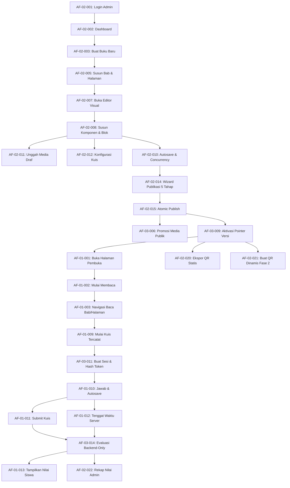

---

## 15. Asumsi dan Hal yang Memerlukan Klarifikasi Teknis

Meskipun alur kerja telah terdefinisi secara solid mengacu pada PRD terkunci, aspek teknis implementatif berikut dicatat untuk dirinci lebih lanjut pada dokumen arsitektur turunan (`INFORMATION_ARCHITECTURE.md`, `CORE_FEATURES.md`, `UI_UX_SPEC.md`, dan `DATABASE_ARCHITECTURE.md`):

1. **Format Payload Ceklis Validasi Wizard (Tahap 1–4):** Struktur representasi JSON untuk status Pass, Warning, dan Error per butir pemeriksaan akan distandarisasi pada dokumen `CORE_FEATURES.md`.
2. **Spesifikasi Skema Tabel Relasional Konseptual:** Nama tabel yang digunakan dalam dokumen ini (`books`, `draft_pages`, `book_versions`, `published_pages`, `activity_attempts`, `dynamic_qr_codes`, `private.grading_keys`, `private.audit_logs`) merupakan label konseptual yang konsisten dengan PRD dan akan dirumuskan secara formal dalam dokumen `DATABASE_ARCHITECTURE.md` dan `DATA_DICTIONARY.md`.
3. **Penyimpanan State Offline Sementara:** Penanganan antrean jawaban kuis lokal saat internet terputus akan diuraikan mendalam pada spesifikasi peramban di `UI_UX_SPEC.md`.

---

## 16. Checklist Validasi Dokumen

Pemeriksaan konsistensi internal dokumen `docs/APP_FLOW.md`:
- [x] Dokumen berstatus **APPROVED & LOCKED — DISETUJUI PEMILIK PROYEK**.
- [x] PRD terkunci (`v1.2.0-final-alignment`) dijadikan Single Source of Truth mutlak.
- [x] Seluruh 17 bagian utama tersusun lengkap tanpa ada yang terlewat.
- [x] Terdapat tepat 17 subflow Pembaca Publik (`AF-01-001` s/d `AF-01-017`).
- [x] Terdapat tepat 28 subflow Administrator (`AF-02-001` s/d `AF-02-028`).
- [x] Terdapat tepat 28 subflow Sistem Internal & Backend (`AF-03-001` s/d `AF-03-028`).
- [x] Total keseluruhan: **73 subflow unik** tanpa duplikasi identifier.
- [x] Seluruh 68 FR, 20 NFR, dan 28 AC dari PRD terpetakan 100% pada matriks keterlacakan.
- [x] Terdapat 16 diagram Mermaid yang telah diperiksa secara statis: alur global, reader, registrasi/kuis, ganti pembaca, login/dashboard, buku/editor, autosave/konflik, wizard, publish atomik, unpublish default/immediate block, emergency revoke, rollback, scoring backend, QR, retensi media, serta dependensi alur.
- [x] Seluruh keputusan terkunci Q1–Q5 dan A1–A12 dipertahankan tanpa penyimpangan.
- [x] Pembagian fase mengacu secara patuh pada §13 PRD.
- [x] Tidak ada source code, konfigurasi deployment, atau skema SQL final yang dibuat.

---

## 17. Status Akhir dan Permintaan Persetujuan

**STATUS DOKUMEN SAAT INI:**  
**APPROVED & LOCKED — DISETUJUI PEMILIK PROYEK**

Dokumen alur kerja ini telah disetujui sebagai baseline arsitektur FS-DOC-02 pada 18 November 2026.

*(Perubahan substantif berikutnya hanya dapat dilakukan melalui pengendalian versi dan persetujuan eksplisit Pemilik Proyek.)*
