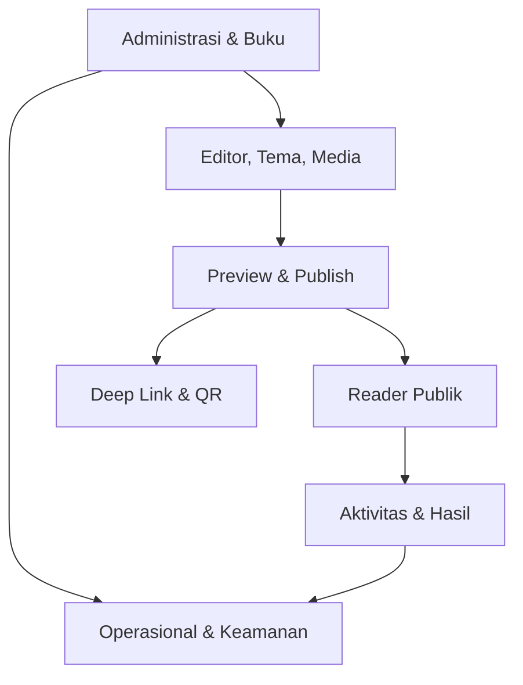

# SPESIFIKASI FITUR INTI (CORE FEATURES) — FLIPBOOK STUDIO

## CF-00 — Identitas dan Tata Kelola Dokumen

- **Proyek/Kode:** Flipbook Studio / FS-CORE
- **Nomor/Nama:** FS-DOC-04 / `docs/CORE_FEATURES.md`
- **Versi/Status:** `v1.0.1-approved-locked` / **APPROVED & LOCKED — DISETUJUI PEMILIK PROYEK**
- **Tanggal penyusunan:** 18 November 2026
- **Tanggal persetujuan:** 18 November 2026
- **Acuan terkunci:** FS-DOC-01 PRD, FS-DOC-02 APP_FLOW, FS-DOC-03 INFORMATION_ARCHITECTURE.
- **Ruang lingkup:** spesifikasi perilaku fitur, aturan, fase, dan keterlacakan; bukan kode, skema fisik, endpoint final, atau desain visual final.
- **Kebijakan perubahan:** dokumen dikunci berdasarkan persetujuan eksplisit pemilik proyek. Perubahan substantif berikutnya memerlukan persetujuan eksplisit pemilik proyek dan pengendalian versi. Detail yang belum terkunci tetap diberi label **BELUM DIPUTUSKAN** dan dicatat pada CF-17.

### Riwayat Revisi Terkendali

| CR | Tanggal | Dampak administratif | Versi |
|---|---|---|---|
| CR-IA-001 | 18 November 2026 | Menyelaraskan status IA-Q-001—IA-Q-004 sebagai keputusan pemilik; tanpa perubahan Feature ID, requirement, route, inventory, fase, atau acceptance criteria. | `v1.0.0-approved-locked` → `v1.0.1-revised-cr-ia-001` |
| CR-IA-001-RELOCK | 18 November 2026 | Penguncian kembali setelah audit konsistensi; tanpa perubahan fitur, requirement, route, inventory, fase, dependensi, atau acceptance criteria. | `v1.0.1-revised-cr-ia-001` → `v1.0.1-approved-locked` |

## CF-01 — Product Feature Overview

Produk menyediakan pembuatan banyak buku, draf relasional yang terpisah dari snapshot terbit immutable, Reader publik tanpa akun, dan aktivitas dengan server sebagai sumber kebenaran. Kemampuan internal—RLS, validasi, scoring, transaksi, retensi, audit, dan backup—mendukung fitur produk tetapi bukan halaman/role baru.

## CF-02 — Feature Catalog dan Penomoran

| ID | Fitur | Tujuan | Modul/Aktor | Fase/Prioritas | Status Keputusan Produk | PRD / Flow / Page-Route |
|---|---|---|---|---|---|---|
| CF-001 | Autentikasi admin | Melindungi akses privat | Admin | MVP / P0 | Terkunci | FR-ADM-001, FR-ADM-002; AF-02-001, AF-03-001; P-ADM-001, R-ADM-001 |
| CF-002 | Dashboard dan konfigurasi | Mengendalikan aplikasi | Admin | MVP / P1 | Terkunci | FR-ADM-003, FR-ADM-005; AF-02-002, AF-02-024; P-ADM-002, P-ADM-016 |
| CF-003 | Manajemen buku & struktur | Mengelola konten buku | Admin | MVP / P0 | Terkunci | FR-BOK-001, FR-BOK-002, FR-BOK-003, FR-BOK-004, FR-BOK-005, FR-BOK-006; AF-02-003, AF-02-004, AF-02-005, AF-02-006; P-ADM-003, P-ADM-004, P-ADM-005 |
| CF-004 | Editor & autosave konflik | Menyusun draf aman | Admin | MVP / P0 | Terkunci | FR-EDT-001, FR-EDT-002, FR-EDT-003, FR-EDT-004, FR-EDT-005, FR-EDT-006, FR-EDT-007, FR-EDT-008, FR-EDT-009; AF-02-007, AF-02-008, AF-02-009, AF-02-010; P-ADM-006, M-ADM-001 |
| CF-005 | Komponen, tema & media | Membentuk konten terkelola | Admin | MVP/Fase 2 / P0 | Terkunci | FR-CMP-001, FR-CMP-002, FR-CMP-003, FR-CMP-004, FR-THM-001, FR-THM-002, FR-THM-003, FR-THM-004, FR-THM-005, FR-MED-001, FR-MED-002, FR-MED-003; AF-02-008, AF-02-009, AF-02-011 |
| CF-006 | Aktivitas & assessment | Menilai aktivitas secara sah | Siswa/Sistem | MVP/Fase 2 / P0 | Terkunci | FR-ACT-001, FR-ACT-002, FR-ACT-003, FR-ACT-004, FR-ACT-005, FR-ACT-006, FR-ACT-007, FR-ACT-008; AF-01-009, AF-01-010, AF-01-011, AF-01-012, AF-01-013, AF-01-014; P-PUB-006, P-PUB-007, P-PUB-008, P-PUB-009 |
| CF-007 | Preview & test mode | Memeriksa draf terisolasi | Admin | MVP / P1 | Terkunci | FR-PRV-001, FR-PRV-002, FR-PRV-003; AF-02-013; P-ADM-009 |
| CF-008 | Wizard & publish atomik | Menerbitkan snapshot sah | Admin/Sistem | MVP / P0 | Terkunci | FR-PUB-001, FR-PUB-002, FR-PUB-003, FR-PUB-004; AF-02-014, AF-02-015; W-ADM-001 |
| CF-009 | Version lifecycle | Mengendalikan versi terbit | Admin/Sistem | MVP / P0 | Terkunci | FR-PUB-005, FR-PUB-006, FR-PUB-007, FR-PUB-008; AF-02-016, AF-02-017, AF-02-018, AF-02-019; P-ADM-011, M-ADM-002 |
| CF-010 | Reader adaptif & aksesibilitas | Membaca konten publik | Publik | MVP / P0 | Terkunci | FR-RDR-001, FR-RDR-002, FR-RDR-003, FR-RDR-004, FR-RDR-005, FR-RDR-006, FR-RDR-007, FR-RDR-008, FR-RDR-009; AF-01-001, AF-01-002, AF-01-003, AF-01-004, AF-01-005, AF-01-006, AF-01-007, AF-01-008, AF-01-015; P-PUB-001, P-PUB-002, D-PUB-001, D-PUB-002 |
| CF-011 | Deep link & QR | Membuka target stabil | Publik/Admin | MVP/Fase 2 / P1 | Terkunci | FR-LNK-001, FR-LNK-002, FR-LNK-003, FR-LNK-004, FR-LNK-005, FR-LNK-006, FR-LNK-007, FR-LNK-008; AF-01-004, AF-01-005, AF-01-006, AF-02-020, AF-02-021; R-PUB-001, R-PUB-002, R-PUB-003, R-PUB-004 |
| CF-012 | Results & reporting | Menyajikan hasil privat | Admin/Siswa | MVP/Fase 2 / P1 | Terkunci | FR-ACT-007, FR-ACT-008, FR-ADM-004; AF-01-013, AF-01-014, AF-02-022, AF-02-023; P-PUB-008, P-ADM-014 |
| CF-013 | Security & privacy controls | Menegakkan perlindungan data | Sistem | MVP / P0 | Terkunci | NFR-SEC-001, NFR-SEC-002, NFR-SEC-003, NFR-SEC-004, NFR-SEC-005, NFR-SEC-006, NFR-SEC-007; AF-03-001, AF-03-002, AF-03-024, AF-03-025 |
| CF-014 | Reliability & operations | Menjaga pemulihan dan biaya | Admin/Sistem | MVP/Fase 2 / P1 | Terkunci | NFR-REL-001, NFR-REL-002, NFR-REL-003, NFR-CST-001, NFR-CST-002; AF-02-025, AF-02-026, AF-02-027 |

**Makna status kolom:** `Terkunci` menunjukkan keputusan produk yang diwarisi dari FS-DOC-01, FS-DOC-02, dan FS-DOC-03. Istilah tersebut bukan persetujuan atau penguncian FS-DOC-04; dokumen ini tetap berstatus **DRAF**.

### Register spesifikasi minimum per fitur

| Feature | Precondition dan trigger | Input → output | Aturan, validasi, exception, security/privacy | Dependensi |
|---|---|---|---|---|
| CF-001 | Admin membuka route privat atau login | Kredensial → sesi sah/pesan aman | Frontend memulai login; backend mengotorisasi tiap akses. Sesi salah/kedaluwarsa ditolak tanpa data privat. | CF-013 |
| CF-002 | Sesi admin sah; dashboard/pengaturan dibuka | Preferensi sah → ringkasan atau konfigurasi tersimpan | Validasi sebelum simpan; hanya satu admin. Gagal simpan mempertahankan nilai sebelumnya. | CF-001, CF-014 |
| CF-003 | Admin sah memilih buku/struktur | Metadata atau operasi struktur → draf terbarui | UUID stabil; slug unik; hapus draf tidak menghapus riwayat. Struktur/slug salah ditolak di form. | CF-001 |
| CF-004 | Draf buku tersedia; admin mengubah canvas | Mutasi + `expected revision` → draf tersimpan/konflik | CAS; tidak ada silent overwrite; konflik struktural diselesaikan manual. | CF-003, CF-013 |
| CF-005 | Draf editor tersedia | Properti, tema, media → komponen/media tervalidasi | Sanitasi, allowlist, batas nesting tiga; media snapshot/sesi tak dapat dihapus. Gagal unggah/verifikasi memblokir publish. | CF-004, CF-013 |
| CF-006 | Aktivitas terbit dan sesi sah | Nama/kelas minimum, jawaban → status A/B/C atau penolakan | Timer, deadline, scoring, finalisasi **server-only**; token mentah tidak disimpan. Jawaban lewat deadline ditolak. | CF-005, CF-009, CF-013 |
| CF-007 | Draf tersedia | Mode/viewport → preview terisolasi | Test mode tidak menulis hasil siswa; preview bukan snapshot terbit. | CF-004 |
| CF-008 | Admin sah memulai wizard | Konfigurasi dan konfirmasi → snapshot aktif/gagal aman | Error memblokir; draf berubah wajib validasi ulang; transaksi atomik/idempoten menjaga versi aktif saat gagal. | CF-003, CF-005, CF-013 |
| CF-009 | Versi terbit tersedia | Aksi lifecycle → pointer/status terkontrol | Snapshot immutable; revoke memblokir gateway tanpa nilai nol; rollback memverifikasi media. Semua tindakan diaudit. | CF-008, CF-006 |
| CF-010 | Buku/versi publik tersedia | Navigasi atau preferensi lokal → Reader/fallback sesuai | Konten hilang/tidak tersedia memberi pilihan jelas; media tidak autoplay; preferensi lokal, aksesibel, tanpa akun. | CF-008, CF-009 |
| CF-011 | Target buku/halaman/aktivitas sah | URL/target QR → link/QR atau penolakan | Stable ID dan alias; target QR dinamis harus internal, aktif, bukan siklus/eksternal. Analitik tidak mengidentifikasi siswa. | CF-003, CF-010 |
| CF-012 | Sesi aktivitas atau admin sah | Permintaan hasil/filter → hasil yang diizinkan | Disclosure policy dan akses admin membatasi data. Retry tidak menimpa nilai lama; analitik QR agregat saja. | CF-006, CF-013 |
| CF-013 | Request ke data/fungsi privat | Konteks otorisasi → izin/penolakan teraudit | RLS default deny, validasi, rate limit, allowlist; service role dan token siswa mentah tidak bocor. | — |
| CF-014 | Operasi publish/data berjalan | Sinyal kuota/backup/restore → status atau pemulihan | Backup/restore diuji saat implementasi; gagal/kuota kritis tidak memutasi diam-diam atau menaikkan biaya otomatis. | CF-008, CF-009, CF-013 |

## CF-03 — Authentication dan Administrator

**CF-001.** Tujuan: memberi satu administrator akses terautentikasi tanpa mengekspos data privat. Trigger: membuka route admin atau mengirim kredensial. Input: email/kata sandi; output: sesi sah atau pesan aman. Backend memvalidasi JWT, expiry, dan profil admin sebelum operasi privat. Logout/kedaluwarsa menolak request berikutnya dan membawa pengguna ke login; state draf sementara hanya dipertahankan lokal bila tersedia. Error kredensial tidak mengungkap eksistensi akun. Dependensi: CF-013. Kriteria: *Given* kredensial sah, *when* login, *then* dashboard terbuka; kredensial/sesi salah ditolak deterministik (AC-ADM-001).

**CF-002.** Dashboard menampilkan ringkasan buku, riwayat relevan, kuota, dan pintasan; pengaturan aplikasi mengelola preferensi/allowlist yang didukung. Input perubahan divalidasi sebelum simpan. Tidak ada role administrator kedua. Navigasi admin mengikuti keputusan IA-Q-001 melalui CR-IA-001: sidebar hierarkis dan URL stabil tanpa route baru.

## CF-04 — Book Management

**CF-003.** Admin membuat buku, menyunting metadata/slug, membuat halaman mandiri atau Bab > Halaman, lalu memindah, mengurut, menggandakan, mengarsip, atau menghapus secara aman. UUID buku/bab/halaman/komponen/aktivitas stabil; pindah/urut mempertahankan ID, duplikasi menghasilkan ID baru. Slug publik terpisah dan alias lama mendukung redirect. Kedalaman buku maksimum dua tingkat; daftar isi berasal dari struktur sah. Penghapusan draf tidak menghapus snapshot/hasil historis. Error struktur/slug tetap pada konteks form dan tidak mengubah versi terbit.

## CF-05 — Visual Editor

**CF-004.** Editor memiliki toolbar, panel struktur/pustaka, canvas, dan inspektor lima tab. Mode Blok adalah MVP; grid responsif terbatas adalah Fase 2. Input perubahan draf memakai autosave debounce dan `expected revision`; backend compare-and-swap menerima revisi cocok atau membuka resolusi visual. Auto-merge hanya untuk bidang non-struktural yang tidak bertabrakan; operasi struktur diselesaikan manual. Undo/redo mengikuti titik revisi tersimpan. Tidak ada freehand canvas atau silent overwrite. Kriteria: tab stale yang menyimpan revisi lama ditolak dan diberi dialog konflik (AC-EDT-002, AC-EDT-003).

## CF-06 — Component, Theme, dan Media Management

**CF-005.** Pustaka komponen menyediakan konten, media, layout, dan interaktif sesuai PRD. Tema mengalir Buku → Halaman → Komponen; token induk dipakai bila tidak dioverride, dan reset override tersedia. Preset MVP: Minimal/Alam; Samudra/Hangat sesuai fase PRD. Rich text disanitasi, embed hanya domain allowlist, nesting container maksimum tiga tingkat. Media draf privat diunggah dengan validasi tipe/ukuran **BELUM DIPUTUSKAN** secara kuantitatif; deduplikasi hash dan referensi diproses backend. Media yang dirujuk snapshot/sesi tidak dapat dihapus; media terbit diverifikasi immutable sebelum publish. Error unggah/verifikasi memblokir publish terkait.

## CF-07 — Interactive Activities dan Assessment

**CF-006.** MVP mendukung kuis dasar yang dikonfigurasi admin; siswa mengisi nama/kelas hanya saat mulai aktivitas. Browser menghasilkan token CSPRNG, server hanya menyimpan hash. Jawaban memperoleh Status A setelah konfirmasi server, B saat masih volatile/menunggu, atau C bila server menolak—termasuk melewati tenggat UTC. Timer, finalisasi, dan penilaian adalah **server-only**; jawaban terakhir yang sah dinilai idempoten pada backend private, tanpa kunci/bobot di payload publik. Disclosure policy menyaring hasil. MVP satu percobaan; multi-attempt, agregasi, dan retry grant sekali pakai adalah Fase 2. Kriteria: pengiriman finalisasi berulang dengan key sama menghasilkan satu nilai (AC-ACT-005).

## CF-08 — Preview dan Testing Mode

**CF-007.** Quick Preview beralih di canvas; fullscreen memakai renderer Reader serta viewport desktop/tablet/mobile. Test mode diverifikasi backend dan tidak menulis hasil siswa. Preview tidak menggantikan snapshot terbit dan tidak membuktikan performa produksi.

## CF-09 — Publishing dan Version Management

**CF-008.** Wizard lima tahap memeriksa konten, aktivitas, tampilan/tema, pengaturan, dan konfirmasi. Error memblokir; draf yang berubah setelah validasi wajib divalidasi ulang. Backend merakit snapshot immutable, memverifikasi/promosikan media, lalu mengaktifkan pointer dan audit dalam transaksi atomik/idempoten. Kegagalan menjaga versi aktif sebelumnya. Pengukuran publish <3 detik adalah target pengujian PRD, bukan bukti capaian.

**CF-009.** Sesi aktivitas dipatok ke activity version asal. Unpublish default menolak sesi baru dan memberi grace period sesi aktif; immediate block menghentikan mutasi segera. Emergency Revoke memblokir gateway tanpa memberi nilai nol otomatis. Rollback memverifikasi media target lalu mengalihkan pointer atomik; snapshot historis tidak ditimpa. Semua tindakan kritis diaudit.

## CF-10 — Public Reader dan Flipbook

**CF-010.** Sampul luar memisahkan masuk buku dari isi. Reader memakai flipbook dua halaman desktop hanya bila konten sesuai, fallback scroll untuk konten panjang/interaktif, dan satu kolom mobile. TOC, deep link stable ID, progres lokal, browser navigation, dan Ganti Pembaca tersedia. Preferensi font/kontras/reduced motion disimpan lokal. Media tidak autoplay saat buka/pindah halaman; aksi pembaca, keyboard, dan label aksesibel diperlukan. Target FCP <2,5 detik dicatat sebagai pengujian implementasi, bukan capaian saat ini. Halaman hilang menawarkan pilihan eksplisit; unpublish/revoke menyembunyikan konten.

## CF-11 — QR Code dan Deep Linking

**CF-011.** URL buku/halaman/aktivitas memakai slug dan stable ID. Alias slug lama redirect ke slug sah; halaman hilang tidak silent redirect. QR statis MVP mengekspor URL buku dalam PNG/SVG. QR dinamis Fase 2 hanya menuju target internal terbit, menolak domain eksternal/siklus/status tidak aktif, mencatat audit perubahan, dan menghitung agregat harian Asia/Jakarta tanpa IP, GPS, fingerprint, atau identitas siswa.

## CF-12 — Results, Reporting, dan Analytics

**CF-012.** Siswa melihat hasil sesuai disclosure policy; admin melihat rekap aktivitas melalui area terlindungi. Retry grant Fase 2 berasal dari hasil percobaan tertentu dan tidak menimpa nilai lama. Analitik QR hanya aggregate count; tidak ada pelacakan identitas tersembunyi, profil siswa, atau analitik invasif.

## CF-13 — Operational, Security, dan Reliability Features

**CF-013.** RLS default deny, JWT/otorisasi backend, rate limit berlapis, sanitasi, allowlist, search path aman, dan audit menjaga data. HTTPS/TLS serta enkripsi at-rest/backup wajib diverifikasi saat implementasi; dokumen tidak menyatakan konfigurasi layanan sudah terbukti. Token siswa mentah dan service role tidak masuk browser/database publik.

**CF-014.** Publish/unpublish/rollback atomik, idempotency aktivitas, backup database+media, restore test, retensi snapshot/media, monitoring kuota, dan larangan upgrade biaya otomatis mendukung keandalan. Backup gagal atau kuota kritis memberi status/pemulihan operasional, bukan mutasi diam-diam.

## CF-14 — Feature Dependencies

Dependensi dipecah menurut makna agar lifecycle aktivitas tidak salah dibaca sebagai prasyarat pembangunan assessment. **Implementasi** menyatakan urutan membangun kemampuan dan harus acyclic. **Runtime** menyatakan layanan yang dipakai ketika fitur berjalan. **Data** menyatakan snapshot/versi yang dibaca atau dipatok saat operasi; bukan edge pembangunan.

### Dependensi implementasi

| Feature | Prasyarat implementasi | Dampak bila belum tersedia | Fase |
|---|---|---|---|
| CF-002 | CF-001 | Dashboard privat belum dapat diakses | MVP |
| CF-003 | CF-001 | Buku draf tidak dapat dikelola | MVP |
| CF-004 | CF-003 | Editor tidak memiliki draf/struktur | MVP |
| CF-005 | CF-004 | Komponen, tema, dan media tidak dapat dikonfigurasi | MVP/Fase 2 |
| CF-006 | CF-005 | Aktivitas tidak dapat dikonfigurasi | MVP/Fase 2 |
| CF-007 | CF-004 | Preview draf tidak tersedia | MVP |
| CF-008 | CF-003, CF-005 | Snapshot tidak dapat dirakit | MVP |
| CF-009 | CF-008 | Lifecycle versi terbit tidak tersedia | MVP |
| CF-010 | CF-008 | Reader tidak memiliki snapshot publik | MVP |
| CF-011 | CF-003, CF-010 | Link/QR tidak dapat menyelesaikan target terbit | MVP/Fase 2 |
| CF-012 | CF-006 | Hasil aktivitas tidak dapat disajikan | MVP/Fase 2 |
| CF-013 | — | Kontrol lintas fitur harus dibangun bersama setiap fitur privat | MVP |
| CF-014 | CF-008, CF-009 | Operasi pemulihan versi tidak dapat dipantau | MVP/Fase 2 |

Graf implementasi: **15 relasi** (satu relasi = satu pasangan Feature → prasyarat), acyclic. CF-013 adalah kontrol fondasi lintas fitur, bukan prasyarat graf yang menciptakan edge balik.

### Dependensi runtime

| Feature | Layanan/mekanisme runtime | Keterangan |
|---|---|---|
| CF-002, CF-003, CF-004, CF-005, CF-008, CF-009, CF-012 | CF-001, CF-013 | Sesi admin dan otorisasi backend/RLS untuk operasi privat. |
| CF-006 | CF-013 | Token hash, backend privat, timer UTC, scoring server-only. |
| CF-010, CF-011 | CF-009 | Status/pointer versi menentukan ketersediaan target publik. |
| CF-012 | CF-006, CF-013 | Hasil sah dan disclosure policy sebelum data ditampilkan. |
| CF-014 | CF-013 | Audit, kontrol akses, dan perlindungan backup/pemulihan. |

Graf runtime: **20 relasi** (satu relasi = satu pasangan Feature → mekanisme runtime).

### Dependensi data

| Konsumen | Data/versi yang diperlukan | Penyedia | Keterangan |
|---|---|---|---|
| CF-006 | Konfigurasi aktivitas dari snapshot/version | CF-009 | Sesi aktivitas dipatok ke activity version asal. |
| CF-009 | Sesi aktivitas yang dipatok | CF-006 | Unpublish/grace/immediate block mengevaluasi sesi tanpa membentuk dependensi implementasi balik. |
| CF-010 | Snapshot aktif dan status publik | CF-008, CF-009 | Reader hanya merender versi yang tersedia. |
| CF-011 | Slug, stable ID, dan status target | CF-003, CF-009 | QR/deep link tidak boleh bypass status. |
| CF-012 | Hasil tervalidasi dan disclosure policy | CF-006 | Riwayat nilai tidak ditimpa retry grant. |

Graf data: **7 relasi** (satu relasi = satu pasangan konsumen → penyedia). CF-006 ↔ CF-009 hanya hubungan data dua arah yang disengaja; tidak termasuk graf implementasi.

## CF-15 — Feature Acceptance Criteria

Kriteria berikut adalah turunan teknis; ID `CF-AC-*` tidak mengubah maupun menggantikan AC PRD.

| ID | Feature | AC PRD terkait | Kriteria Given–When–Then |
|---|---|---|---|
| CF-AC-001 | CF-001 | AC-ADM-001 | Given kredensial sah, when login dikirim, then sesi admin sah dibuka. |
| CF-AC-002 | CF-001 | AC-ADM-001 | Given kredensial atau sesi tidak sah, when rute privat diminta, then backend menolak tanpa data privat. |
| CF-AC-003 | CF-002 | AC-CST-001 | Given admin sah, when dashboard dibuka, then ringkasan dan indikator kuota ditampilkan tanpa upgrade otomatis. |
| CF-AC-004 | CF-003 | AC-BOK-001 | Given halaman dipindah/diurutkan, when struktur disimpan, then stable UUID tidak berubah. |
| CF-AC-005 | CF-003 | AC-LNK-003 | Given deep link ke halaman hilang, when Reader membukanya, then pilihan eksplisit ditampilkan tanpa redirect diam-diam. |
| CF-AC-006 | CF-004 | AC-EDT-002 | Given revisi stale, when autosave dikirim, then konflik tampil tanpa overwrite. |
| CF-AC-007 | CF-004 | AC-EDT-001, AC-EDT-003 | Given nesting melebihi tiga atau CAS lama, when disimpan, then backend menolak perubahan. |
| CF-AC-008 | CF-005 | AC-MED-001 | Given media dirujuk snapshot/sesi, when hapus diminta, then penghapusan ditolak. |
| CF-AC-009 | CF-005 | — | Given tipe/ukuran media tidak valid, when unggah dilakukan, then media ditolak dan tidak dapat dipromosikan. |
| CF-AC-010 | CF-006 | AC-ACT-002, AC-ACT-004 | Given jawaban setelah deadline UTC, when server menerima, then jawaban ditolak dan hanya jawaban sah dipakai. |
| CF-AC-011 | CF-006 | AC-ACT-005 | Given finalisasi berulang dengan idempotency key sama, when diproses, then hanya satu penilaian dibuat. |
| CF-AC-012 | CF-006 | AC-ACT-001 | Given siswa membuka bundle publik, when aktivitas dimulai, then kunci/bobot tidak dikirim dan scoring tetap server-only. |
| CF-AC-013 | CF-007 | — | Given test mode, when aktivitas disubmit, then hasil siswa asli tidak berubah. |
| CF-AC-014 | CF-008 | AC-PUB-001 | Given wizard memiliki Error, when admin mengonfirmasi, then publish diblokir. |
| CF-AC-015 | CF-008 | AC-PUB-002 | Given transaksi publish gagal, when rollback internal selesai, then pointer aktif sebelumnya tetap berlaku. |
| CF-AC-016 | CF-009 | — | Given snapshot aktif, when draf berubah, then snapshot historis tetap immutable. |
| CF-AC-017 | CF-009 | AC-PUB-003, AC-PUB-004 | Given unpublish default/immediate/revoke, when akses terjadi, then grace atau blok berlaku sesuai aksi tanpa nilai nol otomatis. |
| CF-AC-018 | CF-009 | AC-PUB-005 | Given rollback diminta, when media target lolos verifikasi, then pointer beralih atomik. |
| CF-AC-019 | CF-010 | AC-RDR-002 | Given Reader membuka media/halaman, when pembaca belum bertindak, then media tidak autoplay. |
| CF-AC-020 | CF-010 | AC-RDR-001 | Given Reader dioperasikan dengan keyboard, when TOC atau kontrol dibuka, then kontrol dapat diakses dengan label dan fokus yang sesuai. |
| CF-AC-021 | CF-011 | AC-LNK-003 | Given target deep link hilang, when URL diresolusikan, then pembaca menerima pilihan eksplisit. |
| CF-AC-022 | CF-011 | AC-LNK-002, AC-LNK-004 | Given QR dinamis menunjuk target eksternal atau siklus, when disimpan, then backend menolak. |
| CF-AC-023 | CF-012 | AC-ACT-003 | Given hasil tertutup, when siswa melihat hasil, then pembahasan/kunci tidak terkirim; retry sah tidak menimpa nilai lama. |
| CF-AC-024 | CF-013 | AC-SEC-001 | Given anon meminta draf, when RLS diproses, then akses ditolak tanpa kebocoran. |
| CF-AC-025 | CF-014 | AC-REL-001 | Given restore test, when arsip database/media dipulihkan, then referensi media dapat diverifikasi. |
| CF-AC-026 | CF-014 | AC-CST-001 | Given kuota kritis, when monitoring mengevaluasi ambang, then peringatan/pemulihan muncul tanpa mutasi diam-diam atau biaya otomatis. |

## CF-16 — Traceability dan Coverage Audit

Register berikut mengaudit setiap requirement individual terhadap baseline FS-DOC-02 §12.3. `Langsung` berarti requirement memiliki pemilik fitur utama; `Lintas fitur` berarti pemenuhan juga menuntut fitur atau mekanisme pendukung. Status ini tidak membuktikan implementasi maupun pengujian aplikasi.

| Requirement ID | Kategori | Pemilik utama | Pendukung | Flow ID terkait | Status pemetaan | Catatan |
|---|---|---|---|---|---|---|
| FR-ADM-001 | FR | CF-001 | — | AF-02-001, AF-03-001 | Langsung | Baseline FS-DOC-02 §12.3. |
| FR-ADM-002 | FR | CF-013 | CF-001 | AF-03-001, AF-03-024 | Lintas fitur | Baseline FS-DOC-02 §12.3. |
| FR-ADM-003 | FR | CF-002 | — | AF-02-002, AF-02-025, AF-03-028 | Lintas fitur | Baseline FS-DOC-02 §12.3. |
| FR-ADM-004 | FR | CF-012 | CF-008, CF-009, CF-013 | AF-02-015, AF-02-017, AF-02-018, AF-02-019, AF-02-021, AF-02-023, AF-03-025 | Lintas fitur | Baseline FS-DOC-02 §12.3. |
| FR-ADM-005 | FR | CF-002 | — | AF-02-024 | Langsung | Baseline FS-DOC-02 §12.3. |
| FR-BOK-001 | FR | CF-003 | — | AF-02-003, AF-02-004, AF-02-028 | Lintas fitur | Baseline FS-DOC-02 §12.3. |
| FR-BOK-002 | FR | CF-003 | — | AF-02-003, AF-02-005, AF-02-006 | Lintas fitur | Baseline FS-DOC-02 §12.3. |
| FR-BOK-003 | FR | CF-003 | — | AF-02-003, AF-02-004 | Lintas fitur | Baseline FS-DOC-02 §12.3. |
| FR-BOK-004 | FR | CF-003 | — | AF-02-005 | Langsung | Baseline FS-DOC-02 §12.3. |
| FR-BOK-005 | FR | CF-003 | — | AF-02-006 | Langsung | Baseline FS-DOC-02 §12.3. |
| FR-BOK-006 | FR | CF-003 | CF-010 | AF-01-003, AF-02-005 | Lintas fitur | Baseline FS-DOC-02 §12.3. |
| FR-EDT-001 | FR | CF-004 | — | AF-02-007 | Langsung | Baseline FS-DOC-02 §12.3. |
| FR-EDT-002 | FR | CF-004 | — | AF-02-007 | Langsung | Baseline FS-DOC-02 §12.3. |
| FR-EDT-003 | FR | CF-004 | — | AF-02-008 | Langsung | Baseline FS-DOC-02 §12.3. |
| FR-EDT-004 | FR | CF-004 | — | AF-02-008 | Langsung | Baseline FS-DOC-02 §12.3. |
| FR-EDT-005 | FR | CF-004 | CF-013 | AF-02-008, AF-03-004 | Lintas fitur | Baseline FS-DOC-02 §12.3. |
| FR-EDT-006 | FR | CF-004 | — | AF-02-009 | Langsung | Baseline FS-DOC-02 §12.3. |
| FR-EDT-007 | FR | CF-004 | — | AF-02-010, AF-03-003 | Lintas fitur | Baseline FS-DOC-02 §12.3. |
| FR-EDT-008 | FR | CF-004 | — | AF-02-010 | Langsung | Baseline FS-DOC-02 §12.3. |
| FR-EDT-009 | FR | CF-004 | CF-013 | AF-02-024, AF-03-004 | Lintas fitur | Baseline FS-DOC-02 §12.3. |
| FR-CMP-001 | FR | CF-005 | — | AF-02-008 | Langsung | Baseline FS-DOC-02 §12.3. |
| FR-CMP-002 | FR | CF-005 | — | AF-02-011 | Langsung | Baseline FS-DOC-02 §12.3. |
| FR-CMP-003 | FR | CF-005 | — | AF-02-008 | Langsung | Baseline FS-DOC-02 §12.3. |
| FR-CMP-004 | FR | CF-005 | — | AF-02-012 | Langsung | Baseline FS-DOC-02 §12.3. |
| FR-THM-001 | FR | CF-005 | — | AF-02-009 | Langsung | Baseline FS-DOC-02 §12.3. |
| FR-THM-002 | FR | CF-005 | — | AF-02-009 | Langsung | Baseline FS-DOC-02 §12.3. |
| FR-THM-003 | FR | CF-005 | — | AF-02-009 | Langsung | Baseline FS-DOC-02 §12.3. |
| FR-THM-004 | FR | CF-005 | — | AF-02-009 | Langsung | Baseline FS-DOC-02 §12.3. |
| FR-THM-005 | FR | CF-005 | CF-009 | AF-02-016 | Langsung | Baseline FS-DOC-02 §12.3. |
| FR-PRV-001 | FR | CF-007 | — | AF-02-013 | Langsung | Baseline FS-DOC-02 §12.3. |
| FR-PRV-002 | FR | CF-007 | — | AF-02-013 | Langsung | Baseline FS-DOC-02 §12.3. |
| FR-PRV-003 | FR | CF-007 | — | AF-02-013 | Langsung | Baseline FS-DOC-02 §12.3. |
| FR-PUB-001 | FR | CF-008 | — | AF-02-014, AF-03-007 | Lintas fitur | Baseline FS-DOC-02 §12.3. |
| FR-PUB-002 | FR | CF-008 | — | AF-02-014, AF-03-007 | Lintas fitur | Baseline FS-DOC-02 §12.3. |
| FR-PUB-003 | FR | CF-008 | CF-005 | AF-02-015, AF-03-006, AF-03-008 | Lintas fitur | Baseline FS-DOC-02 §12.3. |
| FR-PUB-004 | FR | CF-008 | CF-005 | AF-02-015, AF-03-009 | Lintas fitur | Baseline FS-DOC-02 §12.3. |
| FR-PUB-005 | FR | CF-009 | CF-006 | AF-02-016, AF-03-011, AF-03-015 | Lintas fitur | Baseline FS-DOC-02 §12.3. |
| FR-PUB-006 | FR | CF-009 | — | AF-02-017, AF-03-018, AF-03-019 | Lintas fitur | Baseline FS-DOC-02 §12.3. |
| FR-PUB-007 | FR | CF-009 | — | AF-02-018, AF-03-020 | Lintas fitur | Baseline FS-DOC-02 §12.3. |
| FR-PUB-008 | FR | CF-009 | — | AF-02-019, AF-03-021 | Lintas fitur | Baseline FS-DOC-02 §12.3. |
| FR-RDR-001 | FR | CF-010 | — | AF-01-001, AF-01-002 | Lintas fitur | Baseline FS-DOC-02 §12.3. |
| FR-RDR-002 | FR | CF-010 | — | AF-01-001, AF-01-002 | Lintas fitur | Baseline FS-DOC-02 §12.3. |
| FR-RDR-003 | FR | CF-010 | — | AF-01-003, AF-01-007 | Lintas fitur | Baseline FS-DOC-02 §12.3. |
| FR-RDR-004 | FR | CF-010 | — | AF-01-007 | Langsung | Baseline FS-DOC-02 §12.3. |
| FR-RDR-005 | FR | CF-010 | — | AF-01-003 | Langsung | Baseline FS-DOC-02 §12.3. |
| FR-RDR-006 | FR | CF-010 | — | AF-01-001, AF-01-002 | Lintas fitur | Baseline FS-DOC-02 §12.3. |
| FR-RDR-007 | FR | CF-010 | — | AF-01-008 | Langsung | Baseline FS-DOC-02 §12.3. |
| FR-RDR-008 | FR | CF-010 | CF-013 | AF-01-007, AF-01-008 | Lintas fitur | Baseline FS-DOC-02 §12.3. |
| FR-RDR-009 | FR | CF-010 | — | AF-01-015 | Langsung | Baseline FS-DOC-02 §12.3. |
| FR-ACT-001 | FR | CF-006 | — | AF-01-009, AF-03-011 | Lintas fitur | Baseline FS-DOC-02 §12.3. |
| FR-ACT-002 | FR | CF-006 | — | AF-01-009, AF-03-011, AF-03-012 | Lintas fitur | Baseline FS-DOC-02 §12.3. |
| FR-ACT-003 | FR | CF-006 | — | AF-01-011, AF-03-014, AF-03-016 | Lintas fitur | Baseline FS-DOC-02 §12.3. |
| FR-ACT-004 | FR | CF-006 | — | AF-02-012, AF-01-014, AF-02-023, AF-03-017 | Lintas fitur | Baseline FS-DOC-02 §12.3. |
| FR-ACT-005 | FR | CF-006 | — | AF-01-010, AF-01-012, AF-03-013, AF-03-014 | Lintas fitur | Baseline FS-DOC-02 §12.3. |
| FR-ACT-006 | FR | CF-006 | — | AF-01-010, AF-01-011, AF-03-012 | Lintas fitur | Baseline FS-DOC-02 §12.3. |
| FR-ACT-007 | FR | CF-012 | CF-006 | AF-02-012, AF-01-013, AF-03-016 | Lintas fitur | Baseline FS-DOC-02 §12.3. |
| FR-ACT-008 | FR | CF-012 | CF-006 | AF-01-014, AF-02-023, AF-03-017 | Lintas fitur | Baseline FS-DOC-02 §12.3. |
| FR-LNK-001 | FR | CF-011 | — | AF-01-001, AF-01-004, AF-01-006 | Lintas fitur | Baseline FS-DOC-02 §12.3. |
| FR-LNK-002 | FR | CF-011 | — | AF-02-004, AF-03-010 | Lintas fitur | Baseline FS-DOC-02 §12.3. |
| FR-LNK-003 | FR | CF-011 | — | AF-01-004, AF-01-016 | Lintas fitur | Baseline FS-DOC-02 §12.3. |
| FR-LNK-004 | FR | CF-011 | — | AF-01-005, AF-02-020 | Lintas fitur | Baseline FS-DOC-02 §12.3. |
| FR-LNK-005 | FR | CF-011 | — | AF-01-006, AF-02-021, AF-03-022 | Lintas fitur | Baseline FS-DOC-02 §12.3. |
| FR-LNK-006 | FR | CF-011 | — | AF-02-021, AF-03-022 | Lintas fitur | Baseline FS-DOC-02 §12.3. |
| FR-LNK-007 | FR | CF-011 | — | AF-02-020 | Langsung | Baseline FS-DOC-02 §12.3. |
| FR-LNK-008 | FR | CF-011 | — | AF-01-006, AF-03-023 | Lintas fitur | Baseline FS-DOC-02 §12.3. |
| FR-MED-001 | FR | CF-005 | — | AF-02-011, AF-03-005, AF-03-006 | Lintas fitur | Baseline FS-DOC-02 §12.3. |
| FR-MED-002 | FR | CF-005 | — | AF-02-011, AF-03-006 | Lintas fitur | Baseline FS-DOC-02 §12.3. |
| FR-MED-003 | FR | CF-005 | — | AF-02-028, AF-03-026 | Lintas fitur | Baseline FS-DOC-02 §12.3. |
| NFR-PERF-001 | NFR | CF-010 | CF-014 | AF-01-001 | Langsung | Baseline FS-DOC-02 §12.3. |
| NFR-PERF-002 | NFR | CF-004 | CF-014 | AF-02-010 | Langsung | Baseline FS-DOC-02 §12.3. |
| NFR-PERF-003 | NFR | CF-011 | CF-014 | AF-01-006, AF-03-022 | Lintas fitur | Baseline FS-DOC-02 §12.3. |
| NFR-PERF-004 | NFR | CF-008 | CF-014 | AF-02-015, AF-03-006, AF-03-008, AF-03-009 | Lintas fitur | Baseline FS-DOC-02 §12.3. |
| NFR-SEC-001 | NFR | CF-013 | CF-001, CF-004, CF-006, CF-008, CF-009, CF-012 | AF-03-002, AF-03-024 | Lintas fitur | Baseline FS-DOC-02 §12.3. |
| NFR-SEC-002 | NFR | CF-013 | CF-001, CF-004, CF-006, CF-008, CF-009, CF-012 | AF-03-001, AF-03-014 | Lintas fitur | Baseline FS-DOC-02 §12.3. |
| NFR-SEC-003 | NFR | CF-013 | CF-001, CF-004, CF-006, CF-008, CF-009, CF-012 | AF-03-001, AF-03-005, AF-03-027 | Lintas fitur | Baseline FS-DOC-02 §12.3. |
| NFR-SEC-004 | NFR | CF-013 | CF-001, CF-004, CF-006, CF-008, CF-009, CF-012 | AF-03-014, AF-03-016, AF-03-025 | Lintas fitur | Baseline FS-DOC-02 §12.3. |
| NFR-SEC-005 | NFR | CF-013 | CF-001, CF-004, CF-006, CF-008, CF-009, CF-012 | AF-03-004 | Langsung | Baseline FS-DOC-02 §12.3. |
| NFR-SEC-006 | NFR | CF-013 | CF-001, CF-004, CF-006, CF-008, CF-009, CF-012 | AF-03-024 | Langsung | Baseline FS-DOC-02 §12.3. |
| NFR-SEC-007 | NFR | CF-013 | CF-001, CF-004, CF-006, CF-008, CF-009, CF-012 | AF-03-024 | Langsung | Baseline FS-DOC-02 §12.3. |
| NFR-ACC-001 | NFR | CF-010 | CF-004, CF-008 | AF-01-008, AF-02-014 | Lintas fitur | Baseline FS-DOC-02 §12.3. |
| NFR-ACC-002 | NFR | CF-010 | CF-004, CF-008 | AF-01-008 | Langsung | Baseline FS-DOC-02 §12.3. |
| NFR-ACC-003 | NFR | CF-010 | CF-004, CF-008 | AF-01-007 | Langsung | Baseline FS-DOC-02 §12.3. |
| NFR-ACC-004 | NFR | CF-010 | CF-004, CF-008 | AF-02-009, AF-02-014 | Lintas fitur | Baseline FS-DOC-02 §12.3. |
| NFR-REL-001 | NFR | CF-014 | CF-008, CF-009 | AF-02-015, AF-02-017, AF-02-019, AF-03-009, AF-03-018, AF-03-021 | Lintas fitur | Baseline FS-DOC-02 §12.3. |
| NFR-REL-002 | NFR | CF-014 | CF-008, CF-009 | AF-01-010, AF-01-011, AF-03-012, AF-03-014 | Lintas fitur | Baseline FS-DOC-02 §12.3. |
| NFR-REL-003 | NFR | CF-014 | — | AF-02-026, AF-03-027 | Lintas fitur | Baseline FS-DOC-02 §12.3. |
| NFR-CST-001 | NFR | CF-014 | — | AF-02-025, AF-03-028 | Lintas fitur | Baseline FS-DOC-02 §12.3. |
| NFR-CST-002 | NFR | CF-014 | — | AF-02-025 | Langsung | Baseline FS-DOC-02 §12.3. |
| AC-ADM-001 | AC | CF-001 | — | AF-02-001, AF-02-027, AF-03-001 | Lintas fitur | Baseline FS-DOC-02 §12.3. |
| AC-BOK-001 | AC | CF-003 | — | AF-02-005, AF-02-006 | Lintas fitur | Baseline FS-DOC-02 §12.3. |
| AC-EDT-001 | AC | CF-004 | — | AF-02-008, AF-03-004 | Lintas fitur | Baseline FS-DOC-02 §12.3. |
| AC-EDT-002 | AC | CF-004 | — | AF-02-010, AF-03-003 | Lintas fitur | Baseline FS-DOC-02 §12.3. |
| AC-PUB-001 | AC | CF-008 | CF-013 | AF-02-014, AF-03-007 | Lintas fitur | Baseline FS-DOC-02 §12.3. |
| AC-PUB-002 | AC | CF-008 | CF-013 | AF-02-015, AF-03-009 | Lintas fitur | Baseline FS-DOC-02 §12.3. |
| AC-RDR-001 | AC | CF-010 | CF-011 | AF-01-001 | Langsung | Baseline FS-DOC-02 §12.3. |
| AC-RDR-002 | AC | CF-010 | CF-011 | AF-01-003, AF-01-007 | Lintas fitur | Baseline FS-DOC-02 §12.3. |
| AC-ACT-001 | AC | CF-006 | CF-012 | AF-01-009, AF-03-011, AF-03-014, AF-03-016 | Lintas fitur | Baseline FS-DOC-02 §12.3. |
| AC-ACT-002 | AC | CF-006 | CF-012 | AF-01-012, AF-03-013, AF-03-014 | Lintas fitur | Baseline FS-DOC-02 §12.3. |
| AC-LNK-001 | AC | CF-011 | CF-013 | AF-02-004, AF-03-010 | Lintas fitur | Baseline FS-DOC-02 §12.3. |
| AC-LNK-002 | AC | CF-011 | CF-013 | AF-02-021, AF-03-022 | Lintas fitur | Baseline FS-DOC-02 §12.3. |
| AC-MED-001 | AC | CF-005 | — | AF-03-026 | Langsung | Baseline FS-DOC-02 §12.3. |
| AC-SEC-001 | AC | CF-013 | CF-001 | AF-03-002, AF-03-024 | Lintas fitur | Baseline FS-DOC-02 §12.3. |
| AC-PUB-003 | AC | CF-009 | CF-006, CF-008, CF-013 | AF-02-017, AF-03-018 | Lintas fitur | Baseline FS-DOC-02 §12.3. |
| AC-PUB-004 | AC | CF-009 | CF-006, CF-008, CF-013 | AF-02-018, AF-03-020 | Lintas fitur | Baseline FS-DOC-02 §12.3. |
| AC-PUB-005 | AC | CF-009 | CF-006, CF-008, CF-013 | AF-02-019, AF-03-021 | Lintas fitur | Baseline FS-DOC-02 §12.3. |
| AC-PUB-006 | AC | CF-009 | CF-006, CF-008, CF-013 | AF-02-028, AF-03-026 | Lintas fitur | Baseline FS-DOC-02 §12.3. |
| AC-REL-001 | AC | CF-014 | CF-013 | AF-02-026, AF-03-027 | Lintas fitur | Baseline FS-DOC-02 §12.3. |
| AC-LNK-003 | AC | CF-011 | CF-013 | AF-01-004, AF-01-016 | Lintas fitur | Baseline FS-DOC-02 §12.3. |
| AC-LNK-004 | AC | CF-011 | CF-013 | AF-02-021, AF-03-022 | Lintas fitur | Baseline FS-DOC-02 §12.3. |
| AC-ACT-003 | AC | CF-006 | CF-012 | AF-01-014, AF-02-023, AF-03-017 | Lintas fitur | Baseline FS-DOC-02 §12.3. |
| AC-EDT-003 | AC | CF-004 | — | AF-02-010, AF-03-003 | Lintas fitur | Baseline FS-DOC-02 §12.3. |
| AC-RDR-003 | AC | CF-010 | CF-011 | AF-01-015 | Langsung | Baseline FS-DOC-02 §12.3. |
| AC-ACT-004 | AC | CF-006 | CF-012 | AF-01-012, AF-03-013, AF-03-014 | Lintas fitur | Baseline FS-DOC-02 §12.3. |
| AC-ACT-005 | AC | CF-006 | CF-012 | AF-01-011, AF-03-012, AF-03-014 | Lintas fitur | Baseline FS-DOC-02 §12.3. |
| AC-ACT-006 | AC | CF-006 | CF-012 | AF-01-009, AF-03-011 | Lintas fitur | Baseline FS-DOC-02 §12.3. |
| AC-CST-001 | AC | CF-014 | CF-002 | AF-02-002, AF-02-025, AF-03-028 | Lintas fitur | Baseline FS-DOC-02 §12.3. |

Ringkasan audit individual: **68 FR**, **20 NFR**, dan **28 AC** telah diperiksa. Hasilnya: 38 requirement berstatus **Langsung**, 78 berstatus **Lintas fitur**, dan **0 Belum terpetakan**.

### Matriks Feature → PRD → Flow → IA → CF-AC

| Feature | Requirement PRD | Flow ID | Page/Route ID | CF-AC | Fase |
|---|---|---|---|---|
| CF-001 | FR-ADM-001, FR-ADM-002 | AF-02-001, AF-03-001, AF-03-024 | P-ADM-001, R-ADM-001 | CF-AC-001, CF-AC-002 | MVP |
| CF-002 | FR-ADM-003, FR-ADM-005 | AF-02-002, AF-02-024 | P-ADM-002, P-ADM-016 | CF-AC-003 | MVP |
| CF-003 | FR-BOK-001, FR-BOK-002, FR-BOK-003, FR-BOK-004, FR-BOK-005, FR-BOK-006 | AF-02-003, AF-02-004, AF-02-005, AF-02-006, AF-02-028, AF-01-003 | P-ADM-003, P-ADM-004, P-ADM-005 | CF-AC-004, CF-AC-005 | MVP |
| CF-004 | FR-EDT-001, FR-EDT-002, FR-EDT-003, FR-EDT-004, FR-EDT-005, FR-EDT-006, FR-EDT-007, FR-EDT-008, FR-EDT-009 | AF-02-007, AF-02-008, AF-02-009, AF-02-010 | P-ADM-006, M-ADM-001 | CF-AC-006, CF-AC-007 | MVP |
| CF-005 | FR-CMP-001, FR-CMP-002, FR-CMP-003, FR-CMP-004, FR-THM-001, FR-THM-002, FR-THM-003, FR-THM-004, FR-THM-005, FR-MED-001, FR-MED-002, FR-MED-003 | AF-02-008, AF-02-009, AF-02-011, AF-02-012 | P-ADM-007, P-ADM-008 | CF-AC-008, CF-AC-009 | MVP/Fase 2 |
| CF-006 | FR-ACT-001, FR-ACT-002, FR-ACT-003, FR-ACT-004, FR-ACT-005, FR-ACT-006 | AF-01-009, AF-01-010, AF-01-011, AF-01-012 | P-PUB-006, P-PUB-007 | CF-AC-010, CF-AC-011, CF-AC-012 | MVP/Fase 2 |
| CF-007 | FR-PRV-001, FR-PRV-002, FR-PRV-003 | AF-02-013 | P-ADM-009 | CF-AC-013 | MVP |
| CF-008 | FR-PUB-001, FR-PUB-002, FR-PUB-003, FR-PUB-004 | AF-02-014, AF-02-015 | W-ADM-001 | CF-AC-014, CF-AC-015 | MVP |
| CF-009 | FR-PUB-005, FR-PUB-006, FR-PUB-007, FR-PUB-008 | AF-02-016, AF-02-017, AF-02-018, AF-02-019 | P-ADM-011, M-ADM-002 | CF-AC-016, CF-AC-017, CF-AC-018 | MVP |
| CF-010 | FR-RDR-001, FR-RDR-002, FR-RDR-003, FR-RDR-004, FR-RDR-005, FR-RDR-006, FR-RDR-007, FR-RDR-008, FR-RDR-009, NFR-PERF-001, NFR-ACC-001, NFR-ACC-002, NFR-ACC-003, NFR-ACC-004 | AF-01-001, AF-01-002, AF-01-003, AF-01-007, AF-01-008, AF-01-015 | P-PUB-001, P-PUB-002, D-PUB-001, D-PUB-002 | CF-AC-019, CF-AC-020 | MVP |
| CF-011 | FR-LNK-001, FR-LNK-002, FR-LNK-003, FR-LNK-004, FR-LNK-005, FR-LNK-006, FR-LNK-007, FR-LNK-008 | AF-01-004, AF-01-005, AF-01-006, AF-01-016, AF-02-020, AF-02-021 | R-PUB-001, R-PUB-002, R-PUB-003, R-PUB-004 | CF-AC-021, CF-AC-022 | MVP/Fase 2 |
| CF-012 | FR-ACT-007, FR-ACT-008, FR-ADM-004 | AF-01-013, AF-01-014, AF-02-022, AF-02-023 | P-PUB-008, P-ADM-014 | CF-AC-023 | MVP/Fase 2 |
| CF-013 | NFR-SEC-001, NFR-SEC-002, NFR-SEC-003, NFR-SEC-004, NFR-SEC-005, NFR-SEC-006, NFR-SEC-007 | AF-03-001, AF-03-002, AF-03-004, AF-03-005, AF-03-014, AF-03-016, AF-03-024, AF-03-025, AF-03-027 | Mekanisme internal | CF-AC-024 | MVP |
| CF-014 | NFR-PERF-002, NFR-PERF-003, NFR-PERF-004, NFR-REL-001, NFR-REL-002, NFR-REL-003, NFR-CST-001, NFR-CST-002 | AF-02-010, AF-02-015, AF-02-025, AF-02-026 | P-ADM-016 | CF-AC-025, CF-AC-026 | MVP/Fase 2 |

Referensi singkat pada matriks ini hanya untuk navigasi; register individual di atas adalah catatan audit otoritatif dan selalu memakai ID lengkap.
## CF-17 — Open Questions, Checklist, dan Kesimpulan

### Pertanyaan terbuka

`IA-Q-001` sampai `IA-Q-004` telah **DECIDED/CLOSED melalui CR-IA-001**: navigasi sidebar admin, breadcrumb kontekstual, informasi publish bertingkat yang aman, dan lokasi indikator antrean jawaban. `IA-Q-005` telah **DECIDED/CLOSED melalui CR-IA-005**. Batas unggah kuantitatif media dan detail endpoint/payload tetap **BELUM DIPUTUSKAN** dan tidak menjadi keputusan produk melalui dokumen ini.

### Checklist

- [x] CF-00 s.d. CF-17 tersedia; 14 Feature ID unik memiliki katalog, spesifikasi, acceptance criteria, dan traceability.
- [x] Server-only scoring, token hash, timer UTC, snapshot immutable, publish atomik, RLS default deny, dan privacy-by-design dipertahankan.
- [x] QR dinamis serta retry grant tetap Fase 2; tidak ada role/fitur produk baru.
- [x] Tidak ada skema fisik, endpoint final, atau klaim implementasi/pengujian.

**STATUS DOKUMEN SAAT INI:** **APPROVED & LOCKED — DISETUJUI PEMILIK PROYEK**

Versi `v1.0.1-approved-locked` mengunci hasil penyelarasan administratif CR-IA-001 setelah audit konsistensi; tidak mengubah fitur, requirement, route, inventory, fase, dependensi, atau acceptance criteria. Detail teknis yang belum diputuskan tidak dianggap otomatis disetujui. Penguncian dokumen bukan bukti bahwa aplikasi telah diimplementasikan atau diuji.
