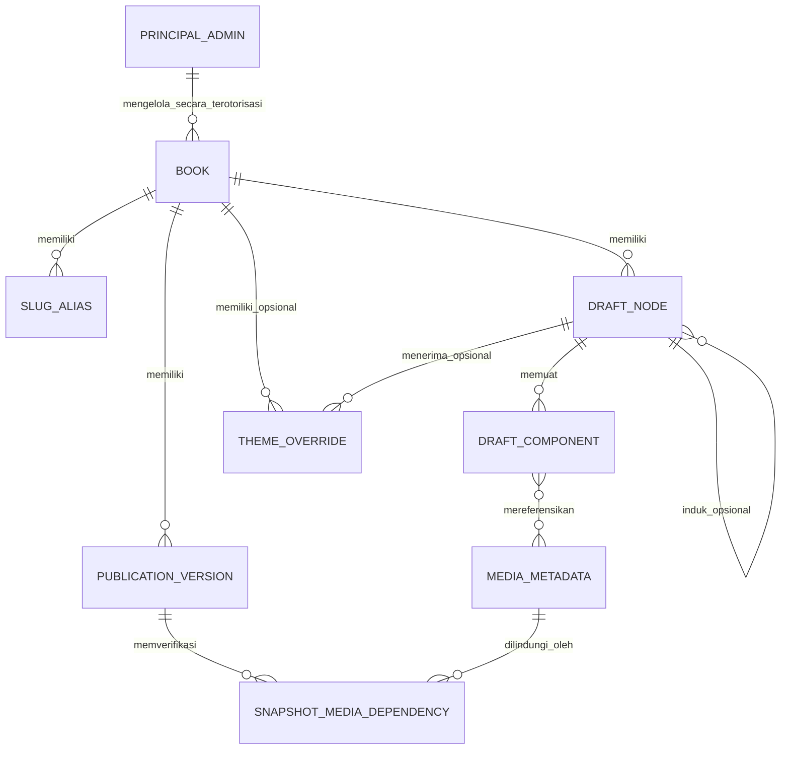
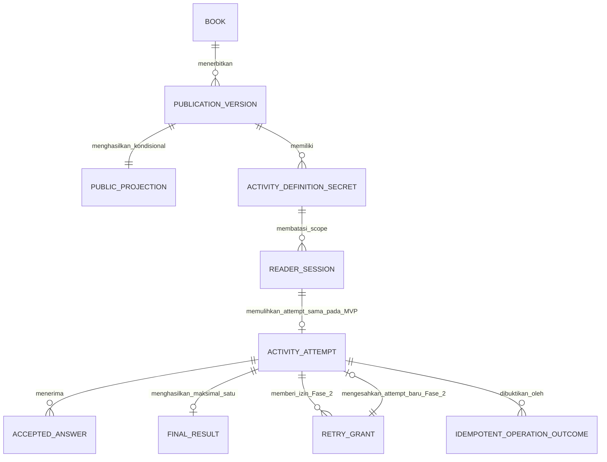
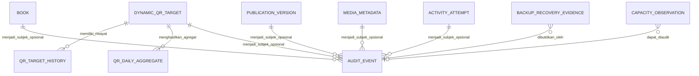

# ERD KONSEPTUAL-LOGIS — FLIPBOOK STUDIO

## ERD-00 — Identitas dan Status

| Item | Nilai |
|---|---|
| Dokumen | FS-DOC-06 — Database ERD |
| Versi | `v0.1.0-draft` |
| Status | **DRAF — BELUM DIAUDIT** |
| Tujuan | Mendokumentasikan entitas kandidat, kardinalitas, kepemilikan, dan lifecycle sebagai dasar desain fisik berikutnya. |
| Bukan cakupan | SQL, nama tabel/kolom final, tipe PostgreSQL, constraint sintaktis, indeks fisik, policy RLS, migrasi, atau implementasi. |

ERD ini menggunakan kandidat dari `DATABASE_CONCEPTUAL_MODEL.md`, `DATABASE_LOGICAL_MODEL.md`, `DATABASE_SECURITY_LIFECYCLE_DRAFT.md`, `DATABASE_FINAL_SPECIFICATION_DRAFT.md`, dan `DATABASE_ARCHITECTURE.md`. Satu kandidat ERD tidak otomatis berarti satu tabel fisik.

## ERD-01 — Konvensi dan Batas

- `1` berarti tepat satu, `0..1` berarti opsional maksimum satu, dan `0..N` berarti nol atau banyak.
- Hubungan bertanda **konseptual** boleh kelak diwujudkan sebagai JSONB immutable, proyeksi, proses server, objek Storage, atau catatan operasional, bukan relasi fisik mandiri.
- UUID stabil adalah identitas konseptual untuk buku, node, komponen, media, versi, aktivitas, sesi, attempt, dan objek terkait.
- Draf bersifat relasional dan mutable melalui CAS; snapshot publikasi dan dasar penilaian historis bersifat immutable.
- Hubungan tidak memberikan akses data. Akses Reader, siswa, admin, dan server tetap tunduk pada trust boundary/RLS konseptual.

## ERD-02 — Register 23 Kandidat Data

| No. | Kandidat | Asal | Bentuk yang mungkin | Fase | Klasifikasi akses |
|---:|---|---|---|---|---|
| 01 | Principal admin | ENT-001 | Relasi privat | MVP | Admin privat |
| 02 | Konfigurasi aplikasi | ENT-002 | Relasi/konfigurasi | MVP | Admin privat/server-only bila rahasia |
| 03 | Buku | ENT-003 | Relasi | MVP | Privat sampai diproyeksikan |
| 04 | Alias slug | ENT-004 | Relasi | MVP | Publik kondisional |
| 05 | Node struktur draf | ENT-005 | Relasi | MVP | Privat draf |
| 06 | Komponen draf | ENT-006 | Relasi | MVP/Fase 2 | Privat draf |
| 07 | Override tema | ENT-007 | Relasi atau konfigurasi terstruktur | MVP/Fase 2 | Privat draf |
| 08 | Metadata media | ENT-008 | Relasi + objek Storage | MVP | Privat/Storage |
| 09 | Versi publikasi/snapshot | ENT-009 | Relasi + JSONB immutable | MVP | Privat operasional |
| 10 | Proyeksi snapshot publik | Turunan ENT-009 | Proyeksi immutable | MVP | Publik kondisional |
| 11 | Definisi aktivitas rahasia | ENT-010 | JSONB privat/relasi konseptual | MVP | Server-only |
| 12 | Sesi siswa | ENT-011 | Relasi | MVP | Siswa/server privat |
| 13 | Attempt aktivitas | ENT-012 | Relasi | MVP | Siswa/server privat |
| 14 | Jawaban diterima | ENT-013 | Relasi | MVP | Server-only/proyeksi terbatas |
| 15 | Hasil final | ENT-014 | Relasi/proyeksi disclosure | MVP | Privat/proyeksi server |
| 16 | Retry grant | ENT-015 | Relasi | Fase 2 | Server/admin privat |
| 17 | Target QR dinamis | ENT-016 | Relasi | Fase 2 | Admin privat/resolusi kondisional |
| 18 | Agregat QR harian | ENT-017 | Relasi/turunan | Fase 2 | Admin operasional |
| 19 | Peristiwa audit | ENT-018 | Relasi/operasional | MVP/Fase 2 | Operasional privat |
| 20 | Observasi kapasitas | ENT-019 | Bukti operasional/provider | MVP/Fase 2 | Operasional privat |
| 21 | Bukti backup/pemulihan | ENT-020 | Bukti operasional/provider | MVP/Fase 2 | Operasional privat |
| 22 | Hasil operasi idempoten | Turunan DB-Q-004 | Relasi/proyeksi operasional | MVP | Server/operasional privat |
| 23 | Dependensi snapshot-media | REL-007 | Relasi eksplisit | MVP | Operasional privat |

## ERD-03 — Diagram Domain Buku, Draf, dan Media

Keterangan: struktur maksimum dan validitas parent/child tidak diekspresikan oleh diagram saja; wajib dijaga oleh INV-001, INV-007, REL-002, dan validasi server. `PUBLICATION_VERSION` tidak dibentuk ulang dari draf saat Reader mengaksesnya.

## ERD-04 — Diagram Snapshot, Proyeksi, dan Aktivitas

`PUBLIC_PROJECTION` bukan akses ke snapshot lengkap. `ACTIVITY_DEFINITION_SECRET` membawa kunci/bobot privat; hasil yang ditampilkan Reader hanya proyeksi server sesuai disclosure. Satu sesi memiliki paling banyak satu attempt; retry grant Fase 2 yang sah membuat sesi baru dengan token baru dan attempt baru, sementara attempt/hasil terdahulu tetap historis.

## ERD-05 — Diagram QR, Audit, dan Operasional

QR dinamis dan agregat adalah Fase 2. Agregat harian tidak menyimpan event scan individual, IP, GPS, fingerprint, nama, atau kelas. Bukti backup/pemulihan dan observasi kapasitas dapat berasal dari provider atau proses operasional; diagram tidak mewajibkan tabel internal.

## ERD-06 — Register Hubungan REL-001 sampai REL-018

| REL | Asal → tujuan | Kardinalitas | Aturan lifecycle/integritas |
|---|---|---|---|
| REL-001 | Buku → Alias slug | 1 → 0..N | Alias mengarah buku sah; perubahan slug tidak mengubah UUID buku. |
| REL-002 | Buku/Node → Node struktur | 1 → 0..N | Parent opsional; tidak ada siklus; batas kedalaman mengikuti baseline. |
| REL-003 | Node → Komponen draf | 1 → 0..N | Komponen memiliki owner node dan identitas stabil. |
| REL-004 | Buku/Node/Komponen → Override tema | 1 → 0..N | Representasi pewarisan tema belum final; tidak menyalin nilai literal tanpa dasar. |
| REL-005 | Komponen → Media metadata | 0..N ↔ 0..N | Referensi media harus tervalidasi; penghapusan aman bergantung dependensi. |
| REL-006 | Buku → Versi publikasi | 1 → 0..N | Satu pointer aktif yang sah; versi historis immutable. |
| REL-007 | Versi/Attempt → Media dependensi | 0..N ↔ 0..N | Media yang dirujuk tidak boleh dihapus tidak aman. |
| REL-008 | Versi publikasi → Definisi aktivitas rahasia | 1 → 0..N | Definisi terikat versi asal dan immutable setelah publish. |
| REL-009 | Definisi aktivitas → Sesi siswa | 1 → 0..N | Sesi dibatasi scope/lifecycle; token mentah tidak disimpan server. |
| REL-010 | Sesi siswa → Attempt | 1 → 0..1 | Pemulihan sesi memakai attempt sama; retry grant Fase 2 yang sah membuat sesi baru dan attempt baru. |
| REL-011 | Attempt → Jawaban diterima | 1 → 0..N | Hanya jawaban diterima server yang menjadi dasar finalisasi. |
| REL-012 | Attempt → Hasil final | 1 → 0..1 | Maksimum satu hasil; tidak mengungkap rahasia scoring. |
| REL-013 | Attempt → Retry grant | 1 → 0..N historis | Grant satu kali konsumsi; hasil lama dipertahankan. |
| REL-014 | Target QR → Agregat QR harian | 1 → 0..N | Agregat non-PII per target/periode. |
| REL-015 | Principal/komponen → Audit event | 1 → 0..N | Audit append-only konseptual dan aman dari token/PII berlebih. |
| REL-016 | Subjek kritis → Audit event | 1 → 0..N | Buku, versi, media, attempt, QR, grant, atau operasi kritis dapat diaudit. |
| REL-017 | Bukti backup/pemulihan → konteks operasional | 0..N konseptual | Tidak mewajibkan relasi fisik; cakupan DB/Storage/mapping harus dapat dibuktikan. |
| REL-018 | Observasi kapasitas → sumber operasional | 0..N konseptual | Sumber/waktu/kepastian harus dapat dibedakan; provider belum diasumsikan. |

## ERD-07 — Kepemilikan, Penghapusan, dan Historis

| Area | Tidak boleh berubah/hilang karena operasi lain | Perlakuan konseptual |
|---|---|---|
| Draf dan snapshot | Snapshot lama tidak berubah saat draf diedit/dihapus. | Draf dan versi publikasi memiliki lifecycle terpisah. |
| Versi dan aktivitas | Publish baru/rollback tidak mengubah attempt atau hasil historis. | Attempt dipin ke versi dan definisi aktivitas asal. |
| Media | Media yang direferensikan snapshot/attempt tidak dihapus tidak aman. | Pending delete, revalidasi dependensi, audit, dan rekonsiliasi; detail fisik belum final. |
| Sesi dan token | Token mentah tidak disimpan database. | Hanya hash/verifier server yang relevan. |
| Jawaban dan hasil | Jawaban sah/historical outcome tidak ditimpa silent. | CAS/idempotensi/finalisasi server; detail isolation belum final. |
| Revoke | Restore tidak membuka kembali akses revoked otomatis. | Lifecycle tetap diperiksa pada jalur akses baru. |

## ERD-08 — Keterlacakan Inti

| Cakupan | Referensi |
|---|---|
| Entitas | ENT-001 sampai ENT-020; kandidat 22 hasil idempoten; kandidat 23 dependensi snapshot-media. |
| Hubungan | REL-001 sampai REL-018. |
| Invariant | INV-001 sampai INV-013. |
| Kebutuhan data | DB-REQ-001 sampai DB-REQ-026. |
| Keamanan/lifecycle | SEC-REQ-001 sampai SEC-REQ-016; DLC-001 sampai DLC-014; SEC-RISK-001 sampai SEC-RISK-015. |
| Keputusan | CR-DB-001 sampai CR-DB-004; keputusan 06E-4, 06E-4B, 06E-5, 06E-6, dan pencatatan IA-Q 06E-7. |

Keterlacakan individual yang kanonis tetap berada pada dokumen konseptual, logis, security-lifecycle, dan final specification; ERD ini tidak menggantikan register tersebut.

## ERD-09 — GAP, OPEN, dan Kesiapan

Tujuh GAP tetap: `SCN-06D3-005`, `SCN-06D3-008`, `SCN-06D3-016`, `SCN-06D3-017`, `SCN-06D3-027`, `SCN-06D3-029`, dan `SCN-06D3-043`. Tiga OPEN tetap: `SCN-06D3-011`, `SCN-06D3-034`, dan `SCN-06D3-044`.

ERD siap diaudit sebagai draf. Tahap berikutnya, setelah pemeriksaan ini, adalah `DATA_DICTIONARY.md`; dokumen tersebut harus membedakan atribut wajib, turunan, dan belum final tanpa mengunci tipe, indeks, atau constraint fisik secara diam-diam.
