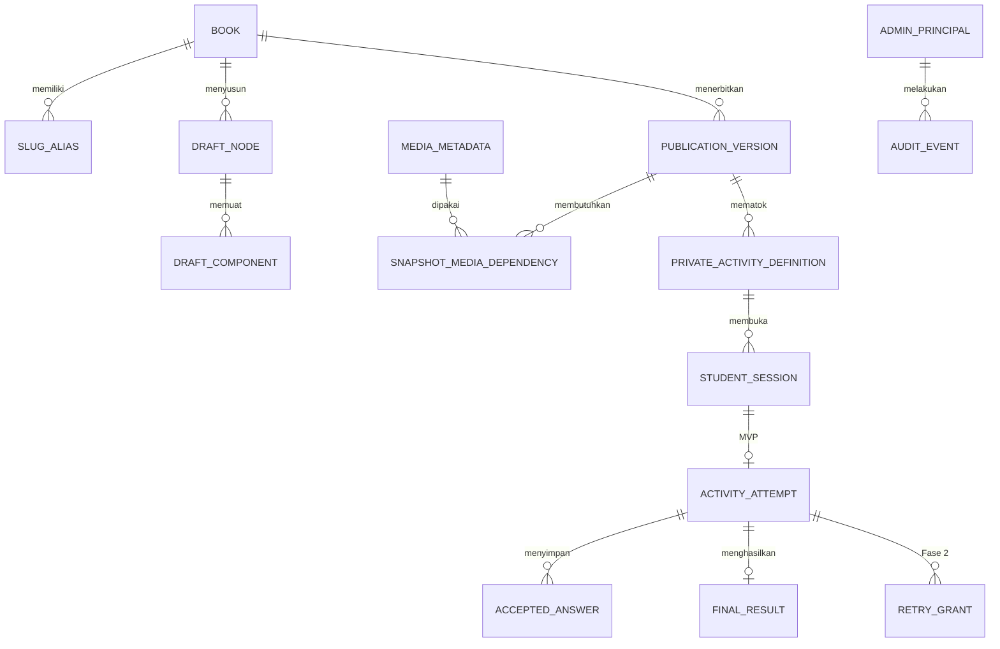
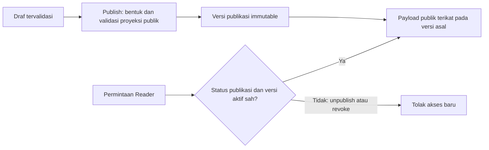

# MODEL LOGIS DATABASE — FLIPBOOK STUDIO

## LDM-00 — Identitas dan Status

- **Kode:** FS-DOC-06 — Supporting Logical Database Model
- **Nama file:** `docs/DATABASE_LOGICAL_MODEL.md`
- **Versi:** `v1.0.0-approved-locked`
- **Status:** **DISETUJUI DAN DIKUNCI — MODEL LOGIS SAJA**
- **Dasar:** `CR-DB-001`, `CR-DB-002`, dan `CR-DB-003`.
- **Change request:** `CR-DB-004 — PERSETUJUAN DAN PENGUNCIAN MODEL LOGIS DATABASE`.
- **Dasar persetujuan:** Persetujuan eksplisit pemilik proyek setelah audit independen Revisi 06C-8.
- **Ruang lingkup:** Kontrak model logis LDM-00 sampai LDM-17.
- **Batas penguncian:** Model logis database, bukan rancangan fisik dan bukan keseluruhan FS-DOC-06.
- **Bahasa:** Indonesia.

Dokumen ini adalah spesifikasi logical untuk tahap lanjutan. Dokumen ini bukan skema fisik, tidak menetapkan nama tabel final, tipe SQL, indeks fisik, migrasi, atau kebijakan RLS sintaktis. FS-DOC-06 secara keseluruhan belum disetujui atau dikunci.

Pemilik proyek telah menyetujui model logis database Flipbook Studio berdasarkan dokumen versi `v0.1.2-draft` yang telah lulus audit independen Revisi 06C-8. Melalui CR-DB-004, model logis ditetapkan sebagai baseline terkunci versi `v1.0.0-approved-locked`. Penguncian berlaku pada kontrak model logis LDM-00 sampai LDM-17, tidak mencakup keputusan yang masih terbuka, rancangan fisik, SQL, migrasi, kebijakan RLS sintaktis, atau persetujuan FS-DOC-06 secara keseluruhan.

## LDM-01 — Acuan dan Batas Rancangan

| Acuan | Peran |
|---|---|
| FS-DOC-01 `PRODUCT_REQUIREMENTS.md` | Requirement produk, keamanan, media, aktivitas, dan reliabilitas. |
| FS-DOC-02 `APP_FLOW.md` | Kontrak alur autosave, publish, lifecycle, aktivitas, dan backend. |
| FS-DOC-03 `INFORMATION_ARCHITECTURE.md` | Batas informasi publik/admin. |
| FS-DOC-04 `CORE_FEATURES.md` | Feature, dependensi, dan acceptance criteria. |
| FS-DOC-05 `UI_UX_SPEC.md` | Batas UI, privacy, dan traceability. |
| `DB_CONCEPTUAL_DECISIONS.md` | Keputusan konseptual CR-DB-001. |
| `DATABASE_CONCEPTUAL_MODEL.md` | Model konseptual terkunci dan CR-DB-002. |
| `DB_LOGICAL_DECISIONS.md` | Keputusan logical terbatas CR-DB-003. |

Rancangan ini mematuhi: draf relasional, snapshot terbit JSONB immutable, data penilaian privat, proyeksi Reader terbatas, CAS tingkat buku untuk MVP, dan operasi privileged melalui server tepercaya.

## LDM-02 — Prinsip Arsitektur Logis

1. Identitas buku, node, komponen, aktivitas, sesi, dan attempt stabil secara konseptual.
2. Draf dapat berubah melalui CAS; snapshot terbit dan representasi rahasia terikat versi tidak boleh dimutasi.
3. Snapshot lengkap bukan payload Reader; Reader hanya menerima proyeksi publik tervalidasi.
4. Kunci, bobot, konfigurasi scoring, verifier token, audit, dan data siswa berada pada batas privat/server.
5. Pointer versi aktif dan audit publikasi berubah secara atomik dalam batas PostgreSQL.
6. Supabase Storage tidak dianggap satu transaksi terdistribusi dengan PostgreSQL.
7. Dependensi media eksplisit melindungi snapshot/attempt historis dari penghapusan tidak aman.
8. Status UI lokal, proyeksi disclosure, objek biner Storage, dan bukti operasional tidak otomatis menjadi penyimpanan relasional.

## LDM-03 — Inventaris Kandidat Relasi

Nama berikut adalah **nama kerja**, bukan nama tabel final. Legenda status digunakan secara konsisten sebagai berikut: **KEWAJIBAN DATA** berarti kontrak data diwajibkan oleh baseline atau keputusan terkunci, tetapi tidak mengesahkan nama relasi, bentuk penyimpanan, atau struktur fisik; **KANDIDAT** berarti kebutuhan data ada namun bentuk representasinya belum diwajibkan; **MEMERLUKAN KEPUTUSAN** berarti detail representasi masih terbuka; **BUKAN PENYIMPANAN FISIK WAJIB** berarti kebutuhan dapat dipenuhi oleh proyeksi, Storage, state lokal, atau bukti operasional. Persetujuan `CR-DB-003` hanya berlaku untuk LDB-Q-001 sampai LDB-Q-004 serta AUD-06C4-001 dan AUD-06C4-002.

| Kandidat | Asal | Fungsi, identitas, dan referensi | Akses/fase/status |
|---|---|---|---|
| Principal admin | ENT-001 | Identitas admin; referensi asal audit. | Privat; MVP; KANDIDAT. |
| Konfigurasi aplikasi | ENT-002 | Preferensi dan allowlist. | Privat; MVP; KANDIDAT. |
| Buku | ENT-003 | UUID stabil, metadata, status, pointer versi aktif. | Campuran; MVP; KEWAJIBAN DATA. |
| Alias slug | ENT-004 | Riwayat alias menuju buku. | Resolusi publik; MVP; KEWAJIBAN DATA. |
| Node struktur draf | ENT-005 | Bab/halaman, parent, posisi, stable ID. | Privat; MVP; KEWAJIBAN DATA. |
| Komponen draf | ENT-006 | Konten/konfigurasi dan referensi media. | Privat; MVP/Fase 2; KEWAJIBAN DATA. |
| Override tema | ENT-007 | Override pada buku/node/komponen. | Privat; MVP/Fase 2; KANDIDAT. |
| Metadata media | ENT-008 | Hash, status, lokasi objek, verifikasi. | Privat/operasional; MVP; KEWAJIBAN DATA. |
| Versi publikasi | ENT-009 | Identitas versi dan snapshot JSONB immutable. | Privileged; MVP; KEWAJIBAN DATA. |
| Proyeksi snapshot publik | Turunan ENT-009 | Payload Reader dari versi tervalidasi. | Anon terbatas; MVP; KEWAJIBAN DATA; bukan record fisik wajib per versi. |
| Definisi rahasia aktivitas | ENT-010 | Kunci, bobot, scoring, disclosure, pin versi. | Privat/server; MVP; KEWAJIBAN DATA. |
| Sesi siswa | ENT-011 | Identitas minimum, hash token, status. | Privat siswa; MVP; KEWAJIBAN DATA. |
| Attempt aktivitas | ENT-012 | Pin aktivitas/snapshot, deadline, status finalisasi. | Privat siswa; MVP; KEWAJIBAN DATA. |
| Jawaban diterima | ENT-013 | Jawaban sah milik attempt. | Privat siswa; MVP; KEWAJIBAN DATA. |
| Hasil final | ENT-014 | Hasil scoring server dan disclosure. | Privat/terfilter; MVP; KEWAJIBAN DATA. |
| Retry grant | ENT-015 | Izin sekali pakai dari attempt asal. | Privat; Fase 2; KEWAJIBAN DATA. |
| Target QR dinamis | ENT-016 | Short code dan target internal. | Campuran; Fase 2; KANDIDAT. |
| Agregat QR harian | ENT-017 | Counter non-PII per QR. | Operasional; Fase 2; KANDIDAT. |
| Peristiwa audit | ENT-018 | Bukti aksi kritis append-only. | Privat; MVP/Fase 2; KEWAJIBAN DATA. |
| Observasi kapasitas | ENT-019 | Metrik provider/aplikasi. | Operasional; MVP; BUKAN PENYIMPANAN FISIK WAJIB. |
| Bukti backup/pemulihan | ENT-020 | Bukti backup/restore dan verifikasi mapping. | Operasional; MVP; BUKAN PENYIMPANAN FISIK WAJIB. |
| Hasil operasi idempoten | Turunan DB-Q-004 | Rekam operasi berulang menurut attempt dan jenis operasi. | Privat; MVP; MEMERLUKAN KEPUTUSAN retensi. |
| Dependensi snapshot-media | REL-007 | Referensi eksplisit snapshot/attempt ke metadata media. | Privat/operasional; MVP; KEWAJIBAN DATA. |

## LDM-04 — Atribut Logis dan Identitas

| Kandidat | Identitas logis | Atribut logis minimum | Integritas/kardinalitas |
|---|---|---|---|
| Buku | `book_id` stabil | Metadata, status lifecycle, pointer versi aktif. | Satu buku → banyak alias/node/versi; maksimal satu versi aktif. |
| Alias slug | identitas alias | Nilai slug/alias, buku tujuan, status redirect. | Alias unik; tepat satu buku sah. |
| Node/komponen | stable node/component ID | Parent, posisi, konten/konfigurasi, revision draf. | Buku→N node; node→N komponen; batas nesting baseline. |
| Tema | identitas scope/token | Scope override dan nilai tema. | Fallback buku→node→komponen. |
| Media | identitas aset/hash | Hash, status, lokasi Storage, verifikasi. | Dipakai banyak komponen/versi; tidak boleh hapus bila referensi ada. |
| Versi publikasi | `publication_version_id` | Nomor versi, schema version, snapshot lengkap, status historis. | Satu buku→N versi; immutable setelah publish. |
| Proyeksi publik | identitas versi publikasi | Konten Reader diizinkan dan identitas versi asal. | Tepat untuk satu versi; tidak mengandung rahasia/PII. |
| Definisi rahasia aktivitas | identitas aktivitas versi | Kunci, bobot, konfigurasi scoring/disclosure, versi asal. | Terikat immutable pada versi publikasi dan aktivitas. |
| Sesi/attempt | session ID / attempt ID | Hash token, identitas minimum, deadline, status, versi asal. | Sesi→0..1 attempt MVP; retry mencipta attempt baru Fase 2. |
| Jawaban/hasil | identitas jawaban/hasil | Jawaban sah, waktu penerimaan, hasil final/disclosure. | Attempt→N jawaban dan 0..1 hasil final. |
| Retry/idempotensi | identitas grant/key operasi | Verifier/kadaluarsa/konsumsi atau jenis operasi/hasil terdahulu. | Grant sekali pakai; operasi berulang tidak menggandakan outcome. |
| QR/audit | identitas target/event | Short code/target/agregat atau aktor, aksi, subjek, ringkasan. | QR→N agregat/audit; audit append-only. |

Detail field final, tipe data, constraint fisik, serta indeks belum ditetapkan.

## LDM-05 — Hubungan dan Kardinalitas

| Hubungan | Kontrak logical |
|---|---|
| Buku→Alias; Buku→Node; Node→Komponen | Buku memiliki 0..N alias/node; node memiliki 0..N komponen; stable ID tidak berubah saat urut/pindah. |
| Buku→Versi→Media | Buku memiliki 0..N versi immutable; versi memiliki 0..N dependensi media; pointer aktif menunjuk 0..1 versi. |
| Versi→Definisi aktivitas→Sesi→Attempt | Versi memiliki 0..N definisi aktivitas; aktivitas memiliki 0..N sesi; sesi menghasilkan paling banyak satu attempt MVP. |
| Attempt→Jawaban/Hasil/Grant | Attempt memiliki 0..N jawaban, 0..1 hasil final, dan 0..N retry grant historis. |
| QR→Agregat/Audit | Target QR dinamis memiliki 0..N agregat harian dan 0..N peristiwa audit. |
| Subjek kritis→Audit | Buku, versi, media, QR, grant, atau operasi kritis dapat memiliki 0..N audit event. |
| Bukti recovery/kapasitas | Dapat mereferensikan konteks operasional, tetapi tidak mewajibkan relasi fisik. |

Hubungan memenuhi REL-001 sampai REL-018; bentuk fisik REL-004, REL-017, dan REL-018 masih dapat berbeda tanpa mengubah kontrak konseptual.

## LDM-06 — Kontrak Snapshot dan Versi

1. Setiap publish membentuk satu snapshot JSONB tunggal, terstruktur, lengkap, immutable, dan memiliki penanda versi skema internal.
2. Snapshot mewakili struktur, halaman, komponen, referensi media, serta identitas versi aktivitas pada saat publish.
3. Snapshot tidak direkonstruksi dari draf saat Reader mengaksesnya.
4. Perubahan draf setelah publish tidak mengubah snapshot historis.
5. Pointer aktif buku hanya berubah bersama audit pada batas transaksi PostgreSQL.
6. Rollback menunjuk versi historis tervalidasi tanpa menimpa versi yang sudah ada.
7. Bentuk field JSONB, evolusi schema version, dan strategi kompatibilitas implementasi tetap belum ditetapkan.

## LDM-07 — Kontrak Aktivitas dan Penilaian

1. Definisi rahasia aktivitas merupakan representasi immutable privat yang terikat pada versi publikasi dan aktivitas asal.
2. Attempt membawa referensi immutable ke aktivitas dan snapshot asal; publish, rollback, dan perubahan draf tidak dapat mengubah dasar penilaian historis.
3. Token sesi dibuat browser sesuai baseline; yang disimpan server hanya hash token untuk validasi sesi.
4. Deadline memakai waktu server UTC.
5. Jawaban sah dan finalisasi diproses idempoten oleh server tepercaya.
6. Kunci, bobot, dan logika scoring tidak dikirim ke Reader.
7. Hasil final paling banyak satu per attempt; disclosure adalah proyeksi server sesuai kebijakan aktivitas.
8. Retry grant Fase 2 menghasilkan attempt baru yang sah tanpa menimpa hasil lama.

## LDM-08 — Kontrak Proyeksi Publik

1. Proyeksi publik dibuat dan divalidasi saat publish dari versi publikasi yang tervalidasi.
2. Proyeksi hanya memuat data Reader yang diizinkan; tidak mengandung rahasia scoring, token, atau data siswa.
3. Akses Reader memeriksa status publikasi dan pointer versi aktif pada setiap jalur aplikasi yang dikendalikan.
4. Unpublish dan emergency revoke menolak akses baru yang dikendalikan aplikasi.
5. Snapshot lengkap tidak tersedia bagi anonim melalui akses langsung Supabase.
6. Cache, invalidasi, gateway, dan URL media belum ditetapkan secara fisik; salinan yang telah disimpan pengguna sebelumnya tidak dapat dijamin ditarik kembali.

## LDM-09 — Kontrak Media dan Dependensi

1. Media draf bersifat privat; objek terbit yang sudah diverifikasi bersifat immutable.
2. Dependensi eksplisit menghubungkan versi snapshot dengan metadata media agar publish, rollback, dan penghapusan dapat diaudit.
3. Validasi media/promotion Storage selesai sebelum aktivasi pointer PostgreSQL.
4. Penghapusan media dikoordinasikan dengan publish, rollback, dan referensi attempt agar tidak terjadi kondisi balapan.
5. Media yang masih diperlukan snapshot aktif/historis, attempt relevan, atau proses aktivasi tidak boleh dihapus.
6. Kegagalan Storage tidak boleh menghasilkan snapshot aktif parsial; objek Storage tanpa referensi akibat kegagalan harus dapat direkonsiliasi.
7. Reference counting, penamaan Storage, retensi, dan mekanisme rekonsiliasi rinci tetap terbuka.

### Kontrak Penghapusan Media Terkendali

1. Sebelum permintaan penghapusan diterima, sistem memeriksa seluruh dependensi eksplisit terhadap snapshot aktif, snapshot historis, attempt historis relevan, serta aktivasi publish atau rollback yang sedang berlangsung.
2. Kandidat media yang lolos pemeriksaan diberi status/penanda operasi penghapusan tertunda secara konseptual; penanda ini mencegah publish, rollback, atau pembentukan referensi baru memperlakukan aset tersebut sebagai aman untuk dihapus tanpa koordinasi.
3. Publish dan rollback harus memeriksa kembali ketersediaan serta status media sebelum aktivasi pointer. Jika aset sedang ditandai untuk penghapusan atau tidak lagi tersedia, operasi aktivasi ditolak tanpa mengubah pointer aktif.
4. Koordinasi metadata PostgreSQL diselesaikan terlebih dahulu untuk menilai dan melindungi dependensi; penghapusan objek Storage dilakukan hanya setelah status tersebut konsisten. Urutan ini bukan transaksi terdistribusi dan tidak menetapkan mekanisme fisik penguncian.
5. Jika kegagalan terjadi sebelum objek Storage dihapus, metadata dan referensi tetap berlaku; operasi penghapusan dibatalkan atau dikembalikan ke status aman untuk rekonsiliasi.
6. Jika objek Storage telah terhapus tetapi pembaruan metadata gagal, aset dicatat sebagai ketidaksesuaian operasional, tidak boleh diperlakukan sebagai media tersedia, dan harus direkonsiliasi melalui pemeriksaan metadata-objek serta audit.
7. Rekonsiliasi membandingkan metadata, dependensi eksplisit, dan keberadaan objek Storage; hasilnya menjadi bukti operasional tanpa mengubah retensi atau jadwal yang belum disetujui.
8. Penghapusan, pembatalan, kegagalan, dan rekonsiliasi adalah tindakan kritis yang memerlukan jejak audit sesuai batas kebijakan yang berlaku.

Jadwal, metode, dan bukti rekonsiliasi tetap menjadi **LDM-Q-002 — TERBUKA**. Kontrak ini tidak mengasumsikan transaksi PostgreSQL dapat membatalkan operasi Supabase Storage secara otomatis.

## LDM-10 — CAS, Idempotensi, dan Transaksi

| Alur | Batas PostgreSQL | Batas Storage/cache eksternal | Kegagalan/pemulihan |
|---|---|---|---|
| Autosave CAS | Cek expected revision lalu terima/tolak mutasi draf. | Tidak relevan kecuali media sedang berubah. | Mutasi stale ditolak; tidak ada silent overwrite. |
| Publish | Simpan versi, ubah pointer aktif, tulis audit secara atomik. | Promotion/verifikasi Storage terjadi sebelum aktivasi; bukan transaksi terdistribusi. | Gagal validasi/Storage: jangan aktivasi; gagal DB: pointer lama tetap dan orphan Storage direkonsiliasi. |
| Rollback | Verifikasi versi, ubah pointer, tulis audit atomik. | Ketersediaan media target diperiksa sebelum transaksi. | Gagal media: pointer tidak berubah. |
| Unpublish/revoke | Ubah lifecycle/pointer dan audit. | Gateway/cache dikendalikan terpisah. | Backend tetap sumber kebenaran akses. |
| Sesi/attempt | Simpan hash token, aktivitas asal, deadline, dan attempt sah. | Token mentah tetap pada browser. | Pemulihan memakai attempt sama, bukan membuat baru. |
| Jawaban/finalisasi | Validasi token/deadline/key; simpan jawaban/hasil final. | Antrean lokal tetap keputusan terbuka. | Key sama mengembalikan hasil terdahulu; satu hasil final. |
| Retry grant | Penerbitan/konsumsi grant dan penciptaan attempt baru atomik. | Tidak relevan. | Grant kedaluwarsa/terpakai ditolak tanpa menimpa historis. |
| Hapus media | Lindungi referensi dalam batas koordinasi database. | Hapus objek Storage hanya setelah kelayakan terverifikasi. | Kegagalan sebelum penghapusan objek mempertahankan referensi yang sah; kegagalan setelah penghapusan objek dapat menyebabkan ketidaksesuaian metadata–Storage dan wajib ditandai, diaudit, serta direkonsiliasi. |

## LDM-11 — Keamanan dan Klasifikasi Akses

| Klasifikasi | Data / hak akses |
|---|---|
| Publik Reader | Proyeksi snapshot aktif, metadata publik, alias sah, QR statis sah. |
| Privat admin | Draf, struktur, komponen, tema, media draf, konfigurasi lifecycle. |
| Privat siswa | Identitas minimum, hash token, sesi, attempt, jawaban, hasil terotorisasi. |
| Khusus server | Kunci/bobot/config scoring, rahasia layanan, operasi privileged, representasi aktivitas rahasia. |
| Audit/operasional | Audit event, kapasitas, bukti backup/pemulihan, target QR/agregat yang diizinkan. |
| Lokal perangkat | Status B, progres Reader, preferensi, konteks konflik, antrean offline bila nantinya disetujui. |
| Storage | Media draf privat dan media terbit immutable terverifikasi. |

RLS berpostur default-deny. Fungsi privileged dan akses private tetap berada pada batas server tepercaya. Dokumen ini tidak menentukan sintaks kebijakan.

## LDM-12 — Siklus Hidup dan Penghapusan

- Buku/node/komponen draf dapat berubah melalui CAS; pengarsipan menyembunyikan data mutabel tanpa merusak histori publikasi.
- Snapshot dan representasi rahasia versi dipertahankan immutable.
- Unpublish, immediate block, emergency revoke, dan rollback mengubah status/pointer tanpa menghapus hasil atau histori wajib.
- Hard delete hanya dipertimbangkan setelah audit dependensi snapshot, media, attempt, hasil, dan audit.
- Retensi numerik snapshot, media, hasil, idempotency key, dan backup belum diputuskan.
- Objek Storage yang tidak lagi direferensikan tidak boleh langsung dihapus tanpa koordinasi dan rekonsiliasi.

## LDM-13 — Pemisahan MVP dan Fase 2

| Domain | MVP | Fase 2 |
|---|---|---|
| Draf/publikasi | CAS buku, snapshot immutable, proyeksi publik, publish/rollback/unpublish/revoke. | Penyempurnaan tanpa mengubah invariant MVP. |
| Aktivitas | Identitas minimum, satu attempt, deadline server, finalisasi idempoten, disclosure. | Multi-attempt dan retry grant. |
| QR | QR statis URL publik sah. | QR dinamis, short code, target audit, agregat non-PII. |
| Operasional | Audit, indikator kapasitas, kewajiban backup/restore. | Optimasi provider dan keputusan operasional yang masih terbuka. |

## LDM-14 — Diagram Mermaid

Diagram kedua menyatakan kewajiban pembentukan payload publik saat publish dan pemeriksaan lifecycle saat akses. `PUBLIC_PROJECTION` bukan kewajiban satu tabel atau satu record fisik per versi; bentuk representasi rahasia aktivitas dan audit juga tetap kontrak logical.

## LDM-15 — Matriks Keterlacakan

### ENT-001 sampai ENT-020

| ID | Mekanisme LDM | Status | Sumber Acuan |
|---|---|---|---|
| ENT-001 | Principal admin dan actor audit. | DIDUKUNG | `DATABASE_CONCEPTUAL_MODEL.md` CDM-03, ENT-001 (baris 43). |
| ENT-002 | Konfigurasi privat tervalidasi. | DIDUKUNG | CDM-03, ENT-002 (baris 44). |
| ENT-003 | Buku, UUID, lifecycle, pointer aktif. | DIDUKUNG | CDM-03, ENT-003 (baris 45). |
| ENT-004 | Alias slug sah. | DIDUKUNG | CDM-03, ENT-004 (baris 46). |
| ENT-005 | Node draf dan stable ID. | DIDUKUNG | CDM-03, ENT-005 (baris 47). |
| ENT-006 | Komponen draf. | DIDUKUNG | CDM-03, ENT-006 (baris 48). |
| ENT-007 | Override tema. | MEMERLUKAN KEPUTUSAN representasi. | CDM-03, ENT-007 (baris 49). |
| ENT-008 | Metadata media dan Storage. | DIDUKUNG | CDM-03, ENT-008 (baris 50). |
| ENT-009 | Versi/snapshot immutable. | DIDUKUNG | CDM-03, ENT-009 (baris 51). |
| ENT-010 | Representasi rahasia terikat versi. | DIDUKUNG oleh CR-DB-003. | CDM-03, ENT-010 (baris 52); `DB_LOGICAL_DECISIONS.md` LDR-04. |
| ENT-011 | Sesi/hash token. | DIDUKUNG | CDM-03, ENT-011 (baris 53). |
| ENT-012 | Attempt pinned/deadline. | DIDUKUNG | CDM-03, ENT-012 (baris 54). |
| ENT-013 | Jawaban sah. | DIDUKUNG | CDM-03, ENT-013 (baris 55). |
| ENT-014 | Hasil final/proyeksi disclosure. | DIDUKUNG | CDM-03, ENT-014 (baris 56). |
| ENT-015 | Retry grant Fase 2. | DIDUKUNG | CDM-03, ENT-015 (baris 57). |
| ENT-016 | Target QR dinamis Fase 2. | MEMERLUKAN KEPUTUSAN detail. | CDM-03, ENT-016 (baris 58). |
| ENT-017 | Agregat QR non-PII Fase 2. | MEMERLUKAN KEPUTUSAN detail. | CDM-03, ENT-017 (baris 59). |
| ENT-018 | Audit append-only. | DIDUKUNG | CDM-03, ENT-018 (baris 60). |
| ENT-019 | Metrik kapasitas. | BUKAN PENYIMPANAN FISIK WAJIB | CDM-03, ENT-019 (baris 61). |
| ENT-020 | Bukti backup/pemulihan. | BUKAN PENYIMPANAN FISIK WAJIB | CDM-03, ENT-020 (baris 62). |

### REL-001 sampai REL-018

| ID | Mekanisme LDM | Status | Sumber Acuan |
|---|---|---|---|
| REL-001 | Buku→alias. | DIDUKUNG | `DATABASE_CONCEPTUAL_MODEL.md` CDM-04, REL-001 (baris 70). |
| REL-002 | Buku→node. | DIDUKUNG | CDM-04, REL-002 (baris 71). |
| REL-003 | Node→komponen. | DIDUKUNG | CDM-04, REL-003 (baris 72). |
| REL-004 | Scope tema bertingkat. | MEMERLUKAN KEPUTUSAN representasi. | CDM-04, REL-004 (baris 73). |
| REL-005 | Komponen↔media. | DIDUKUNG | CDM-04, REL-005 (baris 74). |
| REL-006 | Buku→versi, satu aktif. | DIDUKUNG | CDM-04, REL-006 (baris 75). |
| REL-007 | Versi↔media eksplisit. | DIDUKUNG oleh CR-DB-003. | CDM-04, REL-007 (baris 76); `DB_LOGICAL_DECISIONS.md` LDR-06. |
| REL-008 | Versi→aktivitas rahasia. | DIDUKUNG oleh CR-DB-003. | CDM-04, REL-008 (baris 77); `DB_LOGICAL_DECISIONS.md` LDR-04. |
| REL-009 | Aktivitas→sesi. | DIDUKUNG | CDM-04, REL-009 (baris 78). |
| REL-010 | Sesi→attempt MVP/retry Fase 2. | DIDUKUNG | CDM-04, REL-010 (baris 79). |
| REL-011 | Attempt→jawaban. | DIDUKUNG | CDM-04, REL-011 (baris 80). |
| REL-012 | Attempt→hasil tunggal. | DIDUKUNG | CDM-04, REL-012 (baris 81). |
| REL-013 | Attempt lama→retry grant. | DIDUKUNG | CDM-04, REL-013 (baris 82). |
| REL-014 | QR→agregat. | MEMERLUKAN KEPUTUSAN detail. | CDM-04, REL-014 (baris 83). |
| REL-015 | QR→audit. | DIDUKUNG | CDM-04, REL-015 (baris 84). |
| REL-016 | Subjek→audit. | DIDUKUNG | CDM-04, REL-016 (baris 85). |
| REL-017 | Bukti recovery→snapshot/media. | BUKAN PENYIMPANAN FISIK WAJIB | CDM-04, REL-017 (baris 86). |
| REL-018 | Kapasitas→konteks operasional. | BUKAN PENYIMPANAN FISIK WAJIB | CDM-04, REL-018 (baris 87). |

### INV-001 sampai INV-013

| ID | Mekanisme LDM | Status | Sumber Acuan |
|---|---|---|---|
| INV-001 | Stable ID. | DIDUKUNG | `DATABASE_CONCEPTUAL_MODEL.md` CDM-05, INV-001 (baris 93). |
| INV-002 | Snapshot immutable. | DIDUKUNG | CDM-05, INV-002 (baris 94). |
| INV-003 | Pointer dan audit atomik. | DIDUKUNG | CDM-05, INV-003 (baris 95). |
| INV-004 | Gagal publish tidak mengaktifkan parsial. | DIDUKUNG | CDM-05, INV-004 (baris 96). |
| INV-005 | Validasi media sebelum rollback. | DIDUKUNG | CDM-05, INV-005 (baris 97). |
| INV-006 | Lifecycle tidak menghapus histori. | DIDUKUNG | CDM-05, INV-006 (baris 98). |
| INV-007 | Expected revision/CAS. | DIDUKUNG | CDM-05, INV-007 (baris 99). |
| INV-008 | Idempotensi operasi/finalisasi. | DIDUKUNG; retensi key terbuka. | CDM-05, INV-008 (baris 100). |
| INV-009 | Deadline UTC server. | DIDUKUNG | CDM-05, INV-009 (baris 101). |
| INV-010 | Dependensi media dan koordinasi hapus. | DIDUKUNG | CDM-05, INV-010 (baris 102); `DB_LOGICAL_DECISIONS.md` LDR-08. |
| INV-011 | Target QR internal/lifecycle. | DIDUKUNG secara konseptual | CDM-05, INV-011 (baris 103). |
| INV-012 | Default-deny dan trusted boundary. | DIDUKUNG | CDM-05, INV-012 (baris 104). |
| INV-013 | Pin attempt ke aktivitas/snapshot asal. | DIDUKUNG | CDM-05, INV-013 (baris 105). |

### DB-REQ-001 sampai DB-REQ-026

| ID | Mekanisme LDM | Status | Sumber Acuan |
|---|---|---|---|
| DB-REQ-001 | Principal admin/server trusted. | DIDUKUNG | `DATABASE_CONCEPTUAL_MODEL.md` CDM-09, DB-REQ-001 (baris 145). |
| DB-REQ-002 | Konfigurasi privat. | DIDUKUNG | CDM-09, DB-REQ-002 (baris 146). |
| DB-REQ-003 | Buku/UUID/lifecycle. | DIDUKUNG | CDM-09, DB-REQ-003 (baris 147). |
| DB-REQ-004 | Alias slug. | DIDUKUNG | CDM-09, DB-REQ-004 (baris 148). |
| DB-REQ-005 | Node struktur. | DIDUKUNG | CDM-09, DB-REQ-005 (baris 149). |
| DB-REQ-006 | Komponen/tema. | DIDUKUNG | CDM-09, DB-REQ-006 (baris 150). |
| DB-REQ-007 | Metadata media/Storage. | DIDUKUNG | CDM-09, DB-REQ-007 (baris 151). |
| DB-REQ-008 | CAS draf. | DIDUKUNG | CDM-09, DB-REQ-008 (baris 152). |
| DB-REQ-009 | Snapshot/versi. | DIDUKUNG | CDM-09, DB-REQ-009 (baris 153). |
| DB-REQ-010 | Pointer/audit publish. | DIDUKUNG | CDM-09, DB-REQ-010 (baris 154). |
| DB-REQ-011 | Lifecycle publikasi. | DIDUKUNG | CDM-09, DB-REQ-011 (baris 155). |
| DB-REQ-012 | Proyeksi publik terkontrol. | DIDUKUNG | CDM-09, DB-REQ-012 (baris 156). |
| DB-REQ-013 | Ekspor QR statis. | BUKAN PENYIMPANAN FISIK WAJIB | CDM-09, DB-REQ-013 (baris 157). |
| DB-REQ-014 | Target QR dinamis. | MEMERLUKAN KEPUTUSAN detail | CDM-09, DB-REQ-014 (baris 158). |
| DB-REQ-015 | Agregat QR. | MEMERLUKAN KEPUTUSAN detail | CDM-09, DB-REQ-015 (baris 159). |
| DB-REQ-016 | Sesi/hash token. | DIDUKUNG | CDM-09, DB-REQ-016 (baris 160). |
| DB-REQ-017 | Aktivitas rahasia immutable. | DIDUKUNG | CDM-09, DB-REQ-017 (baris 161); `DB_LOGICAL_DECISIONS.md` LDR-04. |
| DB-REQ-018 | Attempt/jawaban/idempotensi. | DIDUKUNG | CDM-09, DB-REQ-018 (baris 162). |
| DB-REQ-019 | Hasil/disclosure. | DIDUKUNG | CDM-09, DB-REQ-019 (baris 163). |
| DB-REQ-020 | Retry grant. | DIDUKUNG | CDM-09, DB-REQ-020 (baris 164). |
| DB-REQ-021 | Audit. | DIDUKUNG | CDM-09, DB-REQ-021 (baris 165). |
| DB-REQ-022 | RLS/trusted boundary. | DIDUKUNG | CDM-09, DB-REQ-022 (baris 166). |
| DB-REQ-023 | Kapasitas provider. | BUKAN PENYIMPANAN FISIK WAJIB | CDM-09, DB-REQ-023 (baris 167). |
| DB-REQ-024 | Bukti backup/restore. | BUKAN PENYIMPANAN FISIK WAJIB | CDM-09, DB-REQ-024 (baris 168). |
| DB-REQ-025 | Integritas media/snapshot. | DIDUKUNG | CDM-09, DB-REQ-025 (baris 169). |
| DB-REQ-026 | Data lokal/antrean. | MEMERLUKAN KEPUTUSAN | CDM-09, DB-REQ-026 (baris 170). |

### LDB-Q dan AUD

| ID | Mekanisme LDM | Status | Sumber Acuan |
|---|---|---|---|
| LDB-Q-001 | Snapshot tunggal terstruktur/schema version. | DIDUKUNG — DISETUJUI CR-DB-003 | `DB_LOGICAL_DECISIONS.md` LDR-03. |
| LDB-Q-002 | Representasi rahasia immutable privat. | DIDUKUNG — DISETUJUI CR-DB-003 | `DB_LOGICAL_DECISIONS.md` LDR-04. |
| LDB-Q-003 | Proyeksi publish + cek akses request. | DIDUKUNG — DISETUJUI CR-DB-003 | `DB_LOGICAL_DECISIONS.md` LDR-05. |
| LDB-Q-004 | Dependensi media eksplisit. | DIDUKUNG — DISETUJUI CR-DB-003 | `DB_LOGICAL_DECISIONS.md` LDR-06. |
| LDB-Q-005 | Bentuk audit. | MEMERLUKAN KEPUTUSAN | `DATABASE_LOGICAL_MODEL.md` LDM-16; `DB_LOGICAL_DECISIONS.md` LDR-10. |
| LDB-Q-006 | Retensi idempotency. | MEMERLUKAN KEPUTUSAN | LDM-16; `DB_LOGICAL_DECISIONS.md` LDR-10. |
| LDB-Q-007 | Sumber kapasitas. | MEMERLUKAN KEPUTUSAN | LDM-16; `DB_LOGICAL_DECISIONS.md` LDR-10. |
| LDB-Q-008 | Antrean offline. | MEMERLUKAN KEPUTUSAN | LDM-16; `DB_LOGICAL_DECISIONS.md` LDR-10. |
| AUD-06C4-001 | Cek lifecycle pada jalur aplikasi/cache. | DIDUKUNG — WAJIB | `DB_LOGICAL_DECISIONS.md` LDR-07. |
| AUD-06C4-002 | Koordinasi hapus/publish/rollback media. | DIDUKUNG — WAJIB | `DB_LOGICAL_DECISIONS.md` LDR-08. |

## LDM-16 — Keputusan Terbuka dan Risiko

Tetap terbuka: LDB-Q-005 sampai LDB-Q-008; DB-Q-007 sampai DB-Q-010; IA-Q-001 sampai IA-Q-004. IA-Q-005 tetap DISETUJUI/DITUTUP.

Pertanyaan tambahan yang belum disetujui:

| ID | Pertanyaan | Dampak / status |
|---|---|---|
| LDM-Q-001 | Bagaimana versi schema JSONB historis dibaca saat format berkembang? | Kompatibilitas Reader/rollback; TERBUKA. |
| LDM-Q-002 | Bagaimana rekonsiliasi objek Storage orphan dijadwalkan dan dibuktikan? | Biaya/integritas media; TERBUKA. |

Risiko residual: salah konfigurasi proyeksi publik, referensi media tidak konsisten, kegagalan antara Storage dan transaksi PostgreSQL, retensi belum diputuskan, serta asumsi kemampuan paket gratis provider. Tidak ada fitur paket gratis yang dianggap tersedia tanpa verifikasi.

## LDM-17 — Pemeriksaan dan Kesiapan Audit

- LDM-00 sampai LDM-17 tersedia.
- CR-DB-003 tetap berlaku tanpa mengubah keputusan konseptual.
- Audit independen Revisi 06C-8 telah lulus; model logis disetujui dan dikunci melalui CR-DB-004.
- Semua keputusan terbuka tetap terbuka.
- Tidak ada SQL, migrasi, kebijakan RLS sintaktis, atau `DATABASE_DESIGN.md`.

### Pengendalian Perubahan Setelah Penguncian

- `CR-DB-001`, `CR-DB-002`, dan `CR-DB-003` tetap berlaku.
- `CR-DB-004` berstatus **DISETUJUI OLEH PEMILIK**.
- Model konseptual tetap terkunci; model logis terkunci melalui CR-DB-004.
- Tahap 06D dan 06E belum selesai.
- FS-DOC-06 secara keseluruhan belum dikunci.

Setiap perubahan substansial setelah penguncian wajib melalui change request baru, analisis dampak, audit, dan persetujuan pemilik proyek. Penguncian model logis tidak berarti rancangan fisik, implementasi, atau pengujian keamanan telah disetujui.
