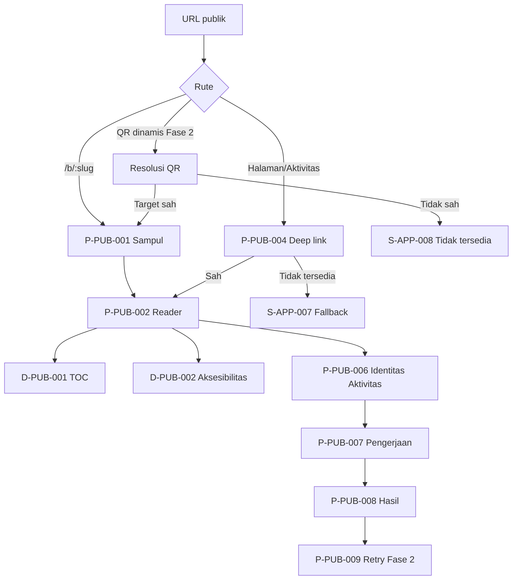
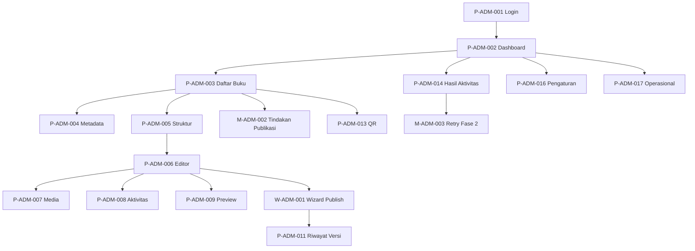
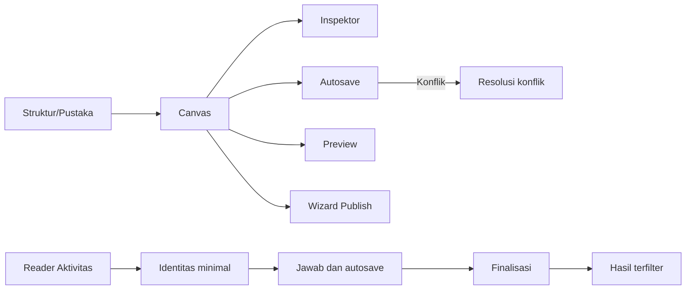
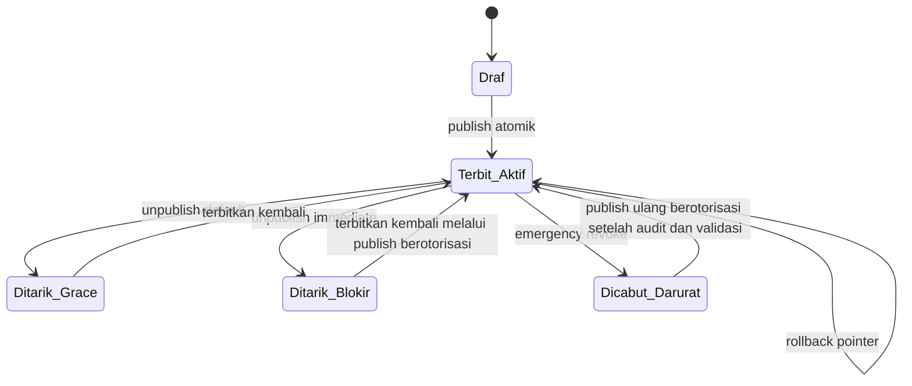

# ARSITEKTUR INFORMASI (INFORMATION ARCHITECTURE) — FLIPBOOK STUDIO

---

## IA-00 — Identitas dan Tata Kelola Dokumen

- **Nama Proyek:** Flipbook Studio
- **Kode Proyek:** FS-CORE
- **Nomor Dokumen:** FS-DOC-03
- **Nama Dokumen:** `docs/INFORMATION_ARCHITECTURE.md`
- **Versi:** `v1.0.2-approved-locked`
- **Status:** **APPROVED & LOCKED — DISETUJUI PEMILIK PROYEK**
- **Versi baseline terkunci sebelumnya:** `v1.0.1-approved-locked`
- **Status baseline terkunci sebelumnya:** **APPROVED & LOCKED — DISETUJUI PEMILIK PROYEK**
- **Tanggal Penyusunan:** 18 November 2026
- **Tanggal Persetujuan:** 18 November 2026

### Riwayat Perubahan Terkendali

| CR | Tanggal | Otorisasi | Keputusan/Dampak | Versi |
|---|---|---|---|---|
| CR-IA-005 | 18 November 2026 | Persetujuan eksplisit pemilik proyek | Menyelesaikan IA-Q-005: Opsi A, satu area `P-ADM-013` dengan QR statis MVP dan QR dinamis Fase 2. Administratif; tanpa perubahan route, inventory, canonical ID, feature, atau fase. | `v1.0.0-approved-locked` → `v1.0.1-revised-cr-ia-005` |
| CR-IA-005-RELOCK | 18 November 2026 | Persetujuan eksplisit pemilik proyek | Penguncian kembali baseline setelah CR-IA-005 disetujui. Tidak ada perubahan struktur atau keputusan produk. Pemeriksaan isi dan konsistensi CR-IA-005 telah dilakukan; perbandingan historis byte-level terhadap artefak asli `v1.0.0-approved-locked` belum dapat dibuktikan lengkap karena file baseline historis terpisah tidak tersedia dalam workspace audit. Keterbatasan ini adalah batas bukti audit historis, bukan temuan perubahan struktur. | `v1.0.1-revised-cr-ia-005` → `v1.0.1-approved-locked` |
| CR-IA-001 | 18 November 2026 | Persetujuan eksplisit pemilik proyek | Mencatat keputusan IA-Q-001—IA-Q-004: navigasi sidebar hierarkis, breadcrumb kontekstual, dua tingkat informasi publish yang aman, serta indikator antrean jawaban dekat tindakan simpan/kirim. Tidak mengubah 15 route, 41 inventory IA, canonical ID, feature, requirement, atau fase. | `v1.0.1-approved-locked` → `v1.0.2-revised-cr-ia-001` |
| CR-IA-001-RELOCK | 18 November 2026 | Persetujuan eksplisit pemilik proyek | Penguncian kembali setelah audit konsistensi CR-IA-001. Tidak ada perubahan struktur, route, inventory, requirement, feature, flow, atau fase. | `v1.0.2-revised-cr-ia-001` → `v1.0.2-approved-locked` |
- **Acuan utama:** `docs/PRODUCT_REQUIREMENTS.md` (FS-DOC-01, `v1.2.0-final-alignment`, **APPROVED & LOCKED**) dan `docs/APP_FLOW.md` (FS-DOC-02, `v1.0.0-approved-locked`, **APPROVED & LOCKED**).
- **Acuan pendukung:** `FLIPBOOK_STUDIO_MASTER_PROMPT.md`.
- **Kebijakan perubahan:** Dokumen FS-DOC-03 telah disetujui dan dikunci oleh pemilik proyek. Perubahan substantif terhadap struktur informasi, navigasi, inventaris tampilan, route, dan keterlacakan hanya dapat dilakukan melalui persetujuan eksplisit pemilik proyek serta pengendalian versi. Keputusan teknis yang masih terbuka pada IA-12 tidak dianggap telah disetujui melalui penguncian dokumen ini.

Dokumen ini menyatakan struktur informasi dan perilaku navigasi konseptual, bukan implementasi React, skema database fisik, endpoint final, atau bukti aplikasi telah diuji.

---

## IA-01 — Public Information Architecture

Pembaca publik tidak perlu login untuk membaca buku terbit. Nama dan kelas hanya diminta pada aktivitas yang hasilnya dicatat. Reader hanya memuat snapshot publik aktif; draf, kunci jawaban, data siswa lain, dan media privat tidak menjadi bagian informasi publik.

| Area / Page ID | Hierarki dan informasi utama | Jalur navigasi | Kondisi akses | Fase | Flow utama |
|---|---|---|---|---|---|
| `P-PUB-001` Sampul luar | Sampul, judul, deskripsi, metadata, aksi mulai/lanjutkan, Ganti Pembaca | URL buku → sampul → mulai/lanjutkan | Buku terbit aktif | MVP | AF-01-001, 002 |
| `P-PUB-002` Reader | Konten halaman snapshot, progres lokal, toolbar, sebelum/berikutnya | Sampul, TOC, tautan internal, browser back/forward | Snapshot aktif | MVP | AF-01-002, 003, 007 |
| `D-PUB-001` TOC | Bab, halaman mandiri, posisi aktif | Drawer/side panel dari Reader | Snapshot aktif | MVP | AF-01-003 |
| `P-PUB-004` Deep link | Halaman atau aktivitas tujuan dengan konteks buku | URL halaman/aktivitas → tujuan sah | Stable ID ada dalam snapshot aktif | MVP | AF-01-004 |
| `D-PUB-002` Aksesibilitas | Ukuran teks, kontras tinggi, reduced motion | Toolbar Reader → panel preferensi | Reader aktif | MVP | AF-01-008 |
| `P-PUB-006` Identitas aktivitas | Pemberitahuan privasi, nama, kelas, mulai aktivitas | Aktivitas → identitas → sesi | Aktivitas terbit; identitas minimal | MVP | AF-01-009 |
| `P-PUB-007` Pengerjaan aktivitas | Butir soal, timer server, status A/B/C simpan, kirim | Sesi aktif → autosave/finalisasi | Token sesi sah; versi aktivitas dipatok | MVP | AF-01-010 s.d. 012 |
| `P-PUB-008` Hasil aktivitas | Hasil yang sudah difilter disclosure policy | Finalisasi → hasil | Sesi final milik token yang sah | MVP | AF-01-013 |
| `P-PUB-009` Retry grant | Masukkan kode retry sekali pakai | Hasil → kode → sesi baru | Fase 2; kode valid dan buku dapat diakses | Fase 2 | AF-01-014 |
| `M-PUB-002` Ganti Pembaca | Konfirmasi dan pembersihan token/riwayat lokal | Sampul atau header → konfirmasi → sampul bersih | Perangkat bersama | MVP | AF-01-015 |
| `S-APP-007` Halaman tidak tersedia | Penjelasan, beranda buku, opsi target pengganti eksplisit | Deep link tak tersedia → pilihan pembaca | Buku masih terbit bila beranda ditawarkan | MVP | AF-01-016 |
| `S-APP-008` Akses ditarik/dicabut | Pesan unpublish atau emergency revoke tanpa isi privat | Rute publik → status tidak tersedia | Unpublish/revoke | MVP | AF-01-017 |

**Media dan interaksi Reader:** desktop dapat memakai flipbook dua halaman hanya bila konten sesuai; konten panjang/interaktif beralih ke scroll. Smartphone selalu satu kolom. Audio/video tidak autoplay pada buka atau pindah halaman, harus dipicu tindakan pembaca, dan embed pihak ketiga wajib mematuhi kebijakan ini. Kontrol harus berlabel aksesibel dan dapat dioperasikan keyboard.

**QR:** QR statis membawa pembaca langsung ke URL buku pada MVP. QR dinamis `/q/:shortCode` adalah Fase 2, hanya menuju target internal terbit yang sah dan tidak menembus Unpublish/Emergency Revoke.

---

## IA-02 — Administrator Information Architecture

Administrator tunggal masuk melalui otentikasi; seluruh data privat tetap memerlukan validasi backend/RLS, bukan hanya pembatasan menu.

| Area / Page ID | Tujuan dan informasi utama | Navigasi / struktur | Fase | Flow utama |
|---|---|---|---|---|
| `P-ADM-001` Login | Email, kata sandi, pesan aman | `/admin` → login → dashboard | MVP | AF-02-001, 027 |
| `P-ADM-002` Dashboard | Ringkasan buku, aktivitas terbaru, kuota, pintasan | Hub utama administrator | MVP | AF-02-002 |
| `P-ADM-003` Daftar buku | Buku draf/terbit, cari, buat, kelola | Dashboard → daftar → buku | MVP | AF-02-003, 028 |
| `P-ADM-004` Metadata buku | Judul, deskripsi, slug, metadata pembelajaran | Daftar buku → detail → metadata | MVP | AF-02-004 |
| `P-ADM-005` Struktur buku | Pohon halaman mandiri dan Bab > Halaman | Detail → struktur → editor | MVP | AF-02-005, 006 |
| `P-ADM-006` Editor visual | Toolbar, struktur/pustaka, canvas, inspektor | Detail/struktur → editor | MVP | AF-02-007 s.d. 010 |
| `P-ADM-007` Media | Unggah, status, referensi, batas hapus | Editor → media | MVP | AF-02-011 |
| `P-ADM-008` Aktivitas | Butir, kunci privat, bobot, durasi, disclosure | Editor → aktivitas | MVP; penguatan Fase 2 | AF-02-012 |
| `P-ADM-009` Preview | Quick Preview, fullscreen, test mode | Editor → preview | MVP | AF-02-013 |
| `W-ADM-001` Wizard publish | Lima tahap, Pass/Warning/Error, konfirmasi | Editor → wizard → publish | MVP | AF-02-014, 015 |
| `P-ADM-011` Riwayat versi | Versi aktif/historis dan rollback | Detail buku → riwayat | MVP | AF-02-016, 019 |
| `M-ADM-002` Tindakan publikasi | Unpublish, immediate block, emergency revoke | Detail buku → tindakan kritis | MVP | AF-02-017, 018 |
| `P-ADM-013` QR | QR statis; target/riwayat/analitik dinamis | Detail buku → QR | MVP / Fase 2 | AF-02-020, 021 |
| `P-ADM-014` Hasil aktivitas | Rekap hasil sesuai akses admin | Dashboard/detail → hasil | MVP | AF-02-022 |
| `M-ADM-003` Retry grant | Grant sekali pakai berbatas waktu | Hasil → grant retry | Fase 2 | AF-02-023 |
| `P-ADM-016` Pengaturan aplikasi | Preferensi global dan allowlist yang didukung | Dashboard → pengaturan | MVP | AF-02-024 |
| `P-ADM-017` Operasional | Kuota, backup, restore, logout | Dashboard → operasional | MVP | AF-02-025 s.d. 027 |

### Struktur informasi editor

1. **Toolbar:** nama buku/status draf-versi, undo/redo, indikator autosave, preview, publish.
2. **Panel kiri:** pohon Bab/Halaman, halaman mandiri, pustaka komponen, pengurutan dan aksi struktur.
3. **Canvas tengah:** Mode Blok (MVP) dan Mode Tata Letak Bebas Terbatas (Fase 2); bukan freehand canvas.
4. **Panel kanan:** tab Konten, Tampilan, Tata Letak, Perilaku, dan Aksesibilitas.
5. **Konteks pendukung:** media, tema, aktivitas, validasi, dan konflik autosave ditampilkan sebagai panel/modal sesuai konteks; bukan semua route mandiri.

---

## IA-03 — Struktur Navigasi Global

### 3.1 Sitemap pembaca publik



### 3.2 Sitemap administrator



### 3.3 Navigasi editor dan aktivitas



### 3.4 Navigasi status publikasi



---

## IA-04 — Route Architecture

Route publik berikut adalah baseline PRD. Semua route admin di bawah adalah **usulan teknis** untuk IA; path final belum dikunci.

| Route ID | Pola URL | Nama halaman | Aktor | Tujuan | Akses/kondisi | Fase | Flow ID | Requirement utama |
|---|---|---|---|---|---|---|---|---|
| `R-PUB-001` | `/b/:slug` | Sampul buku | Publik | Masuk buku | Buku aktif; alias slug dapat redirect | MVP | AF-01-001 | FR-RDR-001, FR-LNK-001/002 |
| `R-PUB-002` | `/b/:slug/p/:stablePageId` | Deep link halaman | Publik | Buka halaman stabil | Target snapshot aktif atau fallback | MVP | AF-01-003, 004, 016 | FR-LNK-001/003 |
| `R-PUB-003` | `/b/:slug/a/:stableActivityId` | Deep link aktivitas | Publik/siswa | Buka aktivitas terbit | Target sah dan status buku mengizinkan | MVP | AF-01-004, 009 | FR-LNK-001, FR-ACT-001 |
| `R-PUB-004` | `/q/:shortCode` | Resolver QR dinamis | Publik | Validasi lalu redirect internal | Target internal terbit; Fase 2 | Fase 2 | AF-01-006, AF-03-022 | FR-LNK-005/006 |
| `R-PUB-005` | — | State tidak tersedia | Publik | Jelaskan halaman/buku tak tersedia | State UI, bukan route wajib | MVP | AF-01-016, 017 | FR-LNK-003, FR-PUB-006/007 |
| `R-ADM-001` | `/admin` | Login/dashboard | Admin | Masuk admin atau dashboard | **Usulan teknis**; sesi menentukan tujuan | MVP | AF-02-001, 002 | FR-ADM-001/003 |
| `R-ADM-002` | `/admin/books` | Daftar buku | Admin | Kelola koleksi | **Usulan teknis**; JWT/RLS sah | MVP | AF-02-003, 028 | FR-BOK-001 |
| `R-ADM-003` | `/admin/books/:bookId` | Detail buku | Admin | Hub metadata/struktur/status | **Usulan teknis**; admin sah | MVP | AF-02-004 s.d. 006 | FR-BOK-001/003 |
| `R-ADM-004` | `/admin/books/:bookId/editor` | Editor | Admin | Susun draf | **Usulan teknis**; admin sah | MVP | AF-02-007 s.d. 013 | FR-EDT-001/007 |
| `R-ADM-005` | `/admin/books/:bookId/publish` | Wizard publish | Admin | Validasi dan terbitkan | **Usulan teknis**; revisi tersimpan | MVP | AF-02-014, 015 | FR-PUB-001/004 |
| `R-ADM-006` | `/admin/books/:bookId/history` | Riwayat versi | Admin | Rollback/verifikasi versi | **Usulan teknis**; riwayat tersedia | MVP | AF-02-019 | FR-PUB-008 |
| `R-ADM-007` | `/admin/books/:bookId/qr` | QR | Admin | QR statis/dinamis | **Usulan teknis**; dinamis Fase 2 | MVP/Fase 2 | AF-02-020, 021 | FR-LNK-004/005 |
| `R-ADM-008` | `/admin/activity-results` | Hasil aktivitas | Admin | Lihat hasil dan retry | **Usulan teknis**; retry Fase 2 | MVP/Fase 2 | AF-02-022, 023 | FR-ACT-004/008 |
| `R-ADM-009` | `/admin/settings` | Pengaturan | Admin | Konfigurasi aplikasi | **Usulan teknis**; admin sah | MVP | AF-02-024 | FR-ADM-005 |
| `R-ADM-010` | `/admin/operations` | Operasional | Admin | Kuota/backup/logout | **Usulan teknis**; admin sah | MVP | AF-02-025 s.d. 027 | NFR-CST-001, NFR-REL-003 |

---

## IA-05 — Navigation Behavior

| Perilaku | Ketentuan navigasi | Flow |
|---|---|---|
| Maju/mundur Reader | Tombol sebelum/berikutnya mengikuti urutan snapshot; tidak memakai nomor urut sebagai identitas target. | AF-01-003 |
| Breadcrumb | Admin menunjukkan Dashboard > Buku > konteks detail/editor. Reader memakai konteks buku/bab/halaman tanpa mengganti TOC. Breadcrumb visual adalah usulan UI; bukan kontrol akses. | AF-02-002, 005, 007 |
| Kembali ke sampul | Toolbar/TOC menyediakan kembali ke Sampul; deep link tidak memaksa melewati tujuan. | AF-01-001 s.d. 004 |
| Browser back/forward | Riwayat URL mempertahankan slug/stable ID; kembali tidak mengubah snapshot atau sesi. | AF-01-003, 004 |
| Slug lama | Router mengarahkan alias ke slug terbaru; stable page ID tetap dipakai. | AF-01-001, AF-03-010 |
| Setelah login | Sesi sah menuju dashboard; sesi kedaluwarsa kembali ke login dengan state draf sementara dijaga sesuai alur. | AF-02-001, 027 |
| Setelah publish | Modal sukses menawarkan URL publik/Reader; tidak mengubah navigasi pembaca yang sedang memakai versi dipatok. | AF-02-015, AF-03-015 |
| Setelah kuis | Finalisasi idempoten menuju hasil yang difilter disclosure policy; retry hanya Fase 2. | AF-01-011 s.d. 014 |
| Target hilang | Tampilkan penjelasan dan pilihan eksplisit ke beranda/target pengganti; tanpa silent redirect. | AF-01-016 |
| Sesi habis | Input ditutup; jawaban baru terlambat ditolak; hasil memakai jawaban sah terakhir. | AF-01-012, AF-03-013/014 |

---

## IA-06 — Page Inventory

Halaman mandiri menggunakan `P-*`; modal (`M-*`), drawer (`D-*`), wizard (`W-*`), dan state (`S-*`) bukan route baru kecuali tercantum di IA-04.

| ID | Jenis | Aktor | Fungsi/informasi utama | Aksi utama/sekunder | Empty/loading/error | Fase | Flow | Requirement utama |
|---|---|---|---|---|---|---|---|---|
| `P-PUB-001` | Halaman | Publik | Sampul, metadata, progres lokal | Mulai, lanjutkan, ganti pembaca | Buku tidak tersedia → `S-APP-008` | MVP | AF-01-001 | FR-RDR-001 |
| `P-PUB-002` | Halaman | Publik | Reader, halaman snapshot, toolbar | Navigasi, TOC, aksesibilitas | Loading snapshot; target hilang | MVP | AF-01-002/003 | FR-RDR-003/005 |
| `D-PUB-001` | Drawer | Publik | TOC terstruktur | Lompat halaman, tutup | Struktur kosong tidak tampil | MVP | AF-01-003 | FR-BOK-006 |
| `D-PUB-002` | Panel | Publik | Preferensi aksesibilitas | Font, kontras, reduced motion | Preferensi lokal gagal → default aman | MVP | AF-01-008 | FR-RDR-007 |
| `P-PUB-006` | Halaman | Siswa | Identitas minimal dan privasi | Mulai, kembali | Aktivitas ditutup/kuota habis | MVP | AF-01-009 | FR-ACT-001/002 |
| `P-PUB-007` | Halaman | Siswa | Soal, timer, status simpan | Jawab, kirim | Offline=Status B; lewat tenggat=Status C | MVP | AF-01-010/012 | FR-ACT-005/006 |
| `M-PUB-001` | Modal | Siswa | Konfirmasi kirim jawaban | Konfirmasi/batal | Double submit aman | MVP | AF-01-011 | NFR-REL-002 |
| `P-PUB-008` | Halaman | Siswa | Skor/umpan balik yang diizinkan | Retry bila tersedia | Disclosure tertutup | MVP | AF-01-013 | FR-ACT-007 |
| `M-PUB-002` | Modal | Publik | Konfirmasi Ganti Pembaca | Bersihkan/batal | Pembersihan lokal gagal → beri instruksi | MVP | AF-01-015 | FR-RDR-009 |
| `S-APP-007` | State | Publik | Halaman/deep link hilang | Beranda/target eksplisit | Tidak redirect diam-diam | MVP | AF-01-016 | FR-LNK-003 |
| `S-APP-008` | State | Publik | Unpublish/revoke | Pesan status | Tidak bocorkan konten | MVP | AF-01-017 | FR-PUB-006/007 |
| `P-ADM-002` | Halaman | Admin | Dashboard dan kuota | Buka buku/operasional | Empty buku; sesi invalid | MVP | AF-02-002 | FR-ADM-003 |
| `P-ADM-003` | Halaman | Admin | Koleksi buku dan tindakan | Buat, buka, arsip | Empty list/loading/error | MVP | AF-02-003/028 | FR-BOK-001 |
| `P-ADM-006` | Halaman | Admin | Editor tiga panel | Edit, undo/redo, preview/publish | Konflik → `M-ADM-001` | MVP | AF-02-007/010 | FR-EDT-001/007 |
| `M-ADM-001` | Modal | Admin | Perbandingan konflik revisi | Resolve/muat ulang | Tidak ada silent overwrite | MVP | AF-02-010 | AC-EDT-002/003 |
| `P-ADM-007` | Halaman/panel | Admin | Media dan dependensi | Unggah/kelola | Gagal verifikasi; hapus diblokir | MVP | AF-02-011 | FR-MED-001/003 |
| `P-ADM-008` | Halaman/panel | Admin | Aktivitas, kunci/bobot privat | Simpan konfigurasi | Kunci belum lengkap | MVP/Fase 2 | AF-02-012 | FR-ACT-003/004 |
| `P-ADM-009` | Modal/halaman | Admin | Preview dan test mode | Ubah viewport/uji | Sesi uji terisolasi | MVP | AF-02-013 | FR-PRV-001/003 |
| `W-ADM-001` | Wizard | Admin | Lima tahap publish | Lanjut/perbaiki/konfirmasi | Error memblokir | MVP | AF-02-014 | FR-PUB-001/002 |
| `P-ADM-011` | Halaman | Admin | Riwayat snapshot | Pilih rollback | Media target hilang | MVP | AF-02-019 | FR-PUB-008 |
| `M-ADM-002` | Modal | Admin | Unpublish/revoke | Pilih grace/immediate/revoke | Audit wajib | MVP | AF-02-017/018 | FR-PUB-006/007 |
| `P-ADM-013` | Halaman | Admin | Ekspor/manage QR | Buat/export/ubah target | Target invalid/eksternal | MVP/Fase 2 | AF-02-020/021 | FR-LNK-004/005 |
| `P-ADM-014` | Halaman | Admin | Hasil aktivitas | Filter/lihat grant | Tidak ada hasil | MVP | AF-02-022 | FR-ACT-001 |
| `P-ADM-017` | Halaman | Admin | Kuota dan backup | Backup/restore/logout | Ambang kuota/backup gagal | MVP | AF-02-025/026 | NFR-CST-001, NFR-REL-003 |
| `P-PUB-004` | Halaman | Publik | Tujuan deep link | Buka target/kembali sampul | Target hilang → S-APP-007 | MVP | AF-01-004 | FR-LNK-001/003 |
| `P-PUB-009` | Halaman | Siswa | Masukkan kode retry | Konsumsi kode/kembali hasil | Kode invalid/kedaluwarsa | Fase 2 | AF-01-014 | FR-ACT-008 |
| `P-ADM-001` | Halaman | Admin | Login | Masuk | Kredensial salah/sesi berakhir | MVP | AF-02-001/027 | FR-ADM-001/002 |
| `P-ADM-004` | Halaman | Admin | Metadata dan slug | Simpan metadata | Slug invalid/konflik | MVP | AF-02-004 | FR-BOK-001/003 |
| `P-ADM-005` | Halaman | Admin | Struktur bab/halaman | Tambah/pindah/urut/duplikasi | Batas struktur/error | MVP | AF-02-005/006 | FR-BOK-004/005 |
| `M-ADM-003` | Modal | Admin | Retry grant | Terbitkan/salin kode | Tidak tersedia sebelum Fase 2 | Fase 2 | AF-02-023 | FR-ACT-008 |
| `P-ADM-016` | Halaman | Admin | Pengaturan aplikasi | Simpan pengaturan | Validasi allowlist gagal | MVP | AF-02-024 | FR-ADM-005 |
| `S-APP-001` | State | Semua | Loading | Tunggu/batalkan aman | Tidak ada mutasi | MVP | AF-01-001, AF-02-015 | NFR-REL-001 |
| `S-APP-002` | State | Admin | Empty | Buat buku/lihat hasil | Tidak ada data sintetis | MVP | AF-02-002/022 | FR-ADM-003 |
| `S-APP-003` | State | Admin | Validation error | Perbaiki pada konteks | Publish tidak dimulai | MVP | AF-02-014, AF-03-007 | FR-PUB-002 |
| `S-APP-004` | State | Siswa | Network error | Retry; Status B jujur | Hanya Status A dihitung | MVP | AF-01-010/012 | FR-ACT-005/006 |
| `S-APP-005` | State | Admin | Sesi admin berakhir | Login ulang | Request privat ditolak | MVP | AF-02-027, AF-03-001 | FR-ADM-002 |
| `S-APP-006` | State | Semua | Unauthorized/Forbidden | Pesan aman | RLS/gateway menolak | MVP | AF-03-001/002/024 | NFR-SEC-001 |
| `S-APP-009` | State | Publik | Emergency revoke | Tampilkan status pencabutan | Tidak memberi nilai nol otomatis | MVP | AF-01-017, AF-03-020 | FR-PUB-007 |
| `S-APP-010` | State | Admin | Publish gagal | Kembali ke wizard | Pointer lama utuh | MVP | AF-02-015, AF-03-009 | AC-PUB-002 |
| `S-APP-011` | State | Admin | Konflik autosave | Buka M-ADM-001 | Server tidak tertimpa | MVP | AF-02-010, AF-03-003 | FR-EDT-007 |
| `S-APP-012` | State | Siswa | Tenggat aktivitas | Nonaktifkan input/tampilkan hasil | Jawaban telat Status C | MVP | AF-01-012, AF-03-013/014 | FR-ACT-005 |

---

## IA-07 — Hierarki Konten Buku

```text
Buku (stable UUID, slug publik)
├── Halaman mandiri (stable UUID)
└── Bab/Bagian (stable UUID)
    └── Halaman (stable UUID)
        └── Komponen (stable UUID; nesting maksimum tiga tingkat)
            └── Aktivitas (stable UUID dan versi aktivitas)
```

- Struktur buku maksimum dua tingkat: `Bab/Bagian > Halaman`; halaman mandiri tetap sah.
- Daftar isi dibangun dari urutan struktur sah. Pindah/urut halaman mempertahankan Stable UUID; duplikasi menghasilkan UUID baru; penghapusan draf tidak menghapus snapshot/hasil historis.
- Deep link menunjuk `stablePageId` atau `stableActivityId`, bukan nomor urut. Bila target tidak ada pada snapshot aktif, gunakan state informatif dan pilihan eksplisit.
- Komponen container dibatasi maksimum tiga tingkat. Hierarki ini adalah informasi konten, bukan skema tabel fisik.

---

## IA-08 — Responsive Navigation

| Konteks | Desktop | Tablet | Smartphone | Aksesibilitas |
|---|---|---|---|---|
| Reader | Flipbook dua halaman bila sesuai; sidebar TOC | Satu halaman proporsional | Satu kolom; drawer TOC; swipe opsional | Keyboard, fokus jelas, kontras, 44x44 px, reduced motion |
| Editor | Tiga panel bersamaan | Dua panel terintegrasi | Panel bergantian melalui drawer | Urutkan dengan keyboard/touch alternatif; label ARIA |
| Admin | Navigasi utama/dashboard lengkap | Navigasi ringkas | Tidak menjadi pengalaman utama editor; panel bergantian | Sesi/otorisasi tetap backend-side |
| Media | Kontrol eksplisit | Kontrol eksplisit | Kontrol eksplisit | Tanpa autoplay; label media dan keyboard |

---

## IA-09 — Access Control dan Visibility

| Halaman/tindakan | Anonim | Siswa dengan sesi | Admin | Sistem internal | Penegakan |
|---|---|---|---|---|---|
| Snapshot buku aktif | Baca | Baca | Baca/kelola melalui admin | Sajikan | RLS/read model publik |
| Draf/editor/media privat | Tolak | Tolak | Kelola sesuai sesi | Proses tervalidasi | JWT, RLS, backend |
| Identitas/sesi aktivitas sendiri | Mulai bila buku aktif | Akses dengan token hash sah | Lihat hasil sesuai admin | Validasi/finalisasi | Token hash, Edge/DB |
| Kunci jawaban/scoring | Tolak | Tolak | Tidak lewat UI publik | Baca/grade privat | Skema private/backend-only |
| Publish/unpublish/revoke/rollback | Tolak | Tolak | Tindakan kritis | Transaksi/audit | JWT, fungsi berotorisasi |
| QR dinamis | Resolusi Fase 2 | Resolusi Fase 2 | Kelola target | Validasi/aggregate | Validasi internal, audit |
| Backup/restore/kuota | Tolak | Tolak | Operasional | Verifikasi | Otorisasi admin dan prosedur |

Penyembunyian menu hanya membantu pengalaman pengguna; otorisasi ditetapkan pada gateway, RLS, fungsi backend, dan batas data.

---

## IA-10 — State dan Exception Navigation

| State ID | Kondisi | Navigasi/umpan balik | Dampak data | Flow |
|---|---|---|---|---|
| `S-APP-001` | Loading | Skeleton/progress; aksi berisiko ditahan | Tidak ada mutasi sebelum respons | AF-01-001, AF-02-015 |
| `S-APP-002` | Empty | Penjelasan dan aksi sesuai peran (buat buku, belum ada hasil) | Tidak ada data sintetis | AF-02-002, 022 |
| `S-APP-003` | Validation error | Tetap pada konteks form/wizard; tunjukkan perbaikan | Publish tidak dimulai | AF-02-014, AF-03-007 |
| `S-APP-004` | Network error | Retry; status jawaban B bila belum server | Hanya Status A dihitung | AF-01-010, 012 |
| `S-APP-005` | Sesi admin berakhir | Simpan state sementara bila tersedia, login ulang | Request privat ditolak | AF-02-027, AF-03-001 |
| `S-APP-006` | Unauthorized/Forbidden | Pesan aman, tanpa data privat | RLS/gateway menolak | AF-03-001, 002, 024 |
| `S-APP-007` | Not found/deleted | Halaman informatif dan pilihan eksplisit | Tidak ada redirect diam-diam | AF-01-016 |
| `S-APP-008` | Unpublish | Akses baru ditolak; grace period sesuai kebijakan | Histori aman | AF-01-017, AF-03-018/019 |
| `S-APP-009` | Emergency revoke | Putuskan rute/operasi publik segera | Tidak memberi nilai nol otomatis | AF-01-017, AF-03-020 |
| `S-APP-010` | Publish gagal | Kembali ke wizard dengan detail; versi lama tetap | Transaksi rollback | AF-02-015, AF-03-009 |
| `S-APP-011` | Konflik autosave | Modal perbandingan/resolusi | Perubahan server tidak tertimpa | AF-02-010, AF-03-003 |
| `S-APP-012` | Tenggat aktivitas | Nonaktifkan input; hasil dari jawaban sah | Jawaban telat Status C | AF-01-012, AF-03-013/014 |

---

## IA-11 — Traceability Matrix

Matriks ini adalah keterlacakan IA pada halaman/route yang dirancang; ia tidak menggantikan 116 requirement individual pada FS-DOC-02.

| Page/Route ID | Flow ID | Requirement PRD | Fase |
|---|---|---|---|
| `P-PUB-001`, `R-PUB-001` | AF-01-001/002 | FR-RDR-001/002/006, FR-LNK-001/002, NFR-PERF-001 | MVP |
| `P-PUB-002`, `D-PUB-001` | AF-01-003/007 | FR-RDR-003/004/005/008, NFR-ACC-002/003 | MVP |
| `P-PUB-004`, `R-PUB-002`, `R-PUB-003` | AF-01-004 | FR-LNK-001/003, FR-ACT-001 | MVP |
| `S-APP-007`, `R-PUB-005` | AF-01-016 | FR-LNK-003, AC-LNK-003 | MVP |
| `D-PUB-002` | AF-01-008 | FR-RDR-007, NFR-ACC-001/002 | MVP |
| `P-PUB-006`, `P-PUB-007`, `P-PUB-008`, `M-PUB-001` | AF-01-009 s.d. 013 | FR-ACT-001/002/003/005/006/007, NFR-REL-002 | MVP |
| `P-PUB-009` | AF-01-014 | FR-ACT-008, AC-ACT-003 | Fase 2 |
| `M-PUB-002` | AF-01-015 | FR-RDR-009, AC-RDR-003 | MVP |
| `S-APP-008` | AF-01-017 | FR-PUB-006/007 | MVP |
| `R-PUB-004` | AF-01-006, AF-03-022/023 | FR-LNK-005/006/008 | Fase 2 |
| `R-ADM-001` | AF-02-001/002 | FR-ADM-001/003 | MVP |
| `R-ADM-002` | AF-02-003/028 | FR-BOK-001 | MVP |
| `R-ADM-003` | AF-02-004/005/006 | FR-BOK-001/003/004/005 | MVP |
| `R-ADM-004` | AF-02-007 s.d. 013 | FR-EDT-001/007, FR-PRV-001 | MVP |
| `R-ADM-005` | AF-02-014/015 | FR-PUB-001/004 | MVP |
| `R-ADM-006` | AF-02-019 | FR-PUB-008 | MVP |
| `R-ADM-007` | AF-02-020/021 | FR-LNK-004/005 | MVP/Fase 2 |
| `R-ADM-008` | AF-02-022/023 | FR-ACT-004/008 | MVP/Fase 2 |
| `R-ADM-009` | AF-02-024 | FR-ADM-005 | MVP |
| `R-ADM-010` | AF-02-025/026/027 | NFR-CST-001, NFR-REL-003 | MVP |
| `P-ADM-001`, `P-ADM-002` | AF-02-001/002 | FR-ADM-001/002/003 | MVP |
| `P-ADM-003`, `P-ADM-004`, `P-ADM-005` | AF-02-003 s.d. 006 | FR-BOK-001 s.d. 006 | MVP |
| `P-ADM-006`, `M-ADM-001` | AF-02-007 s.d. 010 | FR-EDT-001 s.d. 009, FR-THM-001 s.d. 005 | MVP/Fase 2 |
| `P-ADM-007` | AF-02-011, AF-03-005/006/026 | FR-MED-001/002/003 | MVP |
| `P-ADM-008`, `P-ADM-009` | AF-02-012/013 | FR-CMP-004, FR-PRV-001/002/003, FR-ACT-003/004/007 | MVP/Fase 2 |
| `W-ADM-001` | AF-02-014/015, AF-03-007 s.d. 009 | FR-PUB-001 s.d. 004, NFR-REL-001, NFR-PERF-004 | MVP |
| `P-ADM-011`, `M-ADM-002` | AF-02-017 s.d. 019 | FR-PUB-006/007/008 | MVP |
| `P-ADM-013` | AF-02-020/021 | FR-LNK-004/005/007/008 | MVP/Fase 2 |
| `P-ADM-014`, `M-ADM-003` | AF-02-022/023 | FR-ACT-001/004/008 | MVP/Fase 2 |
| `P-ADM-016`, `P-ADM-017` | AF-02-024 s.d. 027 | FR-ADM-005, NFR-CST-001/002, NFR-REL-003 | MVP |
| `S-APP-001`, `S-APP-002`, `S-APP-003`, `S-APP-004`, `S-APP-005`, `S-APP-006`, `S-APP-007`, `S-APP-008`, `S-APP-009`, `S-APP-010`, `S-APP-011`, `S-APP-012` | AF-01-010/012/016/017; AF-02-010/014/015/027 | NFR-REL-001/002, NFR-SEC-001, FR-PUB-006/007 | MVP |

---

## IA-12 — Open Questions dan Keputusan yang Belum Dikunci

| ID | Konteks | Alternatif | Dampak | Rekomendasi | Status |
|---|---|---|---|---|---|
| `IA-Q-001` | Navigasi administrator | **Dipilih:** sidebar hierarkis; Dashboard sebagai awal, Daftar Buku sebagai pusat, dan editor/detail/aktivitas/publikasi dalam konteks buku yang dipilih | Konsistensi konteks, akses langsung, dan refresh | Gunakan URL stabil yang selaras dengan 15 route terkunci; tidak ada route baru melalui CR ini | **DECIDED/CLOSED — CR-IA-001 DISETUJUI PEMILIK PROYEK** |
| `IA-Q-002` | Breadcrumb admin | **Dipilih:** breadcrumb hierarkis dan dapat diklik ke tingkat sebelumnya; halaman aktif terakhir; versi ringkas pada mobile | Kejelasan konteks tanpa menduplikasi navigasi utama | Terapkan sebagai pola UI; bukan kontrol akses | **DECIDED/CLOSED — CR-IA-001 DISETUJUI PEMILIK PROYEK** |
| `IA-Q-003` | Informasi metrik publish di UI | **Dipilih:** ringkasan status/versi aktif/waktu terakhir/hasil operasi terakhir; detail operasional aman untuk riwayat, rollback, kegagalan, durasi tahap, dan audit | Transparansi tanpa overclaim atau kebocoran | Tampilkan metrik teknis hanya jika data tersedia dan terverifikasi; tidak mengubah target AF-02-015 | **DECIDED/CLOSED — CR-IA-001 DISETUJUI PEMILIK PROYEK** |
| `IA-Q-004` | Lokasi antrean jawaban | **Dipilih:** indikator dekat simpan/kirim; detail melalui panel atau dialog; mobile ringkas dan responsif | Status lokal tidak boleh disamakan dengan penerimaan server atau mengekspos antrean siswa lain | Detail persistence browser, expiry, retry, dan recovery tetap keputusan teknis terbuka; tidak menjanjikan offline penuh | **DECIDED/CLOSED — CR-IA-001 DISETUJUI PEMILIK PROYEK** |
| `IA-Q-005` | Presentasi QR dinamis | **Opsi A dipilih:** satu area `P-ADM-013` dengan mode QR statis MVP dan QR dinamis Fase 2 | Konsistensi navigasi admin tanpa route baru | Tab/segmented control tetap usulan desain, bukan keputusan komponen final | **DECIDED/CLOSED — CR-IA-005 DISETUJUI PEMILIK PROYEK** |

Tidak ada konflik substantif yang ditemukan antara FS-DOC-01 dan FS-DOC-02. Keputusan di atas tidak mengubah baseline terkunci.

---

## IA-13 — Checklist dan Kesimpulan

- [x] Public IA membedakan pembaca anonim, siswa bersesi, dan state akses tidak tersedia.
- [x] Admin IA mencakup modul yang memiliki dasar PRD/APP_FLOW tanpa menambah modul produk baru.
- [x] Route publik baseline dipertahankan; route admin diberi label usulan teknis.
- [x] Struktur Buku > Bab > Halaman dan nesting komponen maksimum tiga tingkat dipertahankan.
- [x] MVP, Fase 2, dan Fase 3 tidak dicampur; retry dan QR dinamis diberi fase eksplisit.
- [x] Visibilitas UI dibedakan dari otorisasi backend/RLS.
- [x] State loading, empty, error, konflik, deadline, unpublish, dan revoke tercakup.
- [x] Referensi Flow ID dan requirement pada IA-11 diperiksa terhadap dokumen acuan.
- [x] Diagram Mermaid disusun sebagai model konseptual dan memerlukan rendering pada lingkungan yang menyediakan renderer.

**STATUS DOKUMEN SAAT INI:**  
**APPROVED & LOCKED — DISETUJUI PEMILIK PROYEK**

Versi `v1.0.2-approved-locked` mengunci hasil CR-IA-001 setelah audit konsistensi. `IA-Q-001` sampai `IA-Q-005` tetap **DECIDED/CLOSED** melalui CR-IA-001 dan CR-IA-005. Penguncian ini tidak mengubah 15 route, 41 inventory IA, canonical ID, requirement, feature, flow, atau fase; detail teknis persistence browser, expiry, retry, recovery, capability provider, serta telemetry tetap terbuka pada dokumen teknis terkait. Penguncian dokumen bukan bukti bahwa aplikasi telah diimplementasikan atau diuji.
